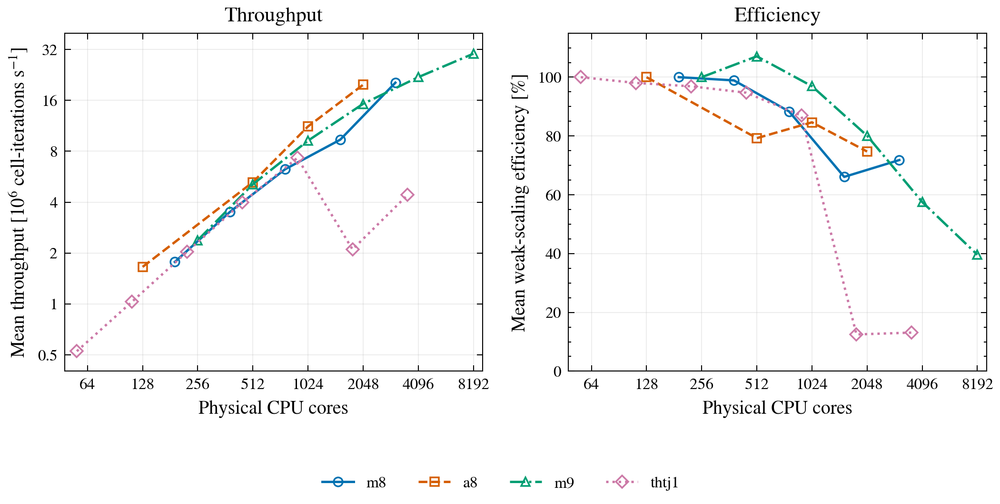
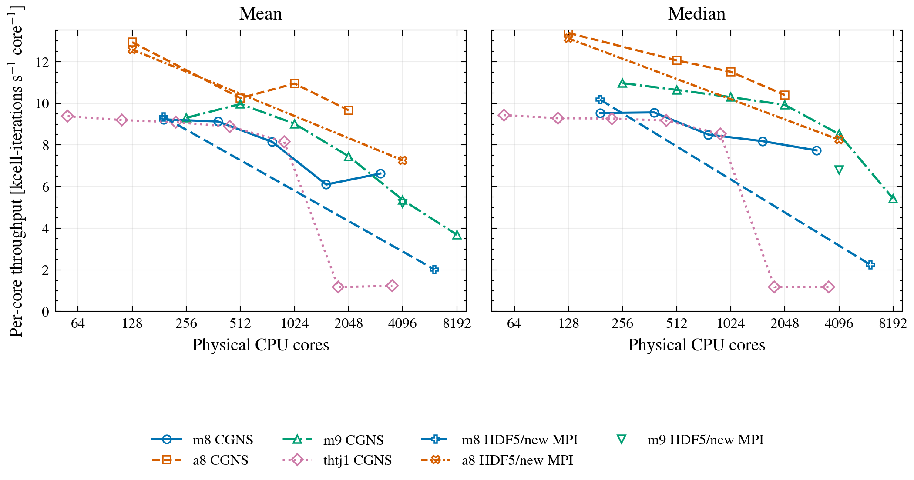

How well does DNDSR scale when each CPU core has roughly the same amount of
work? This study measures its fourth-order Euler3D solver on four CPU
clusters. The largest accepted production run reaches 8,192 MPI ranks, but
the clusters differ sharply in how they behave at scale.

Every run uses whole nodes and one MPI rank per physical core. The
weak-scaling runs and workload-matched retests keep roughly 1,024 periodic
hexahedral cells per rank; four diagnostic controls use heavier workloads.
The measurement covers the steady internal update of the P3 VFV scheme
(`maxOrder=3`, quadrature `intOrder=5`, limiter disabled), not mesh setup.

Each completed run records 500 solver updates. The first 100 serve as warmup;
all 400 remaining updates enter the statistics without trimming. The **mean**
includes slow updates and stalls, while the **median** better describes a
typical update. Their difference matters most at high rank counts, where a
few long updates can lower sustained throughput. A *cell-iteration* is one
cell processed in one solver update; MCell-it/s means millions of these per
second. Timing CV describes the relative variation among update times.

The audit contains **31 runs with all 400 measured updates**:

- 22 production weak-scaling runs using serial CGNS input;
- five workload-matched distributed-HDF5/new-MPI retests;
- four distributed-HDF5 diagnostic controls with deliberately heavier
  per-rank workloads.

Runs that stopped during mesh setup produced no update timings, so they are
not performance points.

## Machines and MPI stacks

| Cluster | CPU per node | Physical cores/node | Benchmark partition | Production MPI | Supplemental MPI |
|---|---|---:|---|---|---|
| m8 | 2x AMD EPYC 9654, Zen 4 | 192 | `amd_m8_768` | Open MPI 4.1.0, UCX 1.14 | Open MPI 5.0.10, UCX 1.14 |
| m9 | 2x AMD EPYC 9755, Zen 5 | 256 | `amd_m9_768` | Open MPI 4.1.8, UCX 1.18 | same stack |
| a8 | 2x AMD EPYC 9554, Zen 4 | 128 | `amd_a8_384` | Open MPI 4.1.0, UCX 1.14 | Open MPI 4.1.6, UCX 1.14 |
| thtj1 | 2x Intel Xeon Gold 6348, Ice Lake-SP | 56 | `cp6` | Open MPI 4.1.4, site UCX/GLEX | none |

These are the normal production partitions: a8 used its 384 GB class rather
than the dedicated 768 GB large-memory partition, and m9 used 768 GB rather
than 1.5 TB. m8 used its M8-specific 768 GB partition; thtj1 used `cp6`.

## Production weak scaling

**Production weak scaling.** Throughput continues to rise to m9's 8,192-rank
point, although its efficiency falls. thtj1 shows a different pattern: a
sharp throughput drop beyond 16 nodes.

[Download the vector PDF](weak-scaling.pdf).

The horizontal axis counts physical CPU cores. The left panel shows
stall-inclusive mean throughput; the right panel compares that throughput
with each cluster's one-node baseline.

| Cluster | Nodes | Ranks | Cells/rank | Mean MCell-it/s | Median MCell-it/s | Mean efficiency | Median efficiency | Timing CV |
|---|---:|---:|---:|---:|---:|---:|---:|---:|
| m8 | 1 | 192 | 1016.2 | 1.772 | 1.830 | 100.0% | 100.0% | 0.108 |
| m8 | 2 | 384 | 1013.1 | 3.504 | 3.672 | 98.9% | 100.3% | 0.150 |
| m8 | 4 | 768 | 1013.9 | 6.261 | 6.527 | 88.3% | 89.2% | 0.161 |
| m8 | 8 | 1536 | 1016.2 | 9.366 | 12.569 | 66.1% | 85.8% | 2.941 |
| m8 | 16 | 3072 | 1034.0 | 20.358 | 23.774 | 71.8% | 81.2% | 0.307 |
| m9 | 1 | 256 | 1024.0 | 2.382 | 2.808 | 100.0% | 100.0% | 1.599 |
| m9 | 2 | 512 | 1038.0 | 5.103 | 5.450 | 107.1% | 97.1% | 0.371 |
| m9 | 4 | 1024 | 1036.3 | 9.238 | 10.545 | 96.9% | 93.9% | 0.657 |
| m9 | 8 | 2048 | 1024.0 | 15.264 | 20.323 | 80.1% | 90.5% | 0.773 |
| m9 | 16 | 4096 | 1018.9 | 21.936 | 34.915 | 57.5% | 77.7% | 1.077 |
| m9 | 32 | 8192 | 1021.2 | 30.201 | 44.441 | 39.6% | 49.5% | 0.978 |
| a8 | 1 | 128 | 1036.3 | 1.656 | 1.712 | 100.0% | 100.0% | 0.082 |
| a8 | 4 | 512 | 1038.0 | 5.249 | 6.177 | 79.3% | 90.2% | 2.092 |
| a8 | 8 | 1024 | 1036.3 | 11.211 | 11.790 | 84.6% | 86.1% | 0.171 |
| a8 | 16 | 2048 | 1024.0 | 19.793 | 21.288 | 74.7% | 77.7% | 0.173 |
| thtj1 | 1 | 56 | 1059.3 | 0.525 | 0.528 | 100.0% | 100.0% | 0.029 |
| thtj1 | 2 | 112 | 1050.4 | 1.030 | 1.040 | 98.0% | 98.4% | 0.042 |
| thtj1 | 4 | 224 | 1013.3 | 2.036 | 2.076 | 96.9% | 98.2% | 0.060 |
| thtj1 | 8 | 448 | 1019.0 | 3.980 | 4.109 | 94.7% | 97.2% | 0.103 |
| thtj1 | 16 | 896 | 1018.6 | 7.309 | 7.639 | 87.0% | 90.4% | 0.119 |
| thtj1 | 32 | 1792 | 1013.3 | 2.101 | 2.109 | 12.5% | 12.5% | 0.011 |
| thtj1 | 64 | 3584 | 1019.0 | 4.414 | 4.241 | 13.1% | 12.5% | 0.177 |

m9 reaches the largest accepted production point: 8,192 ranks on 32 nodes.
It delivers 30.20 million cell-iterations/s by the mean, versus 44.44 million
by the median. Mean and median efficiencies are 39.6% and 49.5%. That gap,
alongside a timing CV of 0.978, shows how strongly slow updates affect the
sustained average.

m8 and a8 retain 71.8% and 74.7% mean efficiency at 16 nodes. thtj1 also
scales smoothly to 16 nodes, then drops from 7.31 to 2.10 million
cell-iterations/s at 32 nodes. Its 32-node timing CV is only 0.011: the
slowdown is consistent, not the result of a few outlier updates. Throughput
partly recovers at 64 nodes, but efficiency stays near 13%. The attempted
128-node runs never reached solver updates and therefore have no throughput
measurement.

## Per-core throughput and MPI retests

**Throughput per core.** Production and workload-matched HDF5/MPI retest
series are distinguished in the legend. Completing a large run does not
guarantee strong per-core performance, particularly on m8.

[Download the vector PDF](per-core-throughput.pdf).

The five HDF5 retests keep the workload within 1.2% of the 1,024-cell-per-rank
target. They use validated MPI stacks available on the same machines.

| Cluster | Nodes | Ranks | Cells/rank | MPI stack | Mean MCell-it/s | Median MCell-it/s | Mean kCell-it/s/core | Median kCell-it/s/core | CV | Outcome |
|---|---:|---:|---:|---|---:|---:|---:|---:|---:|---|
| a8 | 1 | 128 | 1036.3 | Open MPI 4.1.6 + UCX 1.14 | 1.611 | 1.679 | 12.584 | 13.116 | 0.153 | completed |
| a8 | 32 | 4096 | 1018.9 | Open MPI 4.1.6 + UCX 1.14 | 29.751 | 33.806 | 7.263 | 8.253 | 0.561 | completed |
| m8 | 1 | 192 | 1016.2 | Open MPI 5.0.10 + UCX 1.14 | 1.792 | 1.954 | 9.335 | 10.177 | 0.299 | completed |
| m8 | 32 | 6144 | 1030.5 | Open MPI 5.0.10 + UCX 1.14 | 12.421 | 13.758 | 2.022 | 2.239 | 0.944 | completed |
| m9 | 16 | 4096 | 1018.9 | Open MPI 4.1.8 + UCX 1.18 | 21.218 | 27.865 | 5.180 | 6.803 | 0.977 | solver completed; allocation cleanup timed out |

On m8 and a8, the newer Open MPI stacks complete workloads at scales where
the earlier stacks failed during setup. The executable and UCX version were
retained; HDF5 input alone did not make the old Open MPI 4.1.0 large-rank
attempts complete. These checks support an MPI-stack explanation for the
completion difference, but not a general speedup.

Performance remains uneven. Relative to the matching one-node retest, a8
retains 57.7% mean and 62.9% median efficiency at 32 nodes. m8 retains only
21.7% mean and 22.0% median efficiency, with CV 0.944. Its newer stack solves
the completion problem, not the large-scale performance problem.

The m9 HDF5 run produced all 400 samples, and the application and MPI steps
exited successfully. The outer allocation reached its shortened time limit
only during cleanup. Its performance sample is therefore included, with that
status noted in the table.

## Heavier diagnostic controls

The remaining four completed runs have 1.33 to 15.92 times the target
cells per rank. Their timings are valid for those heavier workloads, but they
do not belong to the workload-matched weak-scaling curves.

| Cluster | Nodes | Ranks | Cells/rank | Relative load | Mean MCell-it/s | Median MCell-it/s | Mean kCell-it/s/core | Median kCell-it/s/core | CV |
|---|---:|---:|---:|---:|---:|---:|---:|---:|---:|
| a8 | 16 | 2048 | 2037.7 | 1.99x | 20.049 | 21.133 | 9.789 | 10.319 | 0.117 |
| a8 | 24 | 3072 | 1358.5 | 1.33x | 23.292 | 25.871 | 7.582 | 8.422 | 0.599 |
| m8 | 16 | 3072 | 2061.1 | 2.01x | 21.520 | 24.011 | 7.005 | 7.816 | 0.196 |
| m9 | 1 | 256 | 16301.9 | 15.92x | 2.716 | 2.785 | 10.608 | 10.879 | 0.160 |

## Interpretation and scope

The benchmark reveals three distinct behaviors:

1. m9 runs the unchanged production path at 8,192 ranks, beyond 5,000. There
   is no universal rank-count ceiling near that value.
2. On m8 and a8, repeatable large-rank setup failures are associated with
   the production Open MPI 4.1.0 stacks. Newer validated stacks complete at
   the same scale, although m8's sustained efficiency remains poor.
3. thtj1 has a different limit: its 32-node updates are consistently slow,
   and its 128-node attempts spend hours in distributed mesh setup without
   producing update timings.

This is a whole-node, pure-MPI application benchmark, not a controlled
comparison of CPU architectures. Core counts, processors, MPI and UCX
versions, and network fabrics differ among clusters. Read mean/median gaps
and timing CVs alongside throughput rather than judging a cluster by a
single high-rank result.

The solver source is DNDSR `dev/harry` commit
`f6ece7e91e97c6337ef0761c30017b2ddad6b24b`. Exact configuration hashes,
machine-readable timing rows, scheduler classifications, and failure evidence
are in the public
[benchmark report](https://github.com/CFDLAB-THU/DNDSR-cluster-helper/blob/main/benchmark/REPORT.md).
