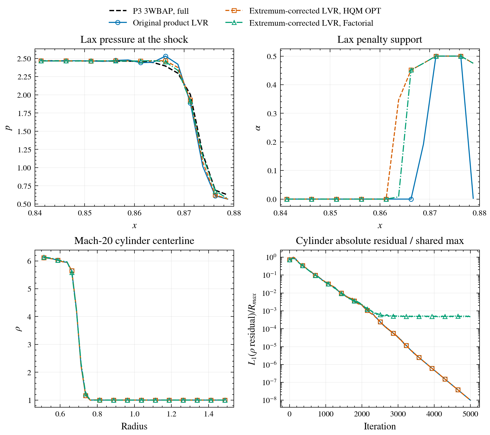
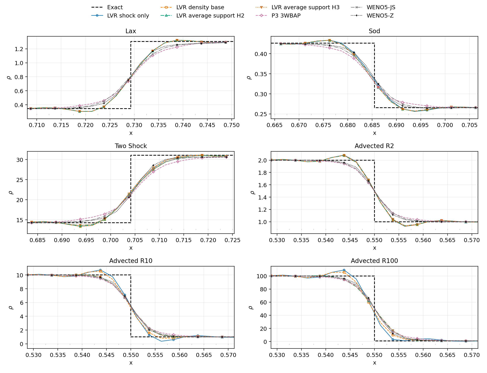
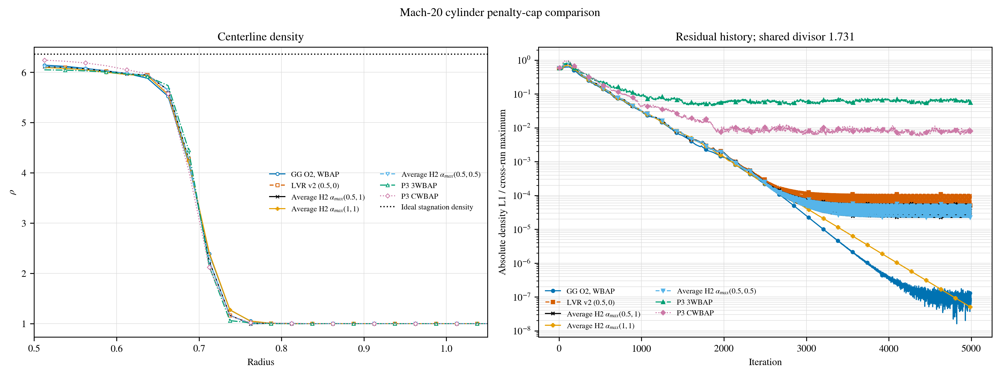
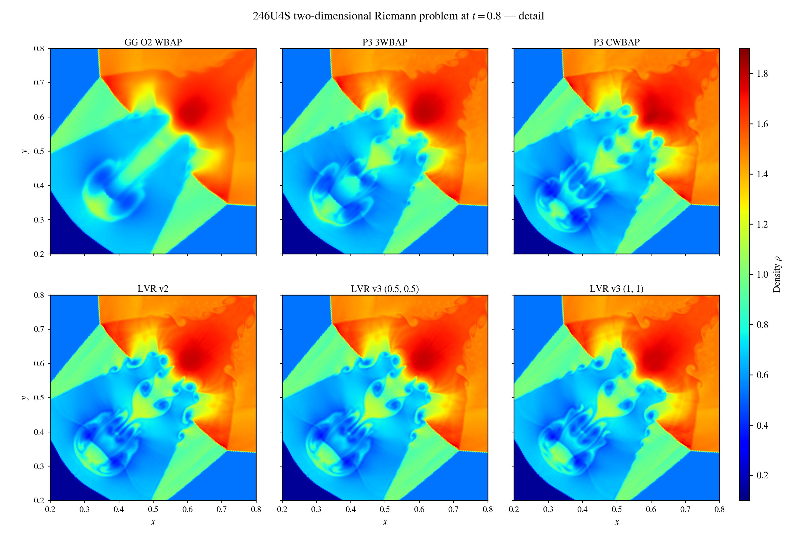
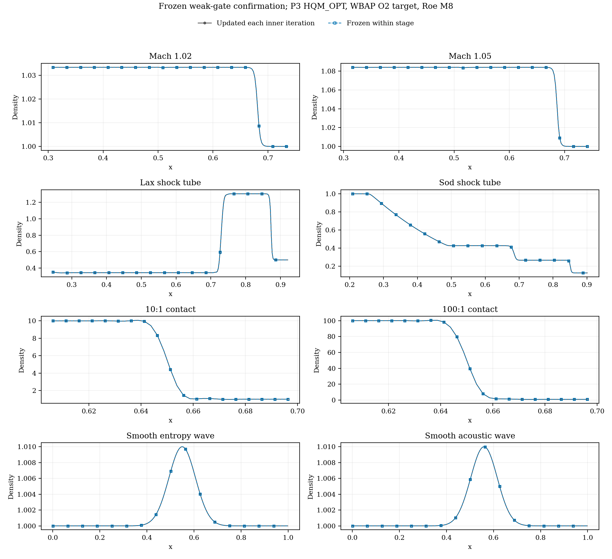
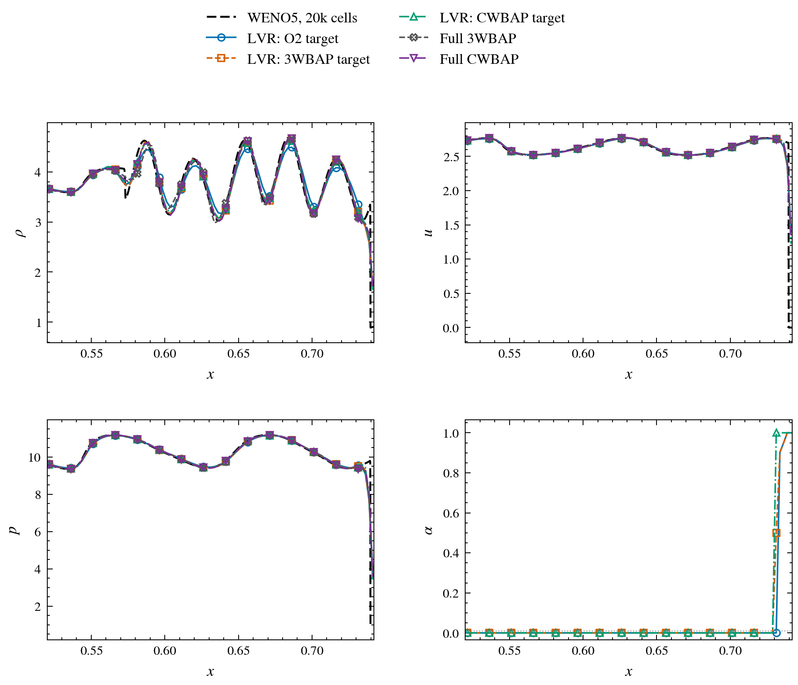
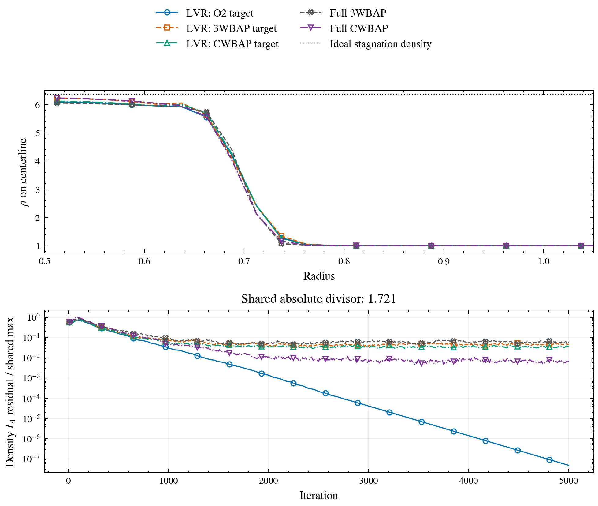
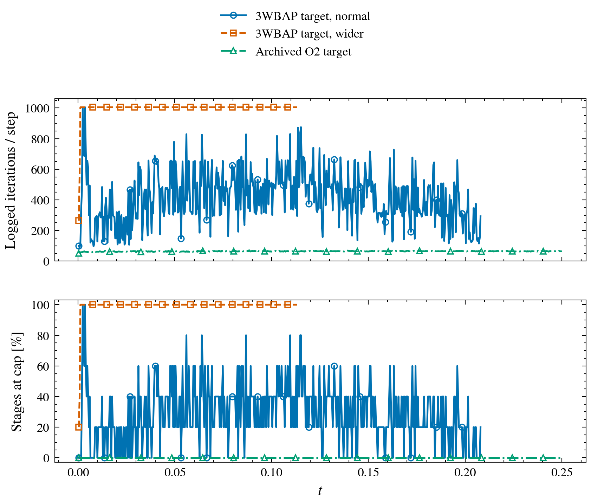

The [earlier LVR v2 post](https://harryzhou2000.github.io/hugo-harry/p/limited-variational-reconstruction-v2/) introduced a selective penalty that stabilizes high-order reconstruction near shocks. This follow-up brings together the subsequent research: a density-sensitive branch for steep contacts, an experimental weak-shock branch, completed two-dimensional comparisons, and a trial of high-order penalty targets. The main conclusion is a trade-off, not a single method that wins every case.

The synthesis here reflects results available through October 19, 2026. In the completed studies, the limited second-order (O2) target remains the reference choice. A newer high-order target improves several one-dimensional profiles but has not retained the O2-target method's convergence advantage.

## The common reconstruction idea

Let \(c_i\) contain the nonconstant polynomial coefficients reconstructed in cell \(i\), and let \(c_i^{O2}\) be a limited O2 polynomial embedded in the same basis. LVR adds a cell-local penalty toward that target:

$$
\frac{\lambda_i}{2}(c_i-c_i^{O2})^T A_i(c_i-c_i^{O2}),
\qquad
\alpha_i=\frac{\lambda_i}{1+\lambda_i}\in[0,1].
$$

Here \(A_i\) is the existing local variational-reconstruction block. For a fixed target and gate, its block update is a blend of the ordinary variational update and \(c_i^{O2}\), with weights \(1-\alpha_i\) and \(\alpha_i\). The gate is built from the evolving cell means, but the reconstruction solve remains linear in the unknown high-order coefficients. At zero gate the original high-order reconstruction is recovered; at unit gate the local update returns the O2 target. This is a penalty **inside** reconstruction, not a limiter applied afterward.

The successive versions differ mainly in where they apply that blend:

| Version | Added sensing mechanism | Main lesson |
|---|---|---|
| Initial LVR | Pressure jump and compression | Selective limiting can stabilize the shock while retaining high order elsewhere. |
| LVR v2 | Supported pressure-extremum correction | Repairs a weakly gated shoulder beside a strong shock. |
| LVR v3, also called Average H2 | Separate density-extremum correction | Handles steep advected contacts much better, with cap-dependent trade-offs. |
| Experimental weak G1 | Pressure-gradient consistency and compression | Suppresses isolated weak-shock ringing in 1-D when held within each implicit stage. |

The familiar v2 Lax result remains a useful point of departure: its wrong-direction pressure excursion fell from 0.11452 in the matched v1 run to 0.006859, while the density \(L_1\) error changed only slightly (0.004208 to 0.004284). The correction addresses a local defect rather than uniformly lowering every error norm.

*The v1/v2 Lax comparison shows why a shock sensor needs support beyond its strongest face: v2 suppresses the spurious pre-shock shoulder while preserving the main discontinuity. Curves are evolved cell averages, not reconstructed point values.*

## Steep contacts need a different signal

A pressure/compression gate can be quiet at a density contact. The v3 branch therefore measures the normalized density jump across faces and uses nearby cell-mean density extrema to support a narrow correction. Its shock and contact penalties are combined by

$$
\alpha_i=\max(\alpha_{s,i},\alpha_{c,i}),
$$

where \(s\) and \(c\) denote the shock and density branches. Two neighbour-expansion passes act on accepted density-extremum seeds; the whole contact region is not expanded indiscriminately. The two caps quoted below are ordered as **(shock, contact)**.

In the advected 10:1 contact, the mixed-cap v3 run \((0.5,1)\) reduces global density overshoot from about 0.733 for shock-only v2 to 0.03395. This does not make v3 universally preferable: the same mixed-cap series increases Toro 123 near-vacuum density \(L_1\) error from 0.004974 to 0.006655. Stronger density treatment also has a width cost. A three-pass contact variant is more bounded in the contact tests but spreads the correction farther.

*The top panels test whether the density correction disturbs Lax, Sod, or two-shock regions; the lower panels show advected 2:1, 10:1, and 100:1 contacts. Mean-supported v3 markedly reduces ringing at steep contacts. The WENO curves are complete-scheme context, not a reconstruction-only comparison, because their flux and time integrator differ.*

The later cap study retained \((0.5,0.5)\) and \((1,1)\) as candidates. For the 10:1 contact, their overshoots are 0.06090 and 0.03395, respectively. On the fixed-budget Mach-20 cylinder, the stronger shock cap improves the final absolute density residual from \(6.90\times10^{-5}\) to \(8.38\times10^{-8}\), although its nearest-wall density moves slightly farther from the ideal stagnation-point value. Larger caps also increase some discontinuity-dominated errors, notably in Toro 123 and Shu–Osher. The historical mixed pair remains evidence, not the selected next setting.

*The steady cylinder comparison isolates an important trade-off: the unit-cap v3 case drives the residual much lower within the same iteration budget, but the near-wall density profile is not uniformly improved. A low residual and a locally accurate wall value are different tests.*

## What survives in two dimensions?

Completed double-Mach-reflection and four-state Riemann runs show that v3 can stay selective while retaining resolved two-dimensional structures. On the diagonally symmetric 246U4S Riemann mesh, all six tested methods reached \(t=0.8\) with finite positive density and pressure. V2 and v3 \((0.5,0.5)\) are almost indistinguishable in the final density view. V3 \((1,1)\) changes the roll-up pattern and reduces the measured density symmetry defect relative to v2, without flattening the flow to the smoother O2 result.

| 246U4S method | Final density min / max | Density symmetry \(D_1\) | Elapsed time |
|---|---:|---:|---:|
| O2/WBAP | 0.13365 / 1.77897 | \(2.48\times10^{-6}\) | 00:43:24 |
| Full P3 3WBAP | 0.12972 / 1.80020 | \(1.244\times10^{-3}\) | 03:04:05 |
| Full P3 CWBAP | 0.13019 / 1.81093 | \(7.36\times10^{-4}\) | 02:47:21 |
| LVR v2 \((0.5,0)\) | 0.12714 / 1.78644 | \(1.056\times10^{-4}\) | 01:54:26 |
| LVR v3 \((0.5,0.5)\) | 0.12714 / 1.78644 | \(1.064\times10^{-4}\) | 01:54:55 |
| LVR v3 \((1,1)\) | 0.13550 / 1.77750 | \(4.91\times10^{-5}\) | 01:55:59 |

The symmetry measure compares reflected cells across \(x=y\); it is **not** error against an exact solution. Likewise, density extrema and elapsed time do not by themselves establish an accuracy or hardware-speed ranking. The LVR rows took roughly 1 h 55 min versus 2 h 47 min–3 h 04 min for the fully limited P3 rows in these separate runs, partly because the latter needed more implicit iterations.

*Cell-average density at \(t=0.8\), shown over the same central \(x,y\) window and color scale for all six methods. The top row contains O2, 3WBAP, and CWBAP; the bottom row contains v2 and the two symmetric-cap v3 settings. The v3 unit-cap result remains structured but differs visibly from the lower-cap roll-up. These visual differences are not an exact-solution ranking.*

## A weak-shock extension—and its temporal caveat

The ordinary v3 gates can remain nearly zero at isolated Mach-1.01–1.10 shocks, leaving density overshoot at roughly 8–15% of the exact shock jump. The experimental G1 branch asks whether the pressure change between cell means is consistent with **unlimited** O2 pressure-gradient extrapolations to their shared face. It also requires compression. The weak penalty is added by a maximum with the established shock and contact branches, so it does not replace them.

Updating this sensitive gate at every nonlinear inner iteration produced many iteration-cap hits. The tested policy evaluates it freshly at each ESDIRK stage, then holds only this branch fixed during that stage's remaining inner evaluations. With that policy, overshoot at Mach 1.05 falls from 15.015% of the jump to 0.03925%, and the 428 cap hits of the every-inner-update run fall to zero. Across Mach 1.01–1.10, the frozen-gate overshoot stays below 0.04% of the jump in these tests. The stronger stabilization broadens the front; full 3WBAP still has slightly smaller density errors in all four isolated-shock rows.

*The top row shows isolated Mach-1.02 and Mach-1.05 shock profiles; lower rows check Lax/Sod, steep contacts, and smooth entropy/acoustic waves. The nearly overlapping curves compare G1 refreshed every inner iteration with G1 frozen within each stage. Similar saved profiles hide a large difference in inner-iteration cap hits; the controls do not establish multidimensional behavior.*

The sensor is a consistency test for a low-order pressure model, **not** a proof that a physical shock is present: smooth cubic pressure can produce a nonzero mismatch. Stage freezing also changes the nonlinear temporal coupling. The weak branch remains optional and off by default; its multidimensional behavior and time-step-refined accuracy are open questions.

## Testing a high-order target

The next experiment replaces the O2 penalty target with a limited full-degree predictor. For each flow right-hand-side evaluation, an ordinary unpenalized reconstruction sweep produces a predictor \(q\); selected cells receive a 3WBAP- or CWBAP-limited target \(t\), while the LVR gate still comes from the WBAP-limited O2 sensor. The penalized update becomes

$$
r_i^{m+1}=(1-\omega_i)r_i^m+\omega_i\big[(1-\alpha_i)G_i(r^{\mathrm{used}})+\alpha_i t_i\big].
$$

The target is frozen for that reconstruction solve but rebuilt at the next flow evaluation. This keeps the local algebra linear for a fixed target while feeding the incoming high-order coefficients back into the outer process. It is therefore a different, more tightly coupled experiment—not a replacement that can inherit the O2-target results.

All 49 planned one-dimensional/steady rows reached their declared horizon or fixed budget. Some high-order targets improve Lax and Shu–Osher density norms and preserve more of the latter's wave train: its global density \(L_1\) changes from 0.033835 for the O2-target v3 control to 0.022324 with a 3WBAP target and 0.018117 with a CWBAP target. But local behavior differs: the ordinary 3WBAP target increases advected 10:1 contact overshoot from 0.033945 to 0.10802, whereas a wider CWBAP target reduces it to 0.0010012. These are case-specific outcomes, not a monotonic trend with target order.

*The selected Shu–Osher wave window illustrates why a high-order target is attractive: several variants retain more post-shock wave structure than the O2-target LVR control. Their global norm alone cannot determine whether local shock and contact excursions are acceptable.*

The decisive counterexample is the fixed-budget cylinder. Its O2-target LVR run ends at an absolute density residual of \(8.3840\times10^{-8}\). The 3WBAP- and CWBAP-target variants end at 0.079925 and 0.065909; widening the target bands only improves those to 0.035074 and 0.029043. Some wall values look closer to the theoretical stagnation point, but the steady fields have not converged comparably.

*At the same 5000-iteration budget, the high-order-target profiles may look locally appealing while their residual histories remain far above the O2-target run. The plot is a convergence warning, not a cost-to-convergence comparison.*

The available two-dimensional extension strengthens that warning but is **incomplete** as of this synthesis. Both high-order-target DMR runs reached a 24-hour timeout before \(t=0.25\); the wider-band run completed 283/625 steps and hit its inner cap in 99.51% of logged stages. The normal-band run completed 520/625 steps with 29.04% capped stages. The 246U4S normal-band case was still running at 896/3200 steps, with 99.82% of logged stages capped; three other rows were pending. Thus there is no accepted final-time two-dimensional result for this target experiment.

*These histories show numerical work, not physical accuracy: the wider DMR target advances fewer steps despite the same wall-time limit because nearly every implicit stage exhausts its inner-iteration budget. Partial contours from these runs cannot be treated as converged final solutions.*

## Current reading of the evidence

The O2-target LVR family offers useful selective stabilization: v2 repairs the strong-shock shoulder, v3 gives a much better steep-contact option, and frozen G1 closes an isolated one-dimensional weak-shock gap. None is universally superior. Toro near-vacuum behavior, cap-dependent two-dimensional structures, and the weak sensor's smooth-field response remain real limits. The experimental high-order target produces interesting waves and some lower one-dimensional norms, but its steady and implicit-transient convergence losses are too large to recommend it as the new default. A future target design must preserve those convergence properties, not just improve selected pictures.
