Recorded October 19, 2026. This report consolidates the Orion experiments on thtj1 and the separate NACA0012 source-model check. The main outcome is **a useful steady robustness result for LVR v3, rather than a demonstrated high-order DES result**. P3 LVR retains plausible fields through 20,000 steady updates; full P3 3WBAP becomes unphysical. Neither reaches the requested steady density threshold. O2 WBAP IDDES advances reliably with converged implicit stages, but the high-order LVR IDDES attempts do not yet provide an acceptable transient result.

All Orion results discussed here were produced with the **reversed, historical version-0 SA rotation correction**. The corrected source now defaults to standard SA-R, and `SAVersion=9001` preserves the old behavior for reproduction. That code repair does not change any archived Orion result. The O2 IDDES case is explicitly an O2 control, not an LVR run.

The source repair and historical selector are committed on DNDSR `dev/harry` as **`03891f8b`**. Both SA solver variants build, the two SA schemas were regenerated, and the focused regression passes 30 cases / 164 assertions. This is focused validation rather than a new full CPU-suite run.

## 1. Geometry, physical conditions and checkpoint

| Quantity | Setting |
|---|---|
| Geometry | Orion capsule half domain, symmetry plane \(z=0\); redraw mesh, 8,857,647 cells |
| Mesh | `Orion_str.cgns-merged-redraw3-A1.cgns`, existing 896-partition mesh input |
| Freestream | Mach 6.41, angle of attack \(28^\circ\), zero sideslip, \(Re_D=1.077\times10^7\) |
| Thermodynamics | \(T_\infty=73.63\) K, \(p_\infty=4068.260149\) Pa, isothermal wall at 295.56 K |
| Scaling | Diameter \(D=0.254\) m = 10 solver length units; \(U_\infty=1102.53\) m/s = 1 solver velocity unit |
| Boundary conditions | Original inflow/farfield, wall and symmetry setup; the back face uses the archived inflow condition, termed **backin** |
| Initial state | Original O2 Roe-M8 backin steady checkpoint at internal update 20,000, not a failed O4 checkpoint |
| Resources | thtj1, cp6, 16 nodes × 56 ranks/node = 896 MPI ranks; one thread/rank; 24-hour allocations |
| Runtime | Open MPI 4.1.4; source/executable/config hashes retained in the per-run manifests |

The starting checkpoint is
`out-restart1-restart1-rot-rm8-cw-backin__1_20000_p896.restart.dnds.h5`,
SHA256 `3935c12bcc05caeec2841ffb7843684ee11b0665ce0351d3f7283b8e38bb2b07`.
It is a partitioned HDF5 DNDS restart. The checkpoint audit identified it as a practical O2 warm start with stable late forces, not a residual-converged reference solution. The historical HLLEP/farfield and Roe/backin runs have different flux/boundary settings and cannot serve as a matched limiter comparison.

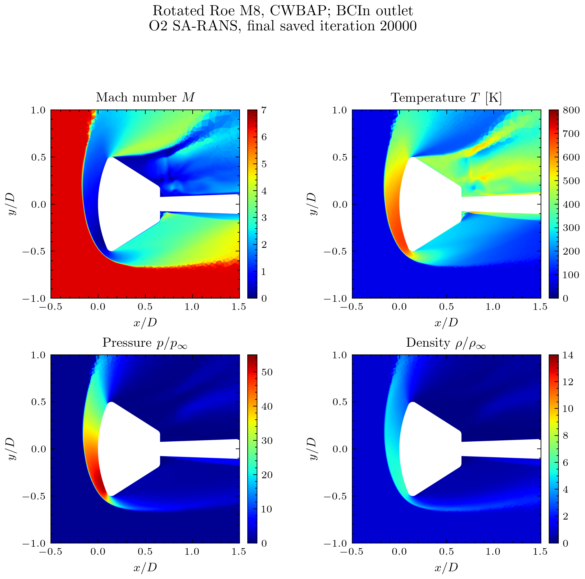

The subsequent steady tests change to Roe M9, rotated scheme 1 with Roe M2/Rusanov in the auxiliary direction. They preserve QCR, enabled SA rotation correction, second-order SA reconstruction (`ransForce2nd=1`), wall treatment and the original O2 restart. The boundary-cell contours below use jet color scales and cell averages without cell-to-point interpolation. Axes are normalized by body diameter.

## 2. What LVR means in this test

The high-order fluid reconstruction is a degree-three polynomial, P3, formally fourth order in smooth flow, with HQM_OPT **derivative** weights and integration order 5. The explicit GG O2 reference uses characteristic WBAP limiting and facial positivity protection. Both the shock detector and the penalty target use that limited reference.

The selected method is **LVR v3 = Average H2**, with separate shock and contact caps \((\alpha_{s,\max},\alpha_{\rho,\max})=(1,1)\) and the weak-shock extension disabled. The production input uses pressure thresholds \((j_{p0},j_{p1})=(0.04,0.16)\) and compression thresholds \((j_{c0},j_{c1})=(0.03,0.13)\). The contact face-density ramp is \((0.5,0.8)\), supplemented by cell-mean-supported density-extremum treatment with two neighbour layers; the full merged input records the other support thresholds. A cap of one permits complete recovery of the limited O2 target where the gate saturates. It does not impose O2 reconstruction throughout the domain.

For orientation, let \(a_i\) be the vector of high-order coefficients in cell \(i\), \(a_i^{(2)}\) the embedded limited O2 target and \(A_i\) the original VR diagonal block. A frozen-gate reconstruction equation has the form

$$A_i a_i+\sum_{j\ne i}A_{ij}a_j=b_i+C_i(a_i^{(2)}-a_i).$$

Here \(b_i\) is the original cell-mean-dependent VR right-hand side, \(A_{ij}\) are neighbour couplings and \(C_i\) is the nonnegative penalty block. With \(C_i=\lambda_i A_i\) and \(\alpha_i=\lambda_i/(1+\lambda_i)\), a block-Jacobi or block-GS update is

$$a_i^{\rm new}=(1-\alpha_i)A_i^{-1}\left(b_i-\sum_{j\ne i}A_{ij}a_j^*\right)+\alpha_i a_i^{(2)}.$$

The neighbour values \(a_j^*\) come from the previous sweep for Jacobi, and from the most recent available values for GS. This reuses the original diagonal inverse. The gate and target depend nonlinearly on cell means, while the frozen reconstruction solve remains linear in \(a_i\). Zero gate leaves VR unchanged; a saturated gate returns the O2 target. This is an explanation of the reconstruction mechanism, not a claim that the gated transient CFD system is linear or automatically positivity preserving. The case retains its separate positivity safeguards.

See the steady setup and effective controls for the exact production configuration.

## 3. Steady P3 LVR versus full P3 3WBAP

The two terminal controls share the original O2 checkpoint and steady controls: pseudo-time CFL 2, four local time-step smoothing passes, density-relative threshold \(10^{-5}\) and cap 20,000 updates. Their printed CFL schedule starts and ends at 2, so it supplies no actual CFL increase. The conventional P3 3WBAP control is fully applied, not selectively restricted by a shock detector.

| Method | Job | Terminal update | Absolute density \(L_1\) residual | Relative density | \(C_L\) | \(C_D\) | Assessment |
|---|---|---:|---:|---:|---:|---:|---|
| LVR v3, WBAP O2 target, HQM_OPT, (1,1) | 12060729 | 20,000 | 17.0713 | 0.0334118 | -0.236226 | 0.559615 | Plausible saved state; density unconverged |
| Full 3WBAP, P3, HQM_OPT | 12051855 | 20,000 | 7,688.68 | 0.0263359 | 34,852.2 | -64,787.8 | Unphysical numerical result |

Residuals are the absolute volume-weighted \(L_1\) values from the solver `.log` CSV. Relative density uses the running-maximum reference of each solve, so that column is useful for the stopping criterion but not for ranking the two different trajectories. The figures compare absolute residuals. Following the researcher's convention, SA is a stability diagnostic, not an additional stopping requirement.

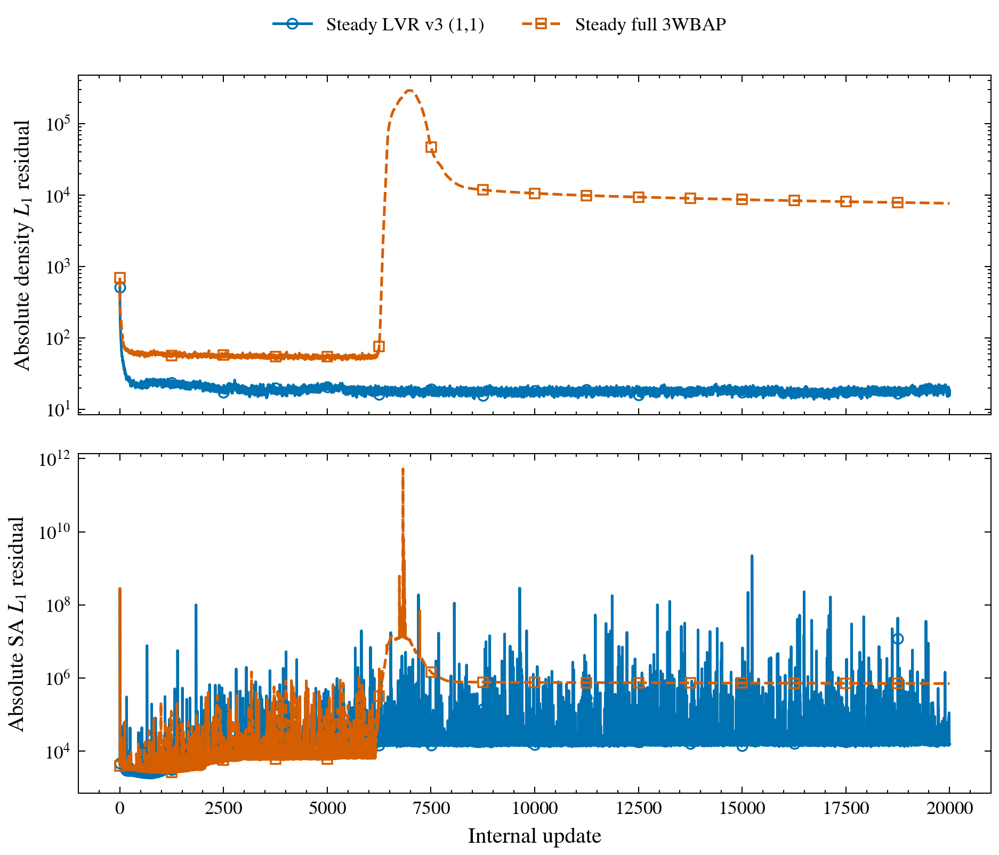

LVR's last-500 lift range is \([-0.236229505,-0.236226445]\) and drag range \([0.559604771,0.559614566]\). These stable force tails coexist with a nonzero density residual and must not be described as a converged steady solution. The separated wake is expected to contain unsteady dynamics; this cap-limited steady solve is mainly a robustness check and possible starting state.

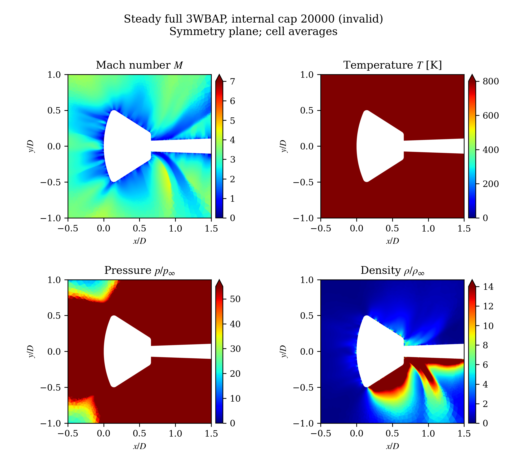

Both frames use Mach 0–7, temperature 0–800 K, pressure ratio \(p/p_\infty\) 0–55 and density ratio 0–14. The LVR symmetry plane spans approximately 62.67–680.53 K and pressure ratio 0.166–52.80. The full-3WBAP plane spans 5,156.75–668,638.9 K, pressure ratio 7.37–808,216 and density up to 677.79. Its saturated colors expose an invalid state rather than an unusually strong physical shock. Finite positive fields and a zero process exit are insufficient acceptance tests.

The practical finding is that this LVR setup preserves a useful high-order steady iterate on this difficult case, while this fully limited P3 3WBAP setup fails numerically. It does not establish universal superiority over conventional limiters, and the SA source error is shared by both methods.

### Cost and cluster effects

| Run | Scheduler result | Accounted elapsed | Suspended time | Note |
|---|---|---:|---:|---|
| Steady LVR 12060729 | COMPLETED, exit 0:0 | 12:51:25 | 0 | Reached update cap, not density criterion |
| Full 3WBAP 12051855 | COMPLETED, exit 0:0 | 15:21:54 | 02:21:07 | Numerically invalid despite normal exit |
| O2 IDDES 12056001 | TIMEOUT | 24:00:17 | 02:21:06 | Allocation ended during physical step 5426 |

The late-500 median printed update times are 2.27031 s for LVR and 2.75035 s for 3WBAP. The corresponding reconstruction/RHS/communication times are 0.12217/1.14663/0.34882 s and 0.11395/1.09973/0.38918 s. The conventional limiter timer is about 0.71949 s for 3WBAP, versus approximately zero for the LVR post-limiter slot; LVR still has reference/gate work, including limiter-B time around 0.31296 s. Printed timers may overlap and are not exclusive additive components. These late timings compare different numerical states, so they are descriptive rather than a controlled cost-to-accuracy benchmark.

Earlier steady runs suffered an MPI daemon communication failure. A later LVR allocation was anomalously slow; a matched fresh allocation improved measured startup throughput by 7.85 times without changing numerical controls. These incidents are retained in the failure/restart history and allocation replacement record. Scheduler suspension also lengthens calendar intervals beyond accounted active time. Numerical breakdown and cluster transport/performance incidents are different failure modes.

## 4. Time-accurate work: high-order limitation and O2 control

### LVR IDDES attempts

The first P3 LVR v3 (1,1) IDDES run used ESDIRK3, step 0.02 and a 100-update inner cap. It failed numerically during physical step 5, stage 3, at time 0.08. Earlier implicit stages had hit the cap. A retry with maximum step 0.005 and the existing positivity-controlled time-step selector reduced the selected step from \(4.40\times10^{-4}\) on step 1 to \(9.46\times10^{-9}\) on step 2; it did not demonstrate useful physical-time progress. The retry was cancelled and retained. These are failed or impractical high-order trials, not valid DES results.

The production control therefore returned to explicit GG O2 with full characteristic WBAP. It starts from the same archived O2 checkpoint, uses `maxOrder=1` and `intOrder=1`, and retains the same Roe M9/rotated-M2 and SA/QCR choices. It does not activate the LVR penalty. See the IDDES experiment history.

### O2 IDDES controls and results

| Quantity | Production control |
|---|---|
| Integrator | ESDIRK3, `odeCode=202`, three implicit stages per physical step |
| Physical step | Fixed 0.005 solver time units, no PP or CFL physical-step restriction |
| Inner solve | Density-relative tolerance \(10^{-3}\), cap 500 per implicit stage |
| Pseudo-time CFL | 0.5 to 20 over the first 25 ramp intervals, reset for every stage |
| IDDES | Mode 1, nominal scale 0.65, \(f_{t2}\) and low-Re correction \(\psi\) enabled |
| Output | Cell-average VTKHDF and HDF5 restart every 500 physical steps, step named; point output disabled |
| Target | 10,000 physical steps; 24-hour allocation |

The 0.5-to-20 schedule was selected from matched three-step tests. Summed inner time fell from 436.424 s for the 0.5-to-2 baseline to 157.154 s, a 2.777-fold short-startup improvement. All nine stages of each tested schedule reached the same density criterion and the final volume checks passed. This is a measured startup result, not an estimate based only on nominal CFL. The full CFL comparison preserves the stage counts and absolute-residual checks.

Job 12056001 completed **5,425 physical steps**, reaching time **27.125**, before the allocation timed out. All **16,275 completed implicit stages** passed the density criterion; none reached the cap. The largest terminal stage iteration was 47. The median over the last 100 complete steps was 7 stage iterations and 13.7255 s per physical step. The last completed forces were \(C_L=-0.2365361\) and \(C_D=0.5579229\). The final interrupted stage is not counted as converged.

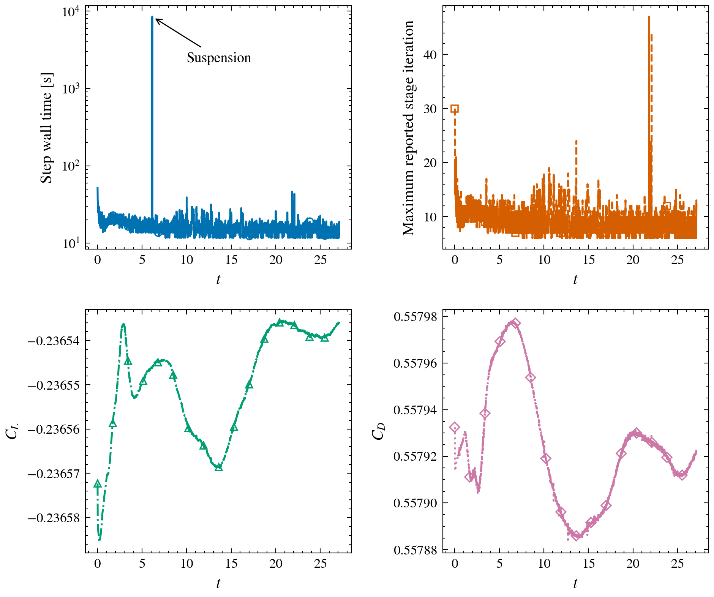

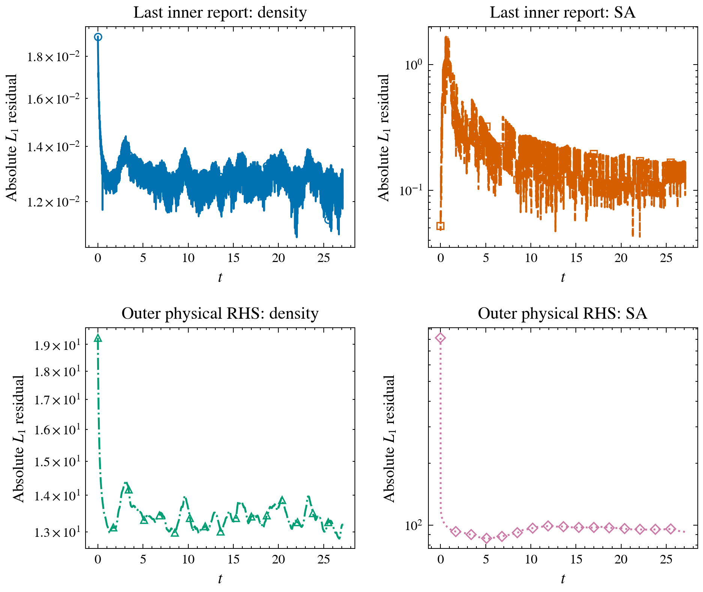

The latest saved frame is step **5,000**, time **25**, not the final completed step 5,425. Since \(D=10\) and \(U_\infty=1\) in solver units, it represents 2.5 diameter convection times. Step 0.005 corresponds to approximately 0.11519 microseconds physically.

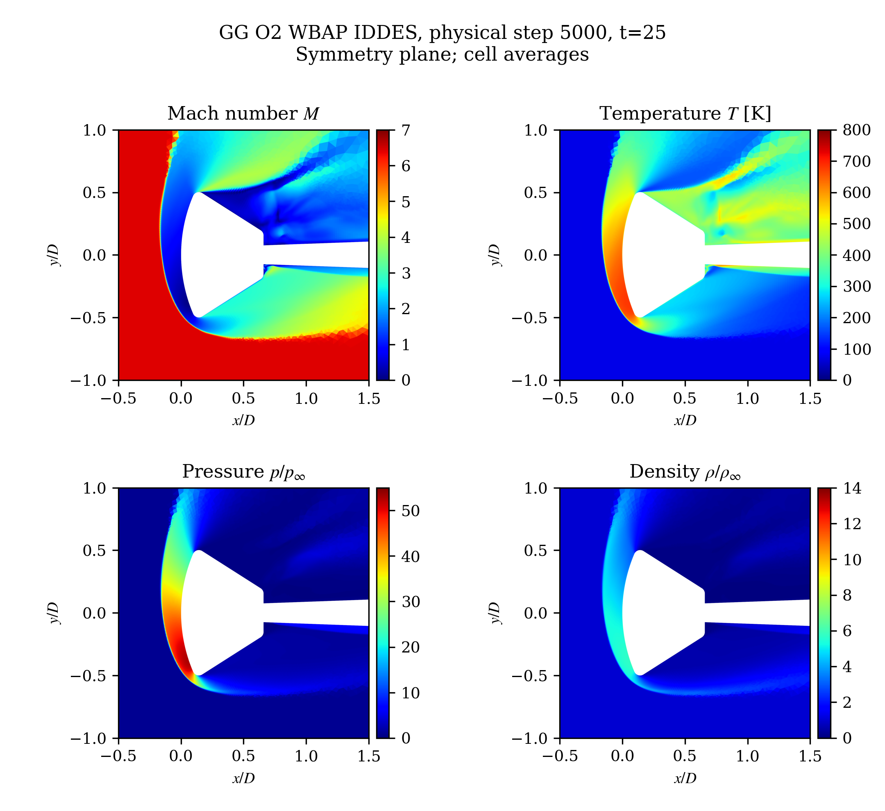

## 5. Wake evolution and model-switch diagnosis

For the symmetry-plane window \(0.65<x/D<2.5\), \(|y/D|<0.8\), use face-area weights \(w_i=A_i/\sum_j A_j\). Saved `nuTilde` is primitive normalized working viscosity; saved density multiplied by it gives the normalized transported SA state \(q=\rho\widetilde\nu\). Define mean speed \(v=|\mathbf u|/U_\infty\) and the field-change measure

$$E_f(t)=\frac{\sqrt{\sum_i w_i[f_i(t)-f_i(0)]^2}}{\sqrt{\sum_i w_i f_i(0)^2}}.$$

Here \(f\) is either \(q\) or \(v\). This is the spatial RMS difference from initialization, not the temporal fluctuation intensity. These are symmetry-plane area statistics, not whole-volume turbulence statistics.

| Saved step | Solver time | Mean \(q\) | \(E_q\) | Mean \(v\) | \(E_v\) |
|---|---:|---:|---:|---:|---:|
| 0 | 0 | 2.24959 | 0 | 0.791041 | 0 |
| 1500 | 7.5 | 3.00963 | 56.94% | 0.790592 | 1.728% |
| 3000 | 15 | 4.27622 | 115.67% | 0.789814 | 2.002% |
| 5000 | 25 | 5.68723 | 170.17% | 0.789046 | 2.721% |

Mean transported SA state increases **152.81%**, while mean speed changes **-0.252%**. The primitive working-viscosity mean increases 402.23%; its mean differs from the density-weighted quantity. These observations demonstrate continuing model-state adjustment with comparatively small velocity changes, not a fully developed or statistically stationary DES wake.

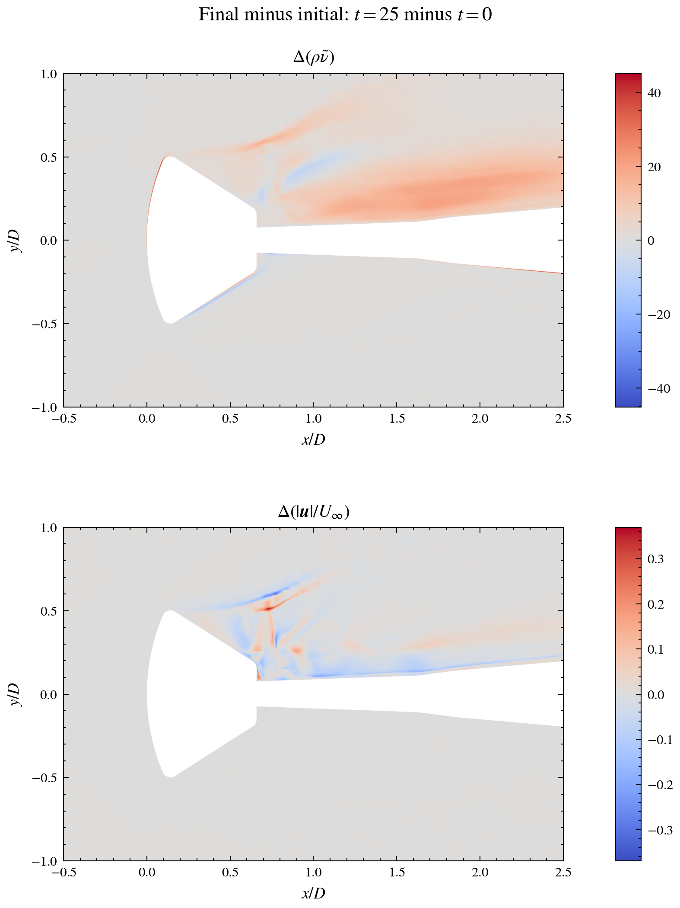

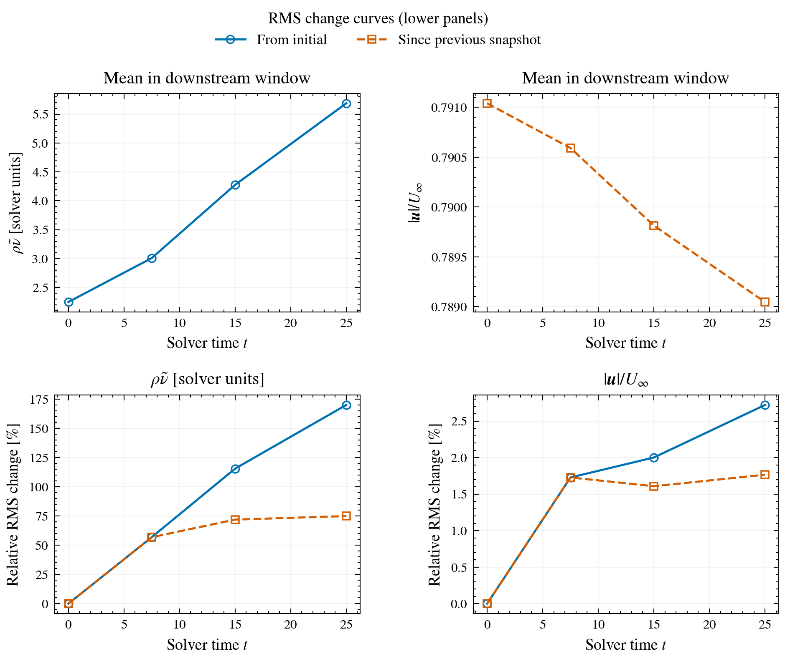

The nominal coefficient 0.65 is not a direct cap on \(\widetilde\nu\). With physical wall distance \(d\) and the solver's bounding-box cell size \(h\), the existing caller supplies

$$\ell_{\rm LES}=\min\{0.65h,\;0.15\max(d,h)\}.$$

The source then blends

$$\ell_{\rm IDDES}=\widetilde f_d(1+f_e)d+(1-\widetilde f_d)\psi\ell_{\rm LES},$$

where \(\widetilde f_d\) is the RANS-side shielding weight, \(f_e\ge0\) is the IDDES elevating function, and \(1\le\psi\le10\) is the low-Re correction. Thus released shielding need not imply a shorter effective length: a large \(\psi\) can enlarge the LES contribution. A very large nominal DES scale also does not algebraically bypass every part of the mode-1 blend; the steady cases are nominal RANS-intended controls with this retained implementation caveat.

An offline 3-D sample replay of frames at times 0, 7.5 and 15 estimates that about **98%** of retained wake volume is on the LES side of shielding, while only **60–61%** has effective length below \(0.9d\). The \(\psi>9.9\) volume fraction is about **53–57%**. These estimates use least-squares gradients from sampled cell means, not the solver's stored limited gradients. Their shielding classification is consistent between 16- and 32-neighbour fits; thin-wall coverage and quantitative production budgets are inadequate. Mean modeled-viscosity ratio in the retained wake is only about 0.31–0.46, so a high \(\psi\) does not establish excessive eddy viscosity everywhere.

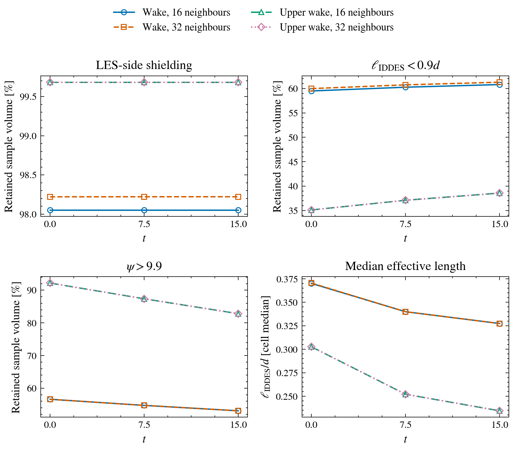

See the formulation audit and diagnostic definitions and limitations. Neither the SA growth nor the small speed change can be attributed to one model term using this evidence alone.

## 6. SA-R correction and the independent NACA0012 check

Let \(G_{ij}=\partial u_i/\partial x_j\), \(S_{ij}=(G_{ij}+G_{ji})/2\) and \(W_{ij}=(G_{ij}-G_{ji})/2\). Strain and vorticity magnitudes are \(s=\sqrt{2\sum S_{ij}^2}\) and \(\omega=\sqrt{2\sum W_{ij}^2}\). The production term for positive working viscosity is

$$P=c_{b1}(1-f_{t2})(\widehat S+\Delta)\widetilde\nu,$$

where \(c_{b1}=0.1355\), \(f_{t2}=1.2\exp[-(\widetilde\nu/\nu)^2/2]\), \(\nu\) is laminar kinematic viscosity and \(\widehat S\) is the existing modified SA vorticity frequency. [Standard SA-R](https://tmbwg.github.io/turbmodels/spalart.html#saR) uses \(\Delta=2\min(0,s-\omega)\), suppressing production in rotation-dominated regions. The archived Orion implementation reverses the subtraction.

| Selector in the repaired source | Meaning | Added production frequency \(\Delta\) |
|---|---|---|
| `SAVersion=0`, default | Corrected SA-R | \(2\min(0,s-\omega)\) |
| `SAVersion=9001` | Bad historical version 0, for reproduction | \(2\min(0,\omega-s)\) |
| `SAVersion=1` | Oldest retained legacy formulation | \(\min(0,\sqrt{2}s-\omega)\) |

Versions 0 and 9001 share the standard strain normalization, coefficient 2 and negative-production contribution in the approximate source diagonal. Version 1 also changes the normalization, uses coefficient 1 and omits production from that diagonal. It cannot isolate the sign correction. The correction acts on production, not on the IDDES blend or LVR gate. No archived Orion run has been rerun with corrected SA-R in this report.

The independent NACA0012 check uses the supplied AOA15 input: Mach 0.15, \(Re_c=2.88\times10^6\), AoA \(15^\circ\), 20,816 cells, Roe M8, HQM_OPT P3 reconstruction, limiter off, QCR off, common uniform start, pseudo-time CFL 50 and density threshold \(10^{-7}\). Each run is serial on 16 local ranks with a 900-second bound. SA stability is checked without requiring its residual to converge.

| Source behavior | Updates to density criterion | Wall minutes | \(C_L\) | \(C_D\) |
|---|---:|---:|---:|---:|
| Corrected version 0 | 3,085 | 11.49 | 1.472217 | 0.0286626 |
| Bad version 0 | 3,341 | 9.07 | 1.521210 | 0.0239430 |
| Legacy version 1 | 2,999 | 10.89 | 1.472307 | 0.0288519 |

All three meet the density criterion without blow-up. Corrected 0 and legacy 1 differ by 0.0061% in lift and 0.6604% in drag. Corrected 0 differs from bad 0 by -3.22% in lift and +19.71% in drag. Repeated version-0 trajectories match their earlier trials exactly at saved precision, but machine timings vary substantially; elapsed times do not establish a source-formula speedup. These are model-sensitivity results, not an experimental accuracy ranking.

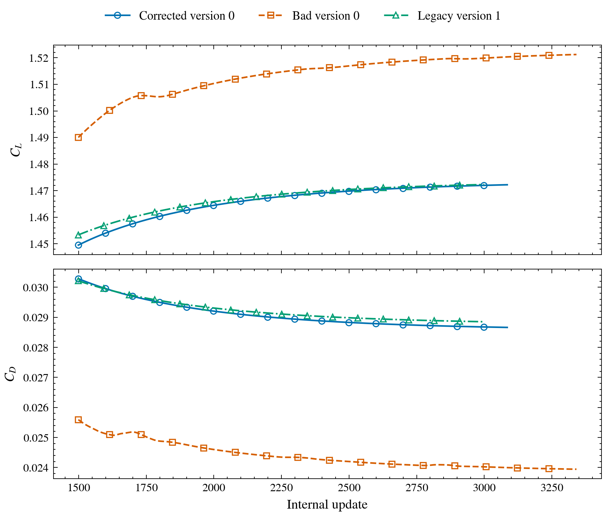

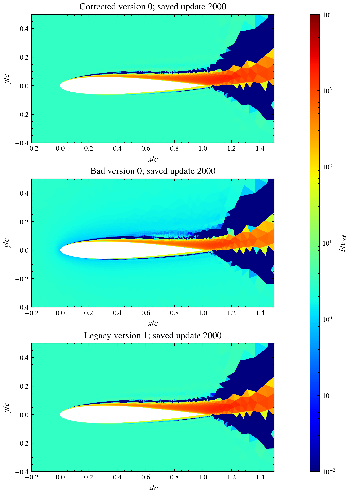

The NACA runs used preserved corrected/original executables. The new 9001 selector preserves the original executable's bad-0 formula; it is not a claim that a new 9001 NACA run was performed. Analytic kernel regression covers all three formulas in 2-D/3-D and their implicit diagonals. See the full three-way study.

## 7. Interpretation and next experiments

The strongest positive evidence is steady robustness of P3 LVR v3 on Orion. Its stable force tail and plausible fields are useful, while the density residual prevents a steady-convergence claim. Fully limited 3WBAP is an unsuccessful control for these settings. The evidence is specific to this mesh, boundary setup, source model and restart.

The main unresolved issue is time-accurate high-order robustness. The successful transient history belongs to O2 WBAP IDDES, and spans only a few diameter convection times. It cannot establish that LVR resolves the unsteady wake, or that the flow has developed DES statistics. Shared SA and length-model qualifications also prevent attributing missing structures solely to reconstruction dissipation.

The next discriminating steps are:

1. Run matched corrected-SA-R and 9001 controls from the same O2 checkpoint, keeping every other numerical and model choice fixed. This isolates the rotation sign before retuning DES coefficients.
2. Record exact solver shielding, effective length, \(\psi\), modeled viscosity and source budgets. Offline reconstructed gradients are inadequate for thin-wall production balances.
3. Reintroduce high-order LVR with controlled physical-step and inner-solve comparisons against the accepted O2 transient control. Preserve failed/cap-limited trials as part of the evidence.
4. Extend accepted transient runs across more body convection times and assess wake spectra, resolved fluctuations and mesh/time sensitivity. A smooth snapshot or stable force trace alone does not establish the quality of DES.

These are proposed follow-ups; no new Orion job was launched for this report.

## 8. Evidence map

- Terminal Orion reduction, all three jobs, timing, history rollover and checksums.
- Steady LVR/full-3WBAP setup and chronological records.
- IDDES failed attempts, O2 production and CFL tuning.
- SA-R correction, analytic regression and original two-way trial.
- Three-way 900-second NACA comparison and matched fields.
- Report asset provenance and committed-source validation.

The terminal IDDES CSV rolls after 100,000 records; both continuous segments were recovered and reduced. Steady no-update terminal reports and outer-summary rows are excluded from update/force statistics. Exact remote stdout/snapshot locations and SHA256 values are in the retrieval manifest. Raw fields and full stdout remain in the DNDSR data area; compact evidence, scripts and report figures belong to this independent LVR repository.

The named study records above refer to the private LVR research archive. This article includes its numerical conditions, qualification of failed/partial runs and all displayed figures locally. The source change is DNDSR commit `03891f8b`; the archived Orion executables predate that correction.
