**Results through 30 October 2026.** This report brings together the checked Orion results from the original steady reconstruction comparison through the corrected-model, whole-domain O2 continuation. Repeated executions with identical numerical settings are grouped; unfinished stages, capped solves, invalid fields and short successful trials retain their qualifications.

The strongest result is a usable **GG O2/WBAP transient baseline**. With corrected SA-R/IDDES, it completed the half-domain continuation from solver time 65 to 135; the subsequent whole-domain continuation has reached time 148.5 at the checked cutoff. The O4 results are more limited: historical steady LVR preserved plausible fields better than full 3WBAP, but neither converged. The corrected-model O4 transient trials have not yet produced a reliable trajectory.

The failure evidence has become substantially more informative. An initial high-order positivity problem was localized near the downstream boundary. Later, outlet-masked LVR trials developed large positive pressure spikes in the **forebody wall layers**, while an earlier unmasked 3WBAP trial first showed a spike beside the **downstream support wall**. A longer masked 3WBAP trial also failed, after progressive loss of inner convergence. These are different observations, not one universal failure mechanism.

## Reading the evidence

- **Completed** means the requested numerical interval was completed; it does not imply steady convergence, statistical stationarity or discretization accuracy.
- **Capped** means an implicit stage exhausted its allowed updates. Advancing physical time after such a stage is not a converged stage solution.
- **Stopped unstable** distinguishes a deliberately terminated deteriorating trial from a solver assertion.
- **Saved** describes an available field snapshot. It may precede the last completed step in the logs.
- **Historical observation** gives the last checked result of a control; it makes no claim about its present execution state.

No cross-family ranking below assumes that different starting checkpoints, model formulations, masks or time steps form a matched comparison. There is no new solver experiment behind this synthesis.

## 1. Common physical setup and notation

| Quantity | Common setting |
|---|---|
| Geometry | Orion capsule with its support/sting and downstream boundary; original half domain has symmetry at \(z=0\) |
| Half-domain mesh | 8,857,647 cells, including highly stretched wall-layer cells |
| Whole-domain mesh | 17,715,294 cells, formed by reflection and joining at the former symmetry plane |
| Freestream | Mach 6.41, angle of attack \(28^\circ\), zero sideslip |
| Reynolds number | \(Re_D=1.077\times10^7\), based on diameter and **freestream Sutherland viscosity** |
| Thermodynamics | \(T_\infty=73.63\) K, \(p_\infty=4068.260149\) Pa; isothermal wall at 295.56 K |
| Length and velocity | Physical diameter 0.254 m corresponds to solver \(D=10\); physical \(U_\infty=1102.53\) m/s corresponds to solver velocity 1 |
| Viscosity | Molecular viscosity follows Sutherland's law; the reference-viscosity coefficient is not the freestream viscosity used in \(Re_D\) |
| Usual outlet | The boundary named `Outflow` uses **BCIn**, a prescribed inflow state; “backin” refers to this choice |
| Output | Cell-average volume and boundary fields; no point-output interpretation |

The unusual BCIn outlet is an inherited numerical choice, not a characteristic outflow. The BCFar experiment below changes this boundary deliberately. In the current implementation, BCFar switches states according to normal Mach number; subsonic outflow retains interior primitives with prescribed pressure. It is not an exact nonreflecting boundary condition.

Here \(t\) is cumulative **solver time**, including the offset of a restarted checkpoint. The diameter convection time is \(t^*=tU_\infty/D=t/10\). One solver time unit is approximately 23.04 microseconds. Thus the usual \(\Delta t=0.01\) is about 0.2304 microseconds and \(\Delta t^*=0.001\). New run counters start at zero; resetting a counter does not reset the physical state.

Unless physical units or a pressure ratio are shown, field extrema below use solver units: freestream density is 1, speed is 1 and pressure is approximately 0.01738425. Thus a reported pressure maximum of 23 is not 23 Pa. The conservative energy \(\rho E\) is total energy per volume. The SA working variable \(\widetilde\nu\) has kinematic-viscosity dimensions; its transported state is \(\rho\widetilde\nu\), which is distinct from the model's final eddy viscosity.

### Reconstruction, implicit solves and model versions

**GG O2/WBAP** means explicit Green–Gauss linear reconstruction, `maxOrder=1`, `intOrder=1`, `subs2ndOrder=1`, with characteristic WBAP applied throughout the domain. A conventional selector named `3WBAP` on this degree-one field still acts only on the linear polynomial.

**O4/P3** means a degree-three variational reconstruction, normally integrated at order 5. Most trials use **HQM_OPT partial-derivative weights**, with amplitudes \((1,0.5295,0.2117,0.2117)\). These are derivative weights, distinct from geometric weights. Geometric weighting uses HQM_SD, with its power and bias stated when changed. The SA variable remains reconstructed at second order.

**LVR v3 = Average H2** uses shock and contact detection, including supported cell-average extrema and two-layer treatment. Unless stated otherwise, both alpha caps are 1, the reference is characteristic-WBAP-limited GG O2 with positivity protection, and the optional weak-shock branch is off. The detector and penalty target use the same finalized O2 gradients. The Barth-target trial changes both together. Initial LVR tests predate the optional expansion gate; later trials explicitly enable it.

For clarity, LVR alpha, reconstruction positivity beta, and flux-residual positivity factors are different quantities. Larger LVR alpha means a stronger pull toward the O2 target. Smaller beta means stronger compression of a reconstruction increment. Neither bounds a large **positive cell-mean** pressure overshoot by itself.

Most corrected-model transient trials use ESDIRK3 with three implicit stages, fixed \(\Delta t=0.01\), density relative volume-weighted \(L_1\) stopping tolerance \(10^{-3}\) and a cap of 500 updates per stage. Internal CFL resets in every stage and ramps logarithmically from 0.5 to 5 over 25 internal-iteration intervals. The usual linear setup has local ILU (`jacobiCode=2`), `sgsIter=0`, GMRES off and p-multigrid off. Exceptions are identified below. A terminal printed index of 501 or 101 can be the reporting callback after a cap of 500 or 100 actual updates.

Primary CSV residuals are **absolute**. Stage-relative stopping values have their own reference and must not be substituted for those absolute residuals. Density stopping alone does not require the SA residual to converge; the practical SA requirement here is absence of instability or blow-up.

Three model generations must remain separate:

| Generation | SA rotation / DES behavior | Interpretation |
|---|---|---|
| Historical Orion results through the first O2 IDDES campaign | Reversed historical version-0 rotation term; old DES coefficient placement; \(f_{t2}\) retained | Useful comparative evidence for that executable, not corrected SA-R results |
| Corrected SA-R, before the DES-length repair | Correct rotation term, old DES-length implementation, \(f_{t2}\) retained | Separates the rotation repair from later model changes |
| Current corrected-model continuations | Correct SA-R, corrected DES coefficient placement, \(f_{t2}\) off, QCR on, nominal \(C_{DES}=0.65\) | Basis of the later O2 and O4 trials |

The historical rotation behavior remains reproducible as `SAVersion=9001`; corrected version 0 is the default. With \(s\) the strain magnitude and \(\omega\) the rotation magnitude, its added correction is \(2\min(0,s-\omega)\); the bad version used \(2\min(0,\omega-s)\). The oldest version 1 has a different expression and must not be conflated with bad version 0.

The DES repair places the coefficient consistently in the shared DES/DDES/IDDES length formulation. It does **not** add a missing wall-normal cell-spacing input. The IDDES geometry measure still uses the available mesh scale rather than a separately resolved wall-normal spacing. The scale 0.65 is a DES coefficient, not a direct multiplier of transported \(\rho\widetilde\nu\), and does not guarantee its suppression. Likewise, turning off \(f_{t2}\) changes the source model; it is not a viscosity cap. This remains an IDDES implementation with a documented geometric approximation, rather than a claim of fully validated Orion DES.

## 2. Historical steady attempts: LVR was more robust, but not converged

These tests begin from the archived, comparatively successful **O2 Roe-M8 backin checkpoint at steady update 20,000**. The new P3 methods use rotated Roe M9/M2, HQM_OPT weights, fixed pseudo CFL 2 and a \(10^{-5}\) density stopping target. The very large DES scale was intended to produce RANS behavior; in the old implementation it prevented LES-length shortening without algebraically bypassing every remaining blend term. Treat these as nominal steady SA-RANS attempts using the historical model.

This archived O2 field is the common initialization reference, not an analytical solution or an independently established converged steady truth.

| Checked attempt | Obtained interval | Numerical result |
|---|---:|---|
| Original P3 LVR v3 (1,1), WBAP target | 14,598 updates before interruption | Plausible field; absolute density residual 18.8634, \(C_L=-0.236268\), \(C_D=0.559476\); unconverged |
| Original full P3 3WBAP | 9,558 updates before interruption | Already unphysical: density residual 10,956.1, extreme forces and PP acting in every cell |
| Fresh/repeated P3 LVR with the same numerical controls | 20,000-update cap | Plausible saved field and stable late forces, but density criterion not met |
| Fresh full P3 3WBAP | 20,000-update cap | Normal program completion with an invalid numerical solution |

The interrupted and repeated runs agree in the qualitative limiter contrast. An external interruption does not rescue the already unphysical 3WBAP field, and a normal exit does not validate it.

| Final 20,000-update quantity | LVR v3 (1,1), WBAP target | Full 3WBAP |
|---|---:|---:|
| Absolute density \(L_1\) residual | 17.0713 | 7,688.68 |
| Solver-relative density residual | 0.0334118 | 0.0263359 |
| Lift coefficient | -0.236226 | 34,852.2 |
| Drag coefficient | 0.559615 | -64,787.8 |
| Saved symmetry-plane temperature | 62.67–680.53 K | 5,156.75–668,638.9 K |
| Saved symmetry-plane \(p/p_\infty\) | 0.166–52.80 | 7.37–808,216 |

The relative residual can look superficially smaller for the invalid control because its reference has also changed. The absolute residual, fields and forces make the actual result clear. LVR's last-500 force variation was small, but its density residual remained far above the requested steady threshold.

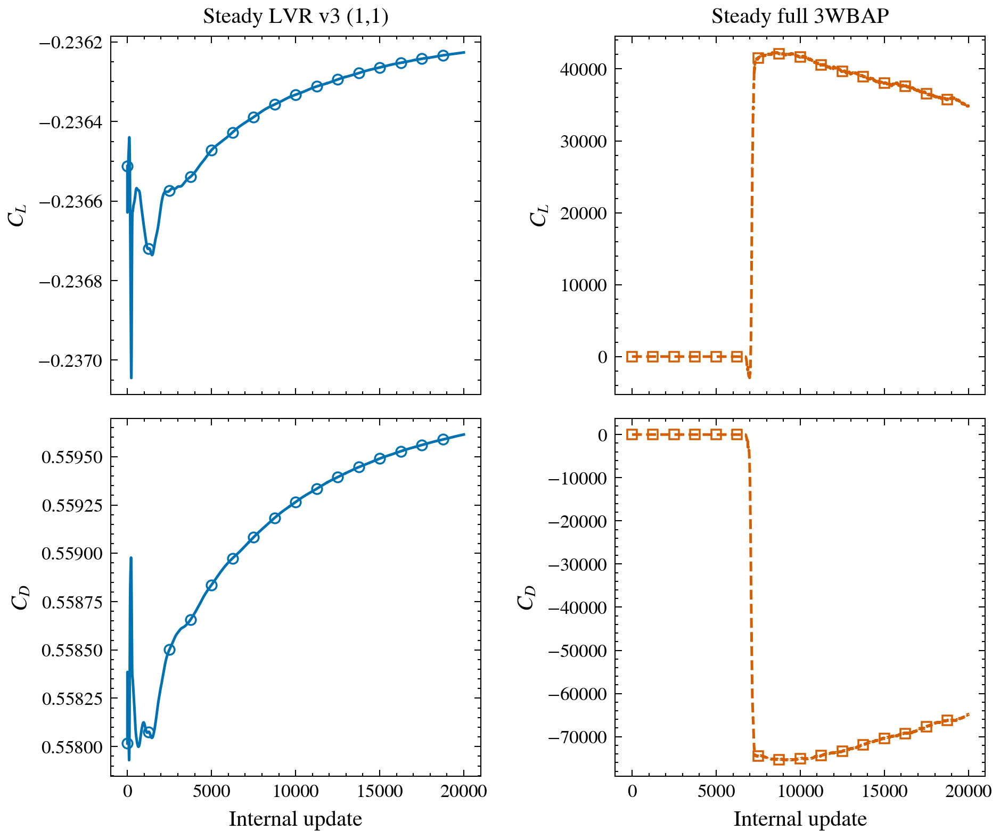

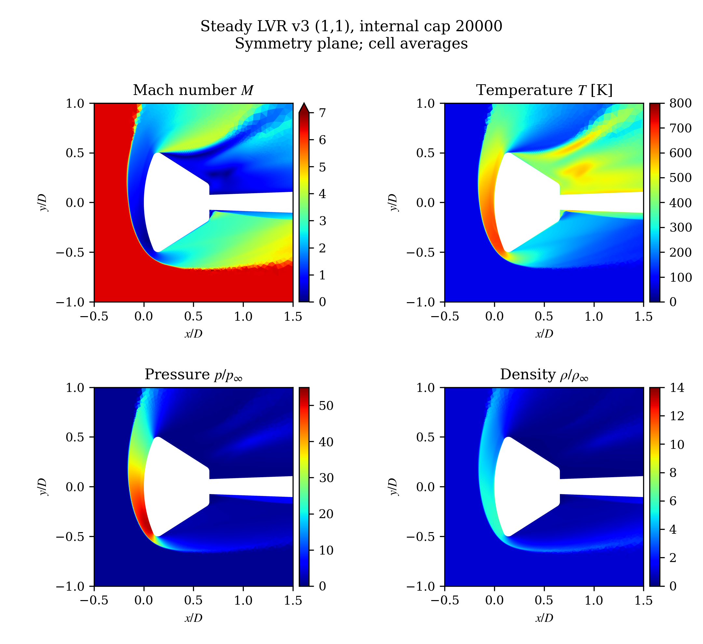

The two contour sets share normal-flow scales, which intentionally saturate the invalid 3WBAP field. This establishes a **historical steady robustness advantage**, not a converged high-order solution or a corrected-model accuracy advantage.

## 3. First transient attempts: O2 supplied the viable control

The separated wake motivated time-accurate integration rather than demanding a truly steady flow. The first transient comparisons still used the historical rotation and DES-length implementation, so their favorable O2 behavior is retained separately from later corrected-model results.

| Spatial method / changed control | Obtained result | Reading |
|---|---|---|
| P3 LVR v3 (1,1), WBAP target; ESDIRK3, \(\Delta t=0.02\), inner cap 100 | Failed during physical step 5; completed time 0.08 | High-order startup was not acceptable; capped stages preceded failure |
| P3 LVR; maximum \(\Delta t=0.005\) with PP-selected physical step; internal CFL 1→10 | Physical time stalled near \(4.40496\times10^{-4}\); selected steps shrank to order \(10^{-8}\)–\(10^{-9}\) | Stopped because the selected step became impractical; not a successful stabilization |
| GG O2/WBAP; fixed \(\Delta t=0.005\), cap 500, CFL 0.5→2, density target \(10^{-5}\) | Checked startup, then stopped for the tolerance comparison | A precursor control, not the completed production baseline |
| Same O2 with density target \(10^{-3}\) | Checked startup and short CFL comparison | Reduced unnecessary inner work; does not establish temporal accuracy |
| O2 production, CFL 0.5→20 | **5,425 completed steps**, \(t=27.125\); last saved field at step 5,000, \(t=25\) | All 16,275 completed stages met the density target; no 500-cap stages |

The allocation bound stopped the O2 production trajectory; no numerical crash was established. Its final partial stage is excluded from the completed-stage count. The first three-step tuning controls also all met the density target:

| Internal CFL schedule | Total updates over nine stages | Sum of printed inner-update seconds |
|---|---:|---:|
| Original 0.5→2 schedule | 660 | 436.424 |
| Ramp endpoint 5 | 340 | 231.814 |
| Ramp endpoint 10 | 271 | 186.072 |
| Ramp endpoint 20 | 231 | 157.154 |

This was useful startup evidence for reducing solve work, not evidence that CFL 20 would remain robust after changing the source model. That distinction matters in the next section.

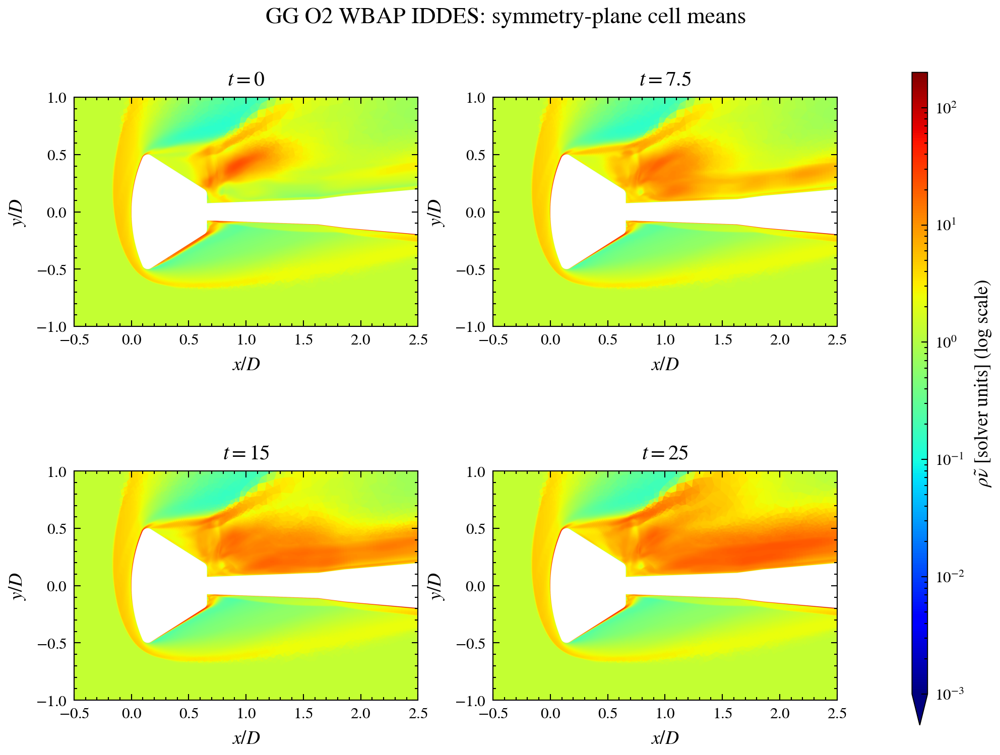

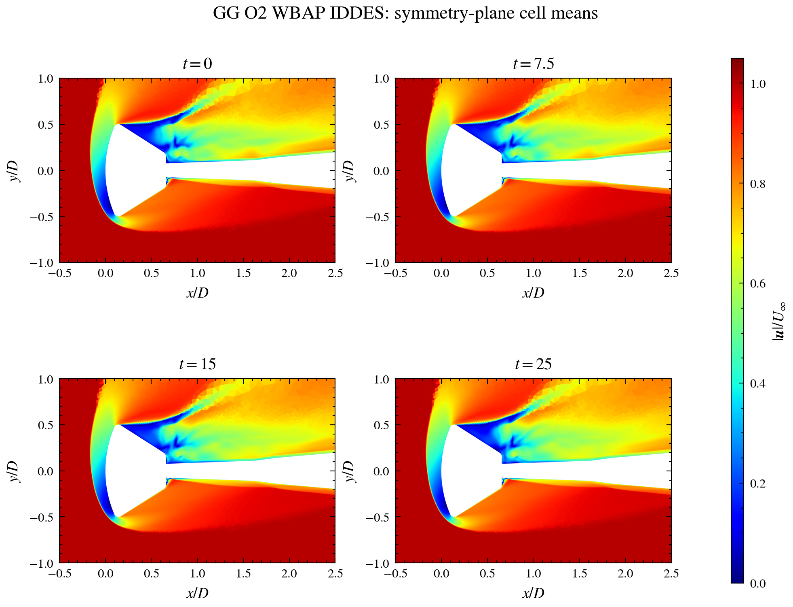

The wake-plane area-weighted mean transported SA state rose from 2.24959 to 5.68723 between \(t=0\) and 25, whereas mean speed changed from 0.791041 to 0.789046. The relative spatial RMS difference from the initial SA field reached 170.17%; for speed it was 2.721%. These are **changes from initialization**, not developed-turbulence fluctuation intensities. They show substantial model-state adjustment beneath a relatively persistent large-scale velocity field.

## 4. Corrected SA-R: the smaller internal CFL was materially safer

The corrected SA-R experiments restart from the original O2 steady checkpoint. They initially retain the old DES-length implementation and \(f_{t2}\). Thus this is a new model generation, not a continuation of the successful historical O2 trajectory.

| O2/WBAP control | Checked outcome | Inner-solve evidence |
|---|---|---|
| \(\Delta t=0.02\), CFL endpoint 20 | Seven steps completed; failed in step 8 at base time 0.14 | All 21 completed stages were capped; final relative density residuals about 0.0051–0.0432 |
| \(\Delta t=0.01\), CFL endpoint 20 | 46 steps completed; failed during step 47 | 22/138 completed stages capped; first miss at step 39/stage 3; enormous state growth before the PP assertion |
| \(\Delta t=0.01\), CFL endpoint 5 | More than 2,000 steps obtained; selected saved checkpoint at \(t=20\) | At the detailed 1,965-step reduction, 5,895/5,895 completed stages met tolerance with no caps |
| Same CFL-5 setup continued from \(t=20\) | Verified continuation; later source-model handoff from saved \(t=35\) | Checked old-model continuation window had 300/300 recent stages passing |

For CFL 20 at \(\Delta t=0.01\), the final partial step had absolute density residual about \(7.18\times10^{23}\) and maximum mean density about \(3.10\times10^{24}\). The reconstructed internal-energy guard failed **after** clear nonlinear deterioration. It was not a harmless convergence stop.

The matched CFL-5 control remained stage-convergent far beyond the CFL-20 failure time. This supports the more conservative internal schedule for the corrected model. It does not prove that CFL alone controls every subsequent instability or that the temporal discretization is sufficiently resolved.

## 5. Corrected DES length and ft2-off: a longer O2 evolution

The next handoff starts from the saved state at **\(t=35\)**, fixes DES coefficient placement and disables \(f_{t2}\). It keeps corrected SA-R, QCR, GG O2/WBAP, rotated Roe M9/M2, \(\Delta t=0.01\) and CFL 0.5→5. Model and switch change together, so the observed response cannot be attributed solely to either change.

At the detailed \(t=52.88\) check, 1,788 new steps had completed; all 300 stages in the last 100 completed steps met density tolerance with no caps. Later saved planes extend this portion of the evolution to \(t=60\), and the continuation checkpoint at \(t=65\) supplies the subsequent comparisons.

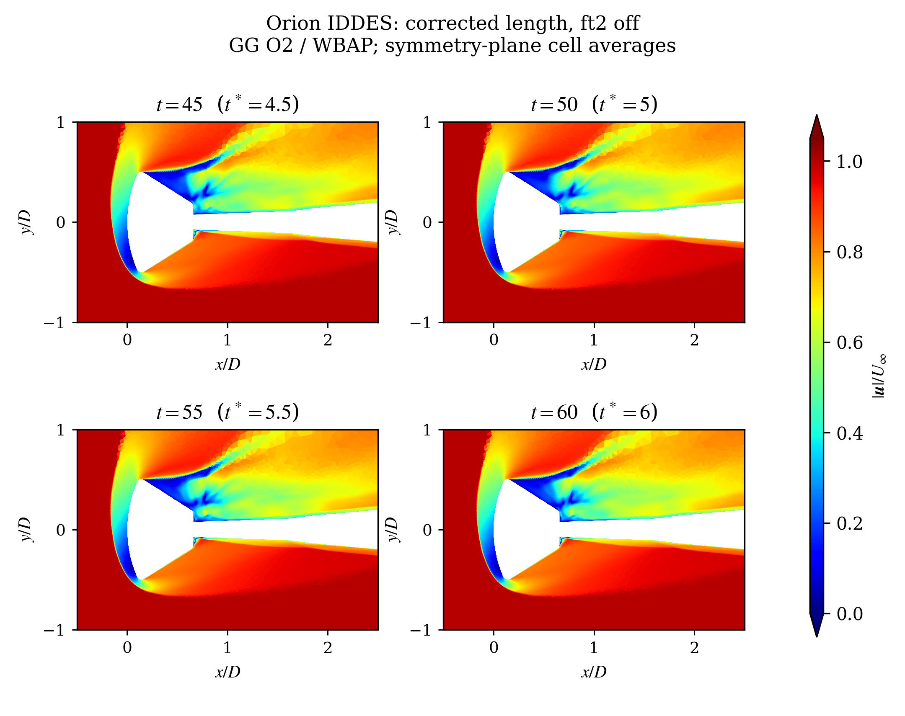

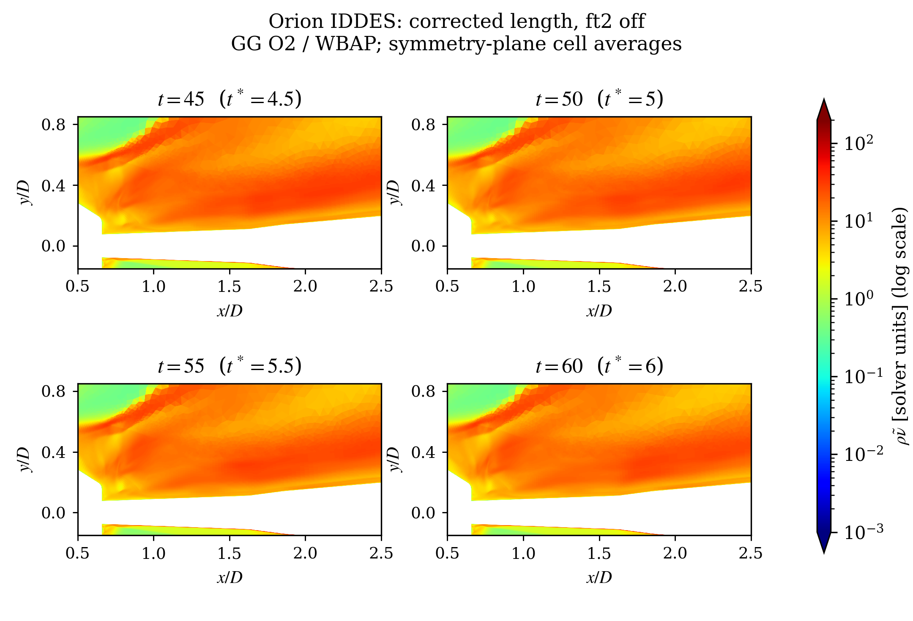

### Global SA-state statistics are not wake-plane statistics

Let \(q_i(t)=\rho_i(t)\widetilde\nu_i(t)\) be the transported SA state in volume cell \(i\), and \(V_i\) its volume. Its instantaneous volume mean is \(\overline q(t)=\sum_iV_iq_i(t)/\sum_iV_i\). The following values use full-volume cells, not just the symmetry plane:

| Cumulative time | Volume mean of \(q\) | Maximum \(q\) | Spatial variance of \(q\) |
|---|---:|---:|---:|
| 35 | 1.402428 | 133.53763 | 0.888653 |
| 40 | 1.406367 | 133.22675 | 0.879183 |
| 45 | 1.409017 | 133.52211 | 0.876562 |
| 50 | 1.409970 | 133.58962 | 0.869828 |

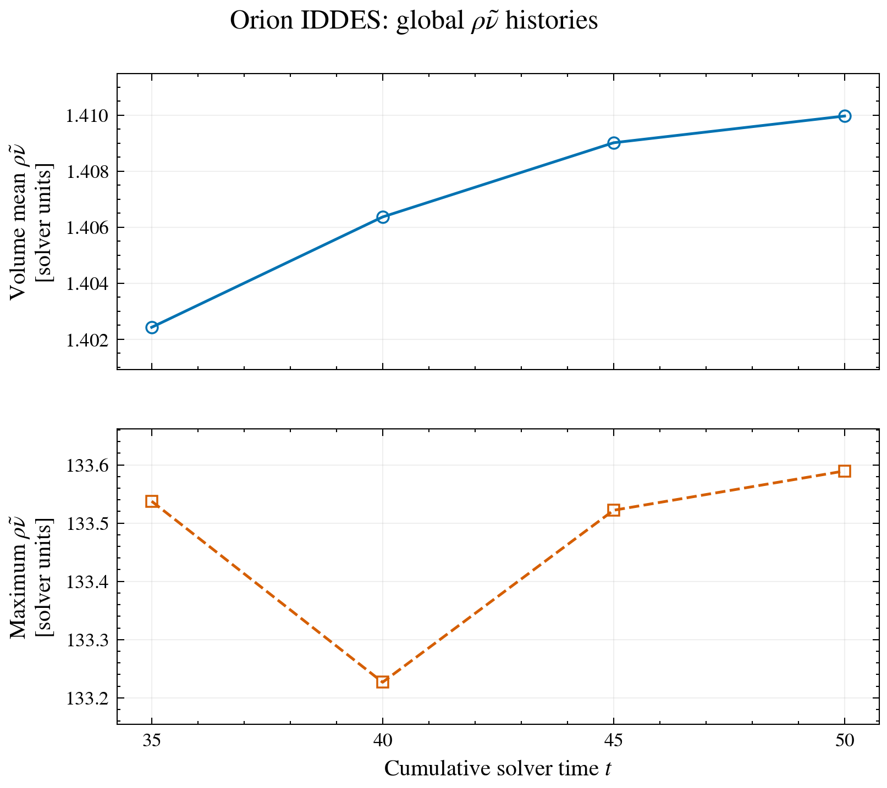

For \(N\) saved times, define the temporal mean in each cell as \(\langle q_i\rangle=N^{-1}\sum_nq_i(t_n)\) and its population variance as \(v_i=N^{-1}\sum_n[q_i(t_n)-\langle q_i\rangle]^2\). The volume mean of \(v_i\) is 0.00536238 and its cell maximum is 109.05058 for times 35/40/45/50. Excluding the inherited time-35 state gives 0.00174547 and 20.21988. These sparse-snapshot numbers include model readjustment and are not statistically converged turbulence estimates.

The whole-volume mean rises slightly even though the selected wake-plane area mean decreases by 8.28%. Different sampling domains and weights explain why both observations can hold. Neither should be generalized to the other domain.

## 6. Flux controls and the completed half-domain O2 trajectory

The flux controls share the corrected-model time-65 checkpoint. Their recorded outcomes support keeping rotated M9/M2 as the practical O2 baseline, rather than claiming a universal ranking of fluxes.

| Flux / inner-control difference | Checked numerical result |
|---|---|
| Nonrotated Roe M9, SGS 2 | First 15 steps: 45/45 stages passed. Step 16/stage 2 subsequently hit the 500 cap with severe positivity correction; stopped |
| Rotated M9/M9, SGS 0 | Logs reached step 21/stage 2 with persistent density residual near \(1.08\times10^{-3}\) and strong residual/reconstruction PP; replaced after convergence concerns. No terminal field-based failure location is established |
| Rotated M9/HLLEP_V1, SGS 0 | At the later checked interval near \(t=99.59\), 47/60 stages passed and 14 reached the cap; one cap-reaching stage still passed. Severe residual PP persisted |
| Rotated M9/M2, SGS 0 | **Completed all 7,000 new steps from \(t=65\) to 135**, with bounded saved fields |

The nonrotated control changes flux and SGS relative to the main baseline; it does not isolate a flux-only effect. The HLLEP control had an earlier all-passing window, but later developed expensive capped stages. Its October 28 observation is historical, not a claim about its current status. Matched saved-time contours at \(t=75,80,85\) provide the available field comparison:

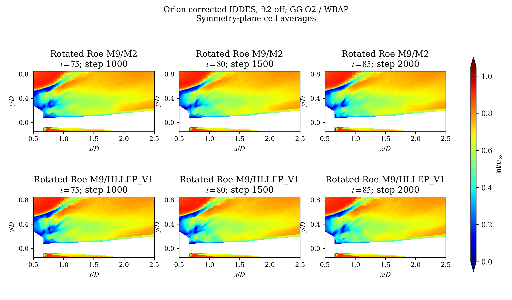

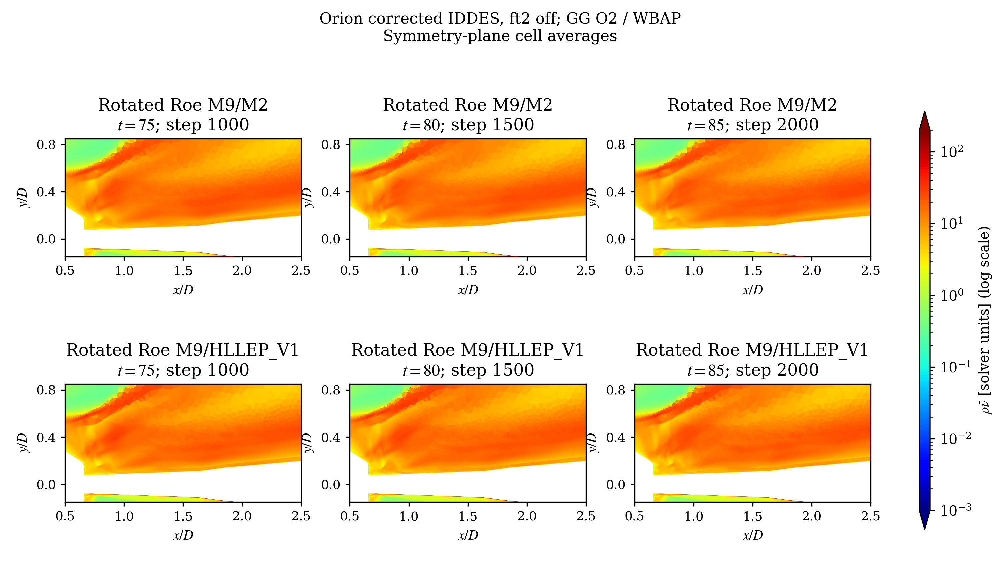

The figure rows identify the primary/auxiliary fluxes directly. Shock envelopes are broadly alike, while the near wake changes. A symmetry plane cannot locate every volume-cell PP event.

### Longest completed half-domain interval

Four checked frames span the **entire saved interval \(t=65,90,110,135\)**. The bow shock and broad separated-flow envelope persist, with time-dependent wake structure. This is a substantially stronger robustness result than a ten-step startup, but it is still not a grid/time-step study or a statistically stationary DES result.

The trajectory had occasional capped stages: for example, an earlier 20-step window had three density misses with ratios up to 0.001159. A later window near its end had 60/60 stages passing. Completing the horizon must therefore not be summarized as proof that every stage throughout the whole run converged.

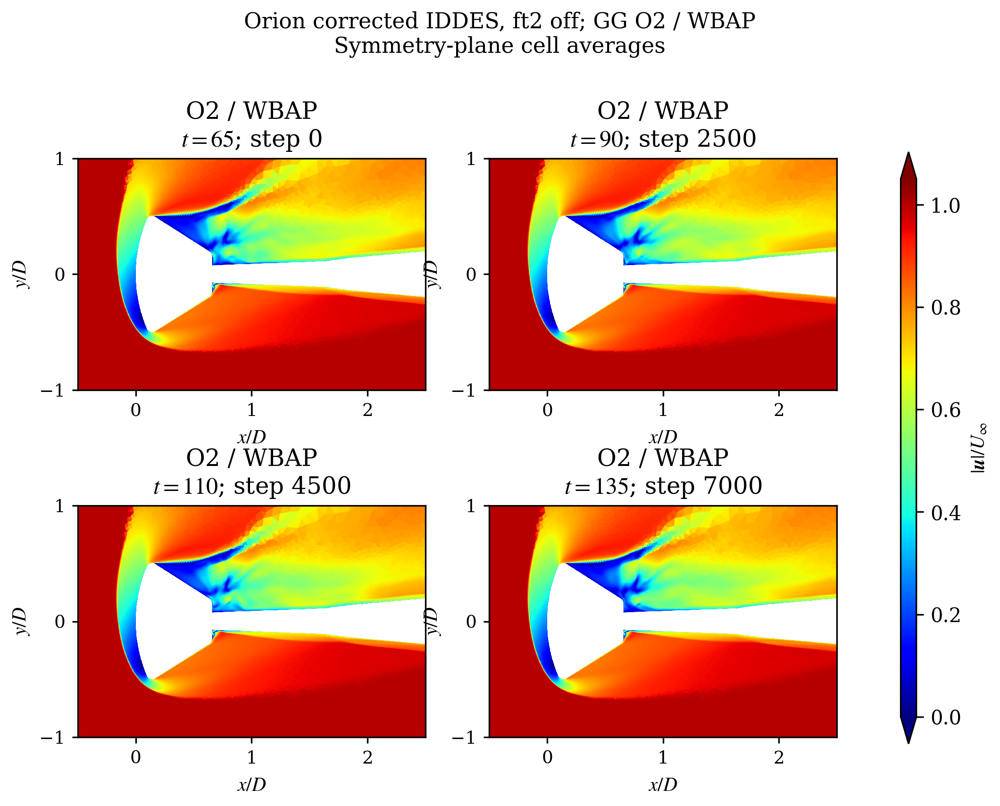

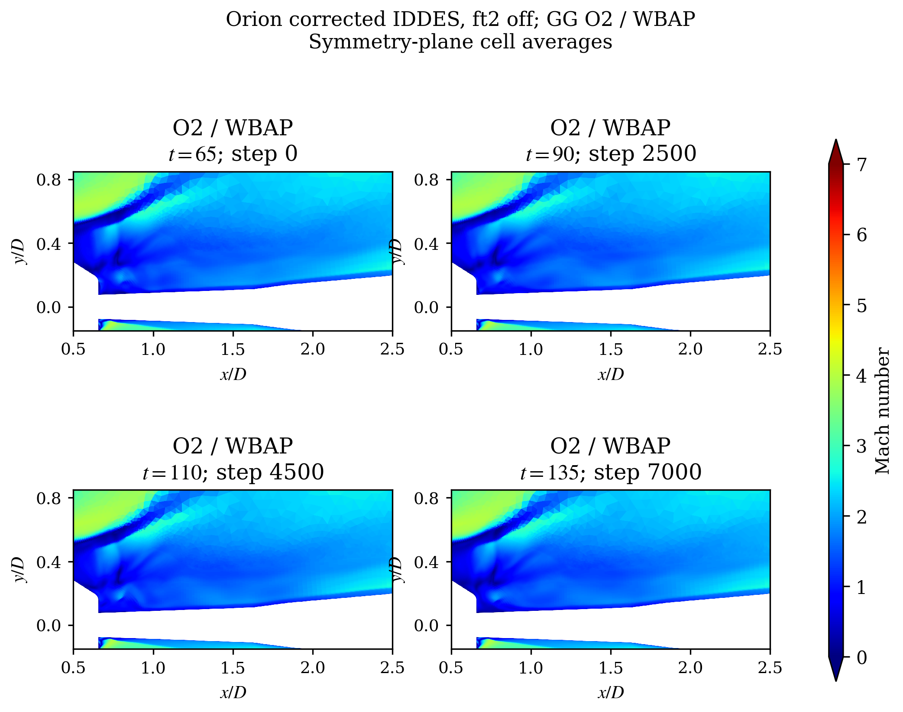

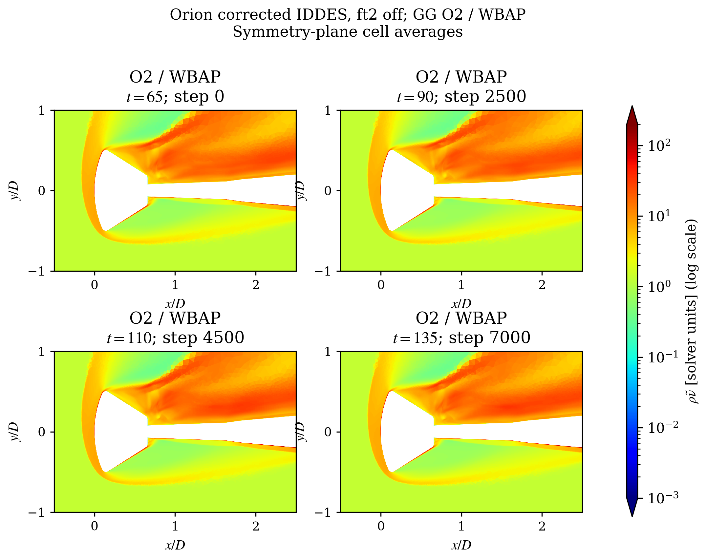

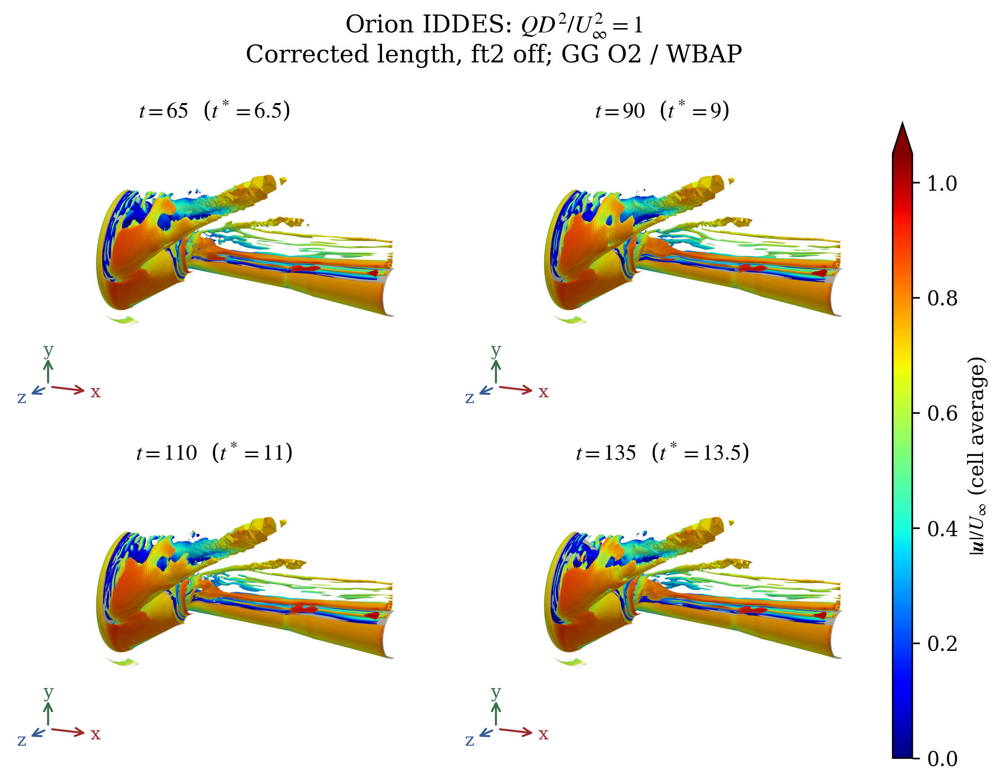

The last figure deliberately preserves its historical **\(Q^*=1\)** level; the whole-domain figures below use the subsequently selected level 5. Their apparent structural density should not be compared as if the levels were identical.

## 7. What the initial O4 diagnostics actually showed

The first frozen O4 diagnosis uses the O2 checkpoint at **\(t=95\)**, P3/HQM_OPT, geometric power 0.5/bias 1, WBAP-target LVR v3 (1,1), no expansion gate and no static mask. It stops after the first reconstruction/positivity calculation, before any mean-state update. The first build allows 40 reconstruction sweeps; it is not evidence for a fully converged VR fixed point.

| Whole-volume diagnostic | Cells |
|---|---:|
| LVR alpha greater than zero | 377,809 (4.2653%) |
| LVR alpha greater than 0.99 | 93,950 |
| Reconstruction PP affected | 4,572 |
| Reconstruction beta exactly zero | 3,236 |
| PP-affected cells without active LVR | 4,123 |
| O2-target PP affected | 679 |

Every reconstruction-PP cell is near the downstream boundary: \(2.4758\le x/D\le2.5564\), with the boundary at \(x/D=2.5576\). There is **no initial near-body or bow-shock PP region** in this particular reconstructed state. Most usual near-body plots stop at \(x/D=2.5\) and would conceal nearly all of this problem.

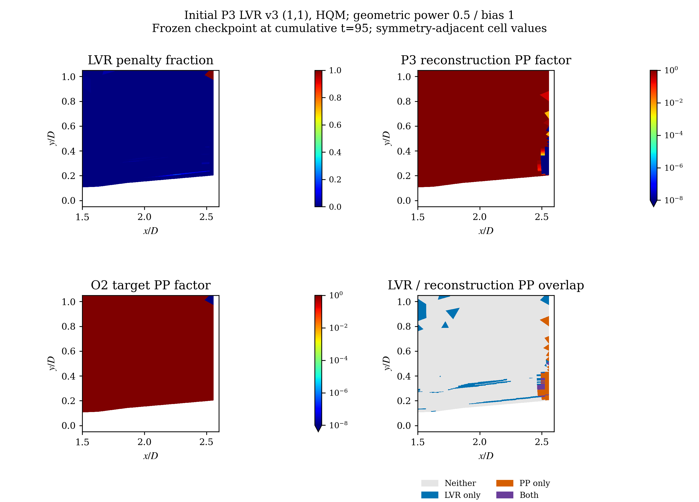

This identifies a concrete boundary-reconstruction concern, not proof that the boundary causes every later O4 failure. A shock/contact gate and a positivity detector need not activate in the same cells.

### Expansion detection improved coverage, not proven stability

With a common face normal, let \(u_{n,L},u_{n,R}\) be the finalized O2 normal velocities, \(c_L,c_R\) their sound speeds and \(p_L,p_R\) their pressures. The pressure jump is \(J_p=2|p_R-p_L|/(p_R+p_L)\). The velocity indicator changes from compression-only \(J_u=\max(u_{n,L}-u_{n,R},0)/[(c_L+c_R)/2]\) to \(J_u=|u_{n,L}-u_{n,R}|/[(c_L+c_R)/2]\) when expansion detection is enabled.

The face response is \(S(J_p;0.04,0.16)S(J_u;0.03,0.13)\), where \(S\) is zero below the first threshold, one above the second, and \(r^2(3-2r)\) in between, with \(r\) the normalized position in that interval. Supported extrema can inherit the changed face support. This option therefore responds to suitable pressure/normal-velocity jumps in expansion as well as compression; it is not an indiscriminate expansion limiter.

A gate-only off/on comparison on the same frozen time-95 means increased active cells from 377,809 to 473,918, or 4.2653% to 5.3504%. The contact gate and O2-target PP arrays were bitwise unchanged. Of the earlier 4,572 PP-region cells, active coverage increased from 449 to 3,063. The gate pair used geometric power 0, whereas the earlier PP membership came from power 0.5: this is a spatial-overlap result, not a matched recomputation of high-order PP.

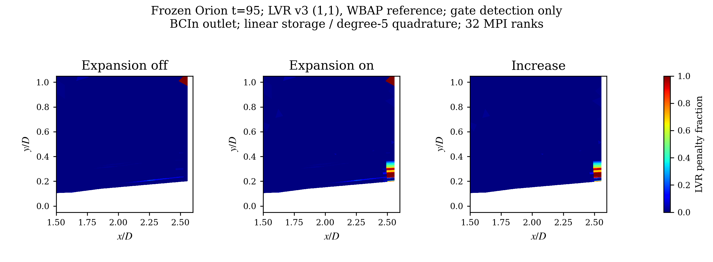

The low-memory diagnostic retained degree-5 quadrature for target positivity checks while allocating only linear reconstruction storage and executing no O4 solve. Ordinary detection samples face centers. It establishes the change in the gate alone; it does not demonstrate improved O4 convergence or reduced reconstruction PP.

## 8. O4 marching trials: separate outlet and forebody failure patterns

### Trials from the time-95 checkpoint

| Checked O4 trial | Useful numerical difference | Obtained result |
|---|---|---|
| LVR v3, WBAP target, BCIn, no mask | HQM_OPT; geometric power 0, then 0.5/bias 1 | Stopped for convergence trouble; frozen reconstruction diagnostic above localizes its initial PP region |
| Same LVR with BCFar, geometric power 0 | Changes outlet state calculation | Early density behavior improved, but momentum/energy deteriorated; after four completed steps, a sampled in-progress maximum density was about 22,805.8 and energy 1,676.25; stopped |
| Full 3WBAP, BCIn, geometric power 0, no mask | Conventional limiter control | Per-step replay: first two steps bounded; step 3 develops a downstream support-wall pressure spike; fails during step 4 |

BCFar did not deliver a satisfactory O4 trajectory. Its extrema are sampled **inner-state** values, not a claim that those are the extrema of the fourth completed field.

The unmasked 3WBAP replay gives a particularly clear spatial result. Steps 1 and 2 have pressure maxima 0.917975 and 0.918209. At step 3 the maximum becomes **304.897**, with 59 cells above pressure 2, all in two small clusters beside the downstream support wall at \(x/D\simeq2.543\). The final assertion occurs later in the wake near \(x/D=1.839\). It does not identify the first unstable region.

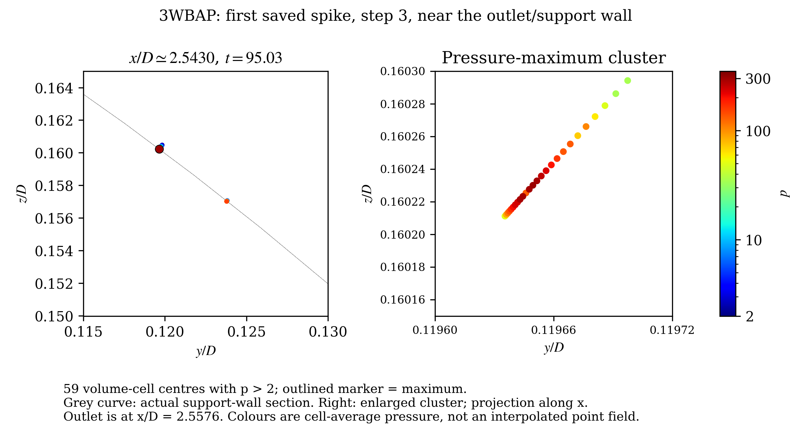

### Trials from the time-100 checkpoint

These later attempts use a more evolved O2 state, so they are not matched against the time-95 controls. They retain BCIn, P3/HQM_OPT, corrected model, rotated M9/M2 and LVR v3 caps (1,1), with expansion detection on. Unless specified, geometric power is 0/bias 1, \(\Delta t=0.01\), SGS 0 and cap 500.

The **broad mask** sets reconstruction coefficients to zero for \(x>20\), equivalently \(x/D>2\). The **outlet-adjacent mask** acts only on cells incident to the named outlet, selecting 20,791 cells. Both preserve cell means and their evolution: they impose local first-order reconstruction, not a frozen state or a changed boundary condition.

| Checked LVR trial | Obtained result |
|---|---|
| WBAP target, broad mask | Eight completed steps; failed during step 9 |
| WBAP target, no mask | Two completed steps; stopped unstable during step 3 |
| WBAP target, outlet-adjacent mask | Five completed steps; failed during step 6 |
| Barth target, outlet-adjacent mask | One completed step; stopped during severely deteriorating step 2 |

Short per-step replays of the masked trials then showed **large forebody pressure spikes in the first completed step**:

| First saved step-1 quantity | WBAP / outlet-adjacent | Barth / outlet-adjacent | WBAP / broad mask |
|---|---:|---:|---:|
| Maximum pressure | 23.3235 | 683.8095 | 83.8864 |
| Maximum conservative energy | 74.0102 | 1,747.3411 | 231.7975 |
| Maximum speed | 4.2461 | 48.5332 | 14.7378 |
| Pressure-peak \(x/D\) | 0.010463 | 0.015153 | 0.025043 |
| Wall distance at that peak, \(d_{wall}/D\) | \(4.50\times10^{-5}\) | \(3.89\times10^{-7}\) | \(3.86\times10^{-7}\) |

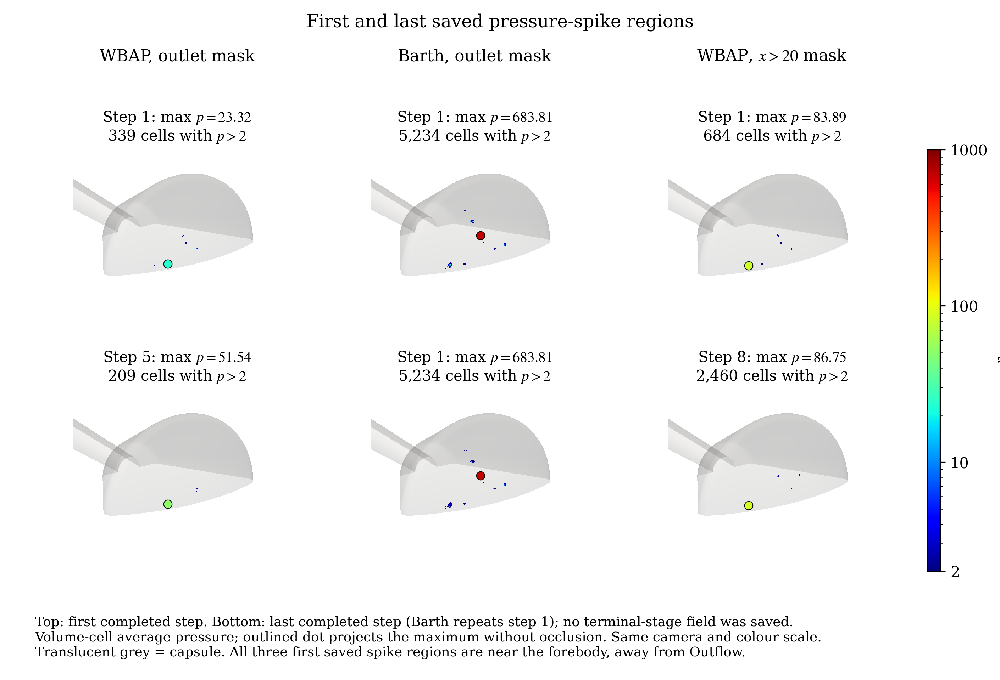

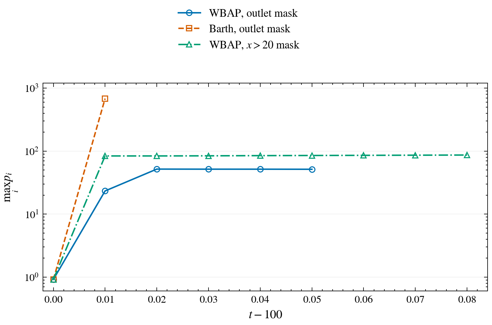

No pressure-above-2 cell in these saved LVR frames enters the downstream outlet band. Their first pressure-peak cells are thin positive-volume HEXA8 wall-layer cells, with scaled Jacobians about 0.99. They are not inverted cells; those metrics do not establish high-order suitability of their anisotropy.

The later WBAP outlet-masked assertion is in an upstream tetrahedron outside the wall layer. The saved step-1 fields establish that this is not the earliest observed corrupted region. Logs can refine the temporal bound—energy first exceeds 10 in step 1/stage 3/internal update 3 or 4—but provide no coordinates for that precise inner event.

### Wall alpha is a response field, not a causal history

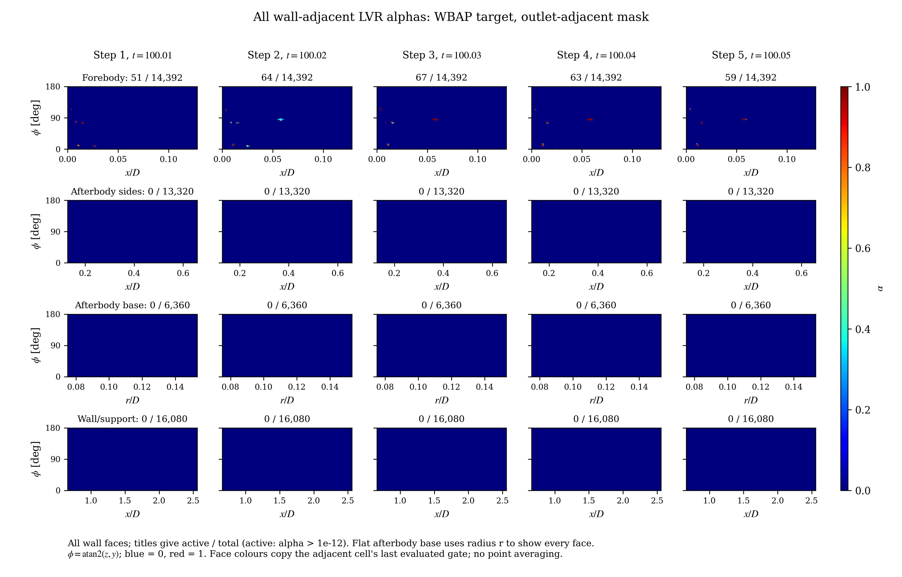

Only a small subset of the 14,392 forebody faces has active LVR in the saved states: for the WBAP outlet-adjacent replay the counts are 51/64/67/63/59 over its five saved steps. Afterbody and downstream-wall alpha stay zero in those frames. Boundary faces can repeat a cell, so these are face counts rather than global active-cell counts.

At the first saved pressure peaks, stored alpha is already 1 and reconstruction beta is 1. That does not show the gate **before** the excursion, and beta 1 does not reject an enormous positive pressure. Near-wall LVR activation may be a response to deterioration. Conversely, physical-boundary cells are excluded from the supported-extremum correction, although ordinary interior-face detection remains available. The records do not determine which effect initiated the instability.

### Smaller dt, more implicit work and mixed derivative weights

| Additional LVR control | Obtained result |
|---|---|
| WBAP target; \(\Delta t=0.0025\), SGS 3, geometric power 0.5/bias 1, two extra shock/expansion halo layers, outlet-adjacent mask | Four completed steps, then stopped unstable during step 5. Step-4 pressure maximum 6,070.91 and energy 58,780.79 in the forebody wall layer |
| Same controls with manual half-Huang/half-factorial derivative amplitudes | Six completed steps, failed during step 7. Of 19 logged stage groups, 15 reached cap 500; only two met density tolerance |

The mixed P3 amplitudes are \((1,0.76475,0.35585,0.1891833333)\), the arithmetic mean of HQM/Huang \((1,0.5295,0.2117,0.2117)\) and factorial \((1,1,1/2,1/6)\). The functional subsequently squares the amplitudes. This is not the Pan half-length-scale sequence \((1,1/2,1/8,1/48)\).

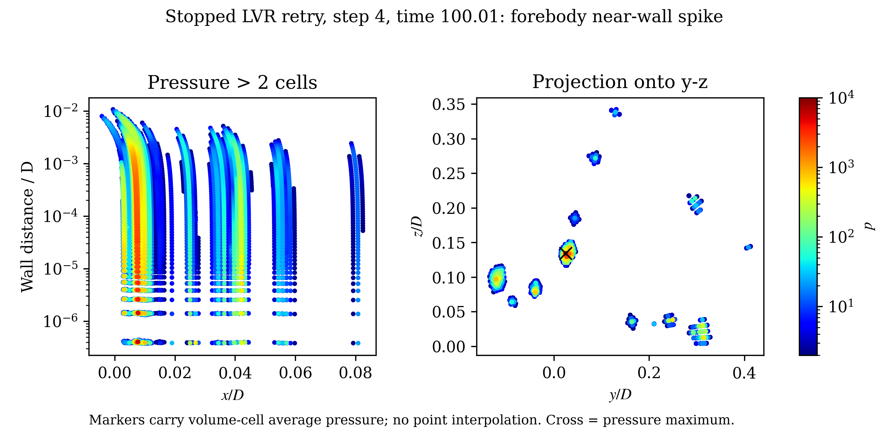

The extra halo is in addition to the v3 detector's own H2 treatment. These changes did not produce a stable trajectory. Since time step, SGS and geometric weights were changed together relative to the earlier controls, their individual contributions are not identified. The mixed-weight trial likewise supplies a failed candidate, not evidence against all factorial weighting.

## 9. Masked full-3WBAP: ten steps were not a long-run result

The broad-mask 3WBAP trial returns to \(\Delta t=0.01\), SGS 0, geometric power 0/bias 1, HQM_OPT, BCIn and the same time-100 checkpoint. Its initial **ten-step** control is genuinely successful within its bound: all 30 stages meet density tolerance, the maximum stage iteration is 36, and the means remain bounded. The cap is 500.

A longer run uses the same numerical setup except an inner cap of **100**. It completes 126 steps and fails during step 127. The first ten steps are comparable because neither cap is active. The first capped stage appears at step 15; the successful ten-step result must not be extended across that later loss of convergence.

| Completed-step range | Completed stages | Capped stages | Density-tolerance passes |
|---|---:|---:|---:|
| 1–10 | 30 | 0 | 30 |
| 11–28 | 54 | 14 | 40 |
| 29–77 | 147 | 103 | 44 |
| 78–110 | 99 | 82 | 17 |
| 111–126 | 48 | 47 | 0 |

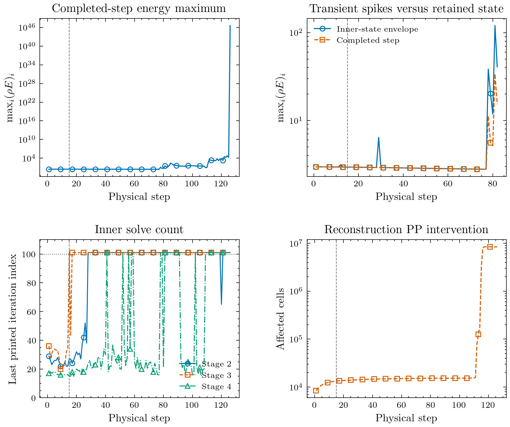

Intermediate-stage energy spikes initially recover. The first **completed-step** energy maximum above 10 occurs at step 78, reaching 11.237. At completed step 126 it is \(4.02496\times10^{46}\); the next partial step reaches \(2.93826\times10^{78}\). The final gradient-NaN assertion is a terminal symptom after this enormous growth. The corrected numbers refer to conservative energy, not the neighboring SA column.

There is **no evolved production snapshot** during deterioration: output cadence 500 means only its initial field was saved. The early pictures below use the **separate successful ten-step control**, not a recovered step-10 checkpoint from the failed production trajectory.

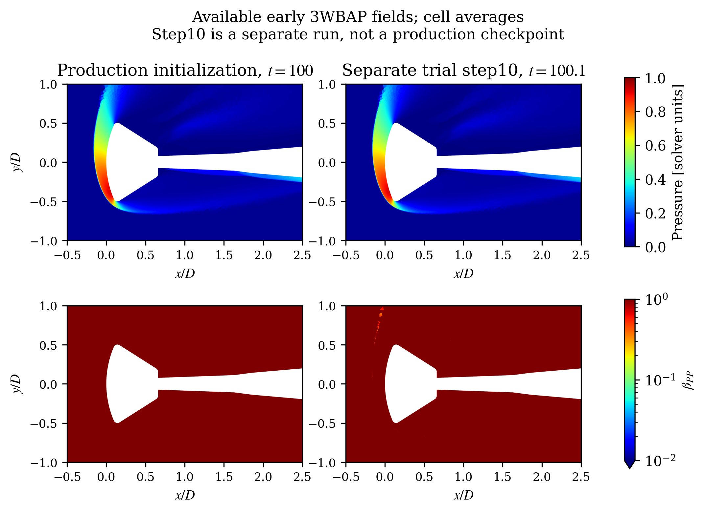

At trial step 10, 12,581 cells have reconstruction beta below 1, but none is within \(d_{wall}/D<10^{-3}\) and none is masked. These early corrections are off-wall/near-shock, not a saved boundary-layer catastrophe. Pressure remains bounded at 0.0011415–0.91713, density at 0.012513–13.0111 and energy at 0.0032016–2.94825.

Late integrated boundary fluxes implicate the forebody: energy flux becomes anomalous before the momentum components become enormous, while afterbody integrals remain order one. They do not locate the first unstable cell. The viscous evaluator was configured to use limited reconstruction; the historical argument name `uRecUnlim` does not establish a bypass of that control.

The supported chronology is **progressive loss of stage convergence → intermediate-state excursions → persistent mean-state growth → late forebody flux contamination → nonfinite gradients**. A 500-cap or smaller-step long run would be a future controlled comparison, not a result already obtained here.

## 10. Whole-domain O2: removing the enforced symmetry plane

The completed half-domain O2 state at **\(t=135\)** was reflected to a whole mesh. Scalar fields and tangential momenta were mirrored unchanged; normal momentum changed sign. The shared plane was joined, with no physical symmetry boundary remaining. Restart conversion used original cell identifiers rather than VTK row or partition order, with independent geometry/state checks. This preserves the starting state while removing the later symmetry constraint.

The whole-domain run retains GG O2/WBAP, corrected SA-R/IDDES with ft2 off, rotated M9/M2, \(\Delta t=0.01\), SGS 0, cap 500 and density tolerance \(10^{-3}\), with **no reconstruction mask**. A separate ten-step diagnostic completed and validated this bounded startup. The longer trajectory is still partial.

At the checked **30 October, 11:23 +08** cutoff, it had completed **1,350 new steps**, reaching cumulative **\(t=148.5\)**. In the captured recent stage window, the maximum iteration was 25 and no stage reached cap 500. The latest mean density range was 0.012489–13.1061 and conservative energy range 0.0032273–2.95914. Reconstruction PP remained active in 22 cells, minimum beta about 0.199. These are checked bounded-state/progress observations, not a global pointwise admissibility proof or a completed whole-domain horizon.

The latest selected **saved fields** are at \(t=135,140,145\), so the following figures do not represent the later log time 148.5.

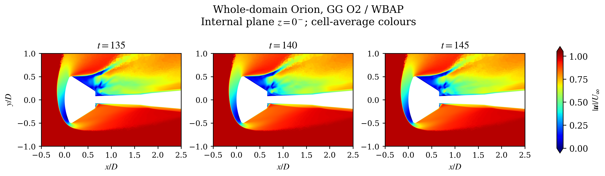

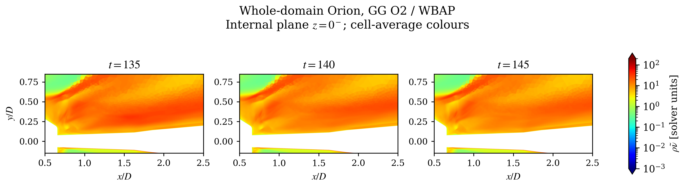

The plane at \(z=0\) is now an internal cut, not an enforced symmetry boundary. The displayed trace uses the negative-z parent cells, labelled \(z=0^-\), with their cell-average colors; it is neither a reconstructed face value nor an average of both sides. The initial state is symmetric; removing the boundary alone does not impose a perturbation or guarantee rapid symmetry breaking. These fields do not yet establish a developed whole-domain wake.

### Three-dimensional structures at the selected Q level

Define \(A=\nabla\boldsymbol u\), \(S=(A+A^T)/2\), \(\Omega=(A-A^T)/2\), and

$$
Q=\frac{\|\Omega\|_F^2-\|S\|_F^2}{2},\qquad Q^*=\frac{QD^2}{U_\infty^2}.
$$

The current selected display level is **\(Q^*=5\)**, colored by speed. One view is oblique; the second looks from **positive y toward negative y**, with positive z upward. Positive x consequently points left in that second image. Both retain the same level, camera and speed scale across times.

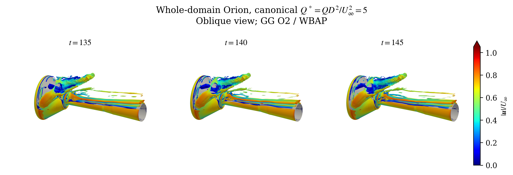

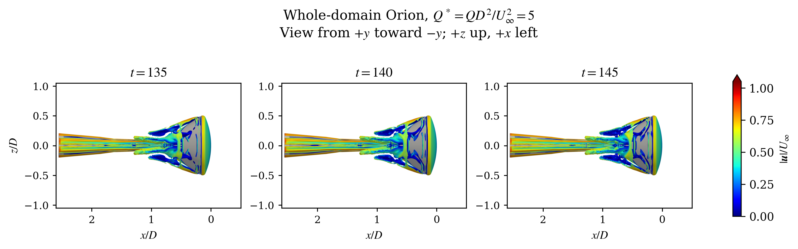

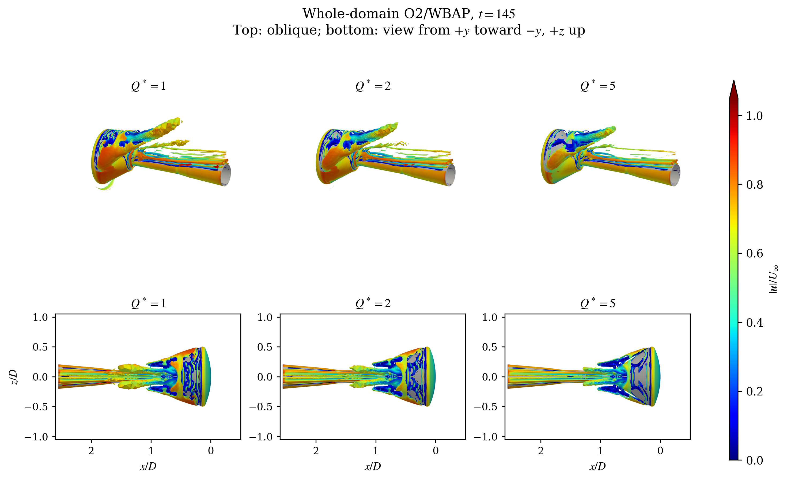

Q is estimated by VTK post-processing from cell-average velocity, rather than an exported solver gradient. Coincident points are merged and Q is averaged to vertices to extract a surface; triangle colors retain parent-cell speed. There is no surface smoothing or removal of connected components. This geometrical interpolation is specific to isosurface extraction; the plane contours retain cell values.

Level 5 removes weak outer patches and gives a cleaner picture of strong structures. It also hides weaker vortical regions. Neither surface triangle count nor apparent visual richness is a resolution or turbulence-quality measure, particularly near stretched wall cells and boundaries.

## 11. What the collected attempts support

1. **O2/WBAP is the practical Orion baseline obtained so far.** It has supported the longest corrected-model intervals and the transition from half to whole domain. This is robustness evidence on the current setup, not a DNS/LES-quality claim.
2. **The historical steady LVR comparison is favorable but narrow.** LVR retained plausible fields when full 3WBAP did not, under the old source model. It did not reach steady density convergence and cannot stand in for a successful corrected-model O4 transient run.
3. **O4 has at least two observed vulnerable regions.** The initial PP mismatch and unmasked 3WBAP spike involve the outlet/support region; masked LVR snapshots instead expose forebody wall-layer pressure growth. Fixing one region did not eliminate the other.
4. **The expansion option changes gate coverage in a useful, measurable way.** It reaches much more of the frozen outlet PP region. It has not, by itself, made the marching O4 trials reliable.
5. **Neither positivity activity nor alpha maps establish causality.** A positive pressure overshoot can survive positivity limiting, and a stored alpha of 1 can be a response after the mean has already deteriorated. The final assertion is often spatially displaced from the earliest saved spike.
6. **Inner convergence is a material part of the failure evidence.** Corrected SA-R favored the smaller internal CFL. In long masked 3WBAP, repeated cap hits precede persistent mean growth. Successful startup cannot be extrapolated through those cap hits.
7. **No current comparison establishes high-order accuracy or mature DES statistics.** Checkpoint/model/control differences prevent a single clean limiter ranking; sparse Q surfaces and SA histories do not supply missing resolution or sampling studies.

The next useful numerical comparison would isolate forebody wall-layer reconstruction from the outlet treatment, retain a common corrected-model checkpoint and output cadence, and vary only one of time step, inner convergence allowance, geometric weighting or local reconstruction order. For LVR, it would be useful to distinguish the converged frozen penalized reconstruction from the one-sweep-per-RHS evolving implementation. Boundary-supported detection and anisotropic viscous reconstruction are concrete questions, but the present records do not yet prove a defect in either.

For physical interpretation, further work also needs the IDDES wall-normal length input/approximation audited against the actual wall mesh, model-switch fields and effective viscosity checked in the separated shear layer, and matched physical-time comparisons before judging the amount of small-scale structure. Removing symmetry is a meaningful setup change; it does not replace those checks.

## Evidence and figure conventions

All figures here are retained reductions/renders of obtained data. Contours use jet with cell-associated values; PyVista field rendering is composed separately from axes, labels and colorbars. Full-volume extrema, boundary-plane extrema, integrated boundary fluxes and per-stage log extrema are identified separately. Source figures preserve their original time labels and numerical scales.

The companion research study records the numerical source documents, checked cutoffs and SHA-256 provenance of each copied image. It retains full-resolution assets and points to the original reductions. This synthesis does not rerun a solver or replace a sparse field history with inferred fields.
