The Orion experiments have now produced useful transient flow fields on several meshes, including a sustained fourth-order Navier–Stokes calculation. They have also exposed a much more specific limitation: the same high-order reconstruction can develop very concentrated pressure and temperature spikes in the forebody wall layer when coupled to SA-IDDES. Those spikes are easy to miss in a global contour or a symmetry-plane plot.

This post gathers the latest saved states of the meaningful transient runs, then examines the failed high-order IDDES trials. It continues the [October synthesis](../orion-numerical-attempts-2026-10-30/) and the [original Orion LVR study](../orion-lvr-test-2026-10-19/). The images are numerical evidence from saved solver outputs. The cover is an AI-generated artistic illustration, not a computed flow field.

The cases are **not a matched accuracy study**. They differ in mesh, domain extent, turbulence treatment, initialization and elapsed physical time. Their strongest use is to show what each setup actually produced, where it remained usable, and where it failed.

## Physical problem and numerical language

All cases use the same nominal Orion flight condition. The support sting is present in the redraw3 geometry and removed in the redraw4 family. The flow is inclined at a substantial angle of attack, so geometric “upstream” and the wake direction should be interpreted relative to that inclined freestream.

| Quantity | Setting |
|---|---|
| Freestream Mach number | 6.41 |
| Angle of attack / sideslip | $28^\circ$ / $0^\circ$ |
| Reynolds number | $Re_D=1.077\times10^7$, using freestream Sutherland viscosity |
| Capsule diameter | 0.254 m = 10 solver length units |
| Freestream velocity | 1102.53 m/s = 1 solver velocity unit |
| Freestream temperature / pressure | 73.63 K / 4068.26 Pa |
| Wall | Isothermal, 295.56 K |
| Usual downstream boundary | Boundary named `Outflow`, prescribed-state `BCIn` condition |
| Usual physical timestep | $\Delta t=0.01$ solver units, approximately 0.2304 microseconds |
| Field output | Cell-average volume and boundary data |

The inherited downstream `BCIn` condition is unusual. It is recorded here because it matters to the interpretation of outlet troubles; it is not a claim of a nonreflecting outflow treatment.

**O2** denotes explicit Green–Gauss linear reconstruction with WBAP limiting. **O4/P3** denotes a degree-three variational reconstruction, integrated at order 5. The O4 LVR cases use the **LVR v3 / Average H2** formulation with a WBAP-limited O2 reference, shock/contact alpha caps $(1,1)$, and HQM_OPT partial-derivative weights. Geometric weights are a different control. In the recent matched diagnostic baseline they use HQM_SD with power 0 and bias 1; the power-0.5 trial changes only that power.

The optional expansion detector is enabled in the recent O4 baseline. The SA variable itself retains the configured second-order reconstruction path. LVR's shock/contact gate, reconstruction positivity factor and increment positivity factor have different purposes: a positive but enormous cell-average pressure can remain problematic even when a reconstruction positivity factor is one.

**NS** below means that no turbulence model is active. It does not mean that the available grid resolves every turbulent scale, so these runs should not be presented as validated DNS. **IDDES** denotes the corrected SA-based hybrid RANS/LES model, with $C_\mathrm{DES}=0.65$ and, unless stated otherwise, $f_{t2}$ disabled. The implementation uses an approximate wall-normal mesh-length measure; calling a case IDDES does not certify the model/grid treatment for this reentry problem. The transported SA state $\rho\widetilde\nu$, its specific variable $\widetilde\nu$, and the modeled eddy viscosity are distinct quantities.

Most earlier O2 runs use ESDIRK3, a density stopping tolerance of $10^{-3}$ and up to 500 internal updates per implicit stage. The selected redraw4-F-add O4 NS run uses ESDIRK3, two internal reconstruction updates, SGS0 and a 40-update stage cap. A capped stage is not a converged implicit solution. The detailed configurations and restart lineage are retained in the research study.

## Meshes and what the images show

The mesh family changes both the support geometry and the wake resolution. Full-domain redraw3 meshes were produced by joining the simulated half mesh to its reflection, with careful cell-index mapping for restart fields. All visualizations in this post show the domain actually simulated; no extra reflected flow is added for presentation.

| Mesh / simulated domain | Volume cells | Stored volume points | Main change |
|---|---:|---:|---|
| redraw3, half domain | 8,857,647 | 7,854,428 | Capsule and downstream support sting |
| redraw3, full domain | 17,715,294 | 15,572,100 | Joined full-domain geometry, no enforced central symmetry |
| redraw4-F, half domain | 14,975,298 | 13,727,588 | Sting removed, revised wall-layer mesh |
| redraw4-F-add, half domain | 16,597,994 | 13,993,072 | More downstream resolution than redraw4-F |

The point counts are the points stored in the corresponding VTKHDF volume datasets, which can include coincident copies. They should not be interpreted as counts of distinct CGNS mesh nodes. The redraw4-F-add mesh adds 1,622,696 cells, about 10.8%, over redraw4-F.

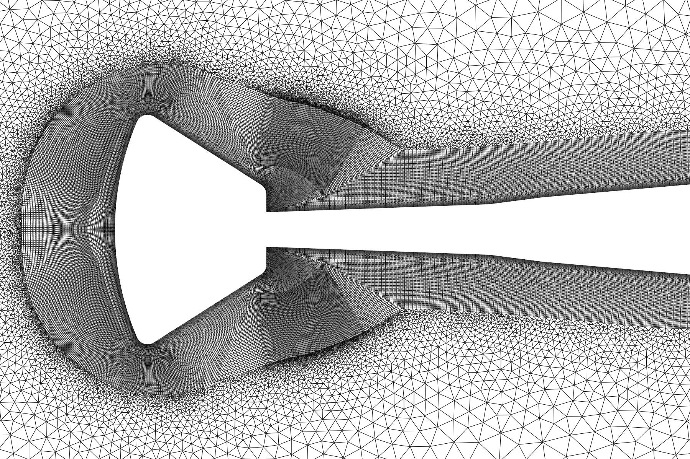

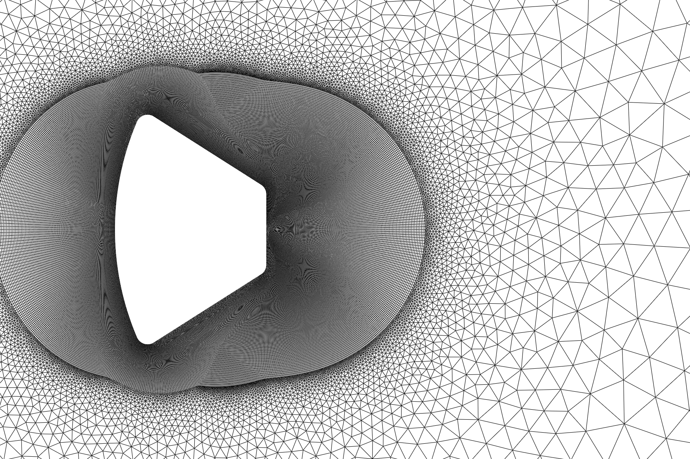

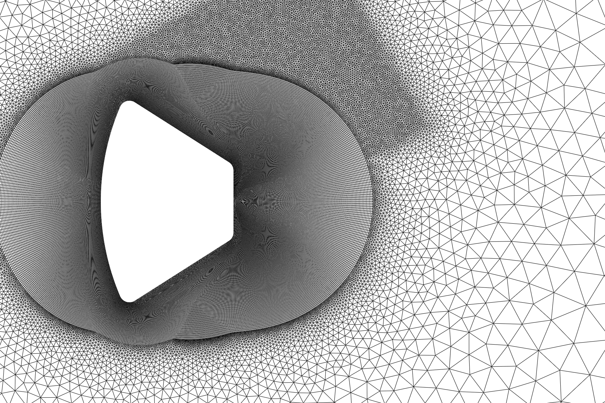

These views show cut-cell edges and the extent of the body/wake refinement. The actual near-wall layers are much thinner than a full-domain figure can display; the global pictures are mesh-layout views, not wall-resolution certifications.

The four-view panels use a common interpretation: symmetry-plane speed, symmetry-plane $Q^{\ast}$, an oblique $Q^{\ast}=20$ isosurface and a top view of that same surface. Here

$$Q=\tfrac12\left(\|\boldsymbol\Omega\|^2-\|\mathbf S\|^2\right),\qquad Q^*=QD^2/U_\infty^2.$$

$\mathbf S$ and $\boldsymbol\Omega$ are the symmetric and antisymmetric parts of the velocity-gradient tensor. Positive $Q$ indicates local rotation dominance under this definition; negative $Q$ indicates strain dominance and does not identify compression alone. These renderings compute gradients from the saved cell-average velocity, rather than using an exact high-order solver gradient. Q is averaged to vertices for isosurface geometry; the underlying flow remains a cell-average dataset. The symmetry-plane Q range is $[-40,40]$ and can clip larger values.

A visually intricate Q surface is not, by itself, evidence of higher accuracy. Instabilities, model choice, mesh changes, elapsed time and numerical dissipation can all change the structure count.

## The meaningful transient cases

Each panel below represents the latest available saved state for a completed or deliberately stopped run, or the latest completed output of the active run. A saved step can precede the final step recorded in the solver log.

### 1. Redraw3 half domain: O2 IDDES with rotated Roe_M9/Roe_M2

This corrected-model half-domain result is the reference trajectory before the whole-domain extension. Its saved endpoint is cumulative solver time **135**. The enforced symmetry plane constrains the permitted motion, and the support sting remains part of the geometry.

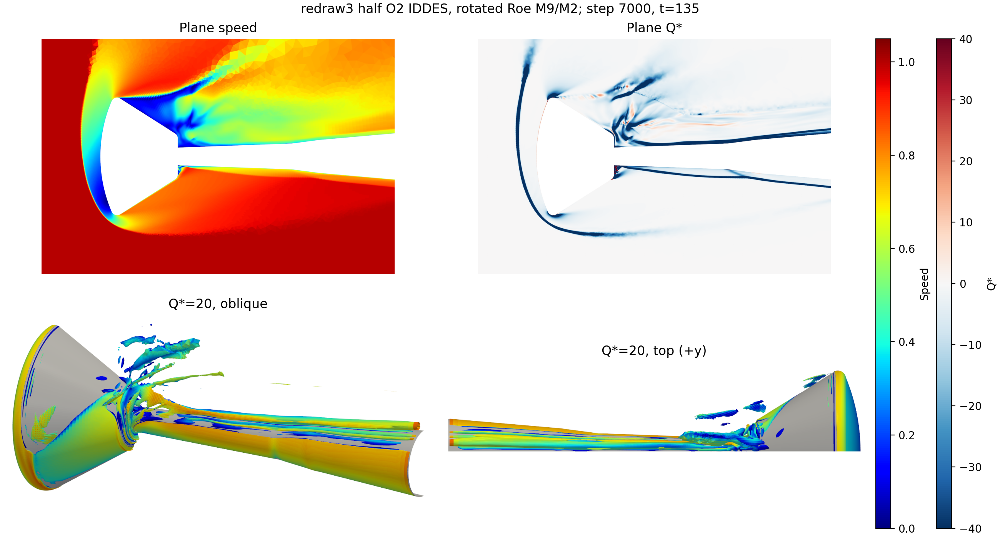

This case establishes that the corrected O2 SA-IDDES path can advance the sting geometry for a substantial transient interval. It should not be equated with a full-domain wake, because antisymmetric motions across the center plane are excluded by construction.

### 2. Redraw3 full domain: O2 IDDES with rotated Roe_M9/Roe_M2

The full-domain continuation permits evolution on both sides of the former symmetry plane. It completed its requested 10,000 new steps, reaching cumulative time **235**. The center-plane panel is now an internal cut rather than a boundary trace.

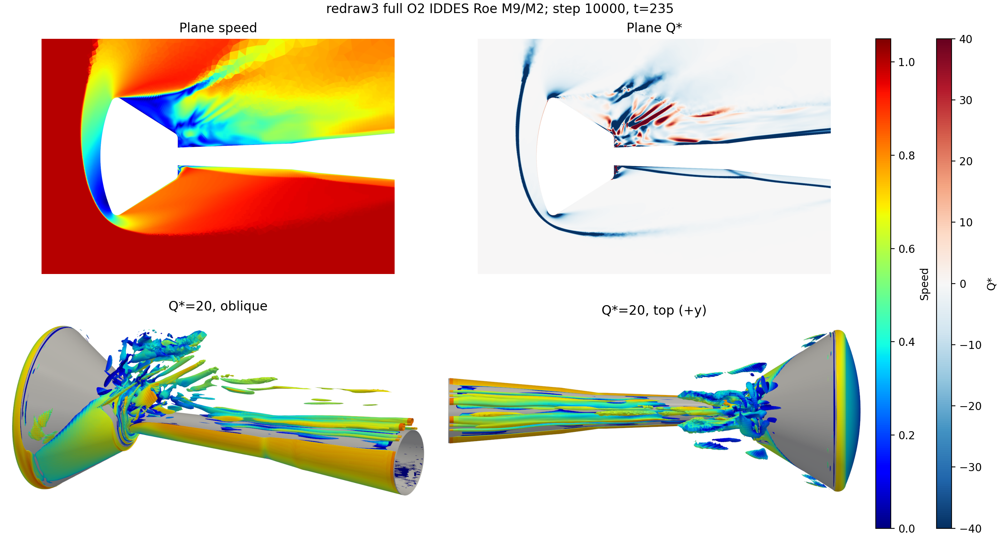

The Q surface shows the structures admitted by the hybrid model and this grid at the selected threshold. It should be read together with the plane fields: a modeled-viscosity calculation can retain a comparatively smooth region even where a no-model calculation develops more small-scale structure.

### 3. Redraw3 full domain: O2 NS with rotated Roe_M9/Roe_M2

This no-turbulence-model branch was stopped before its original horizon; its retained saved state reaches cumulative time **170**. It is included because the produced transient field is informative, while its canceled status is retained.

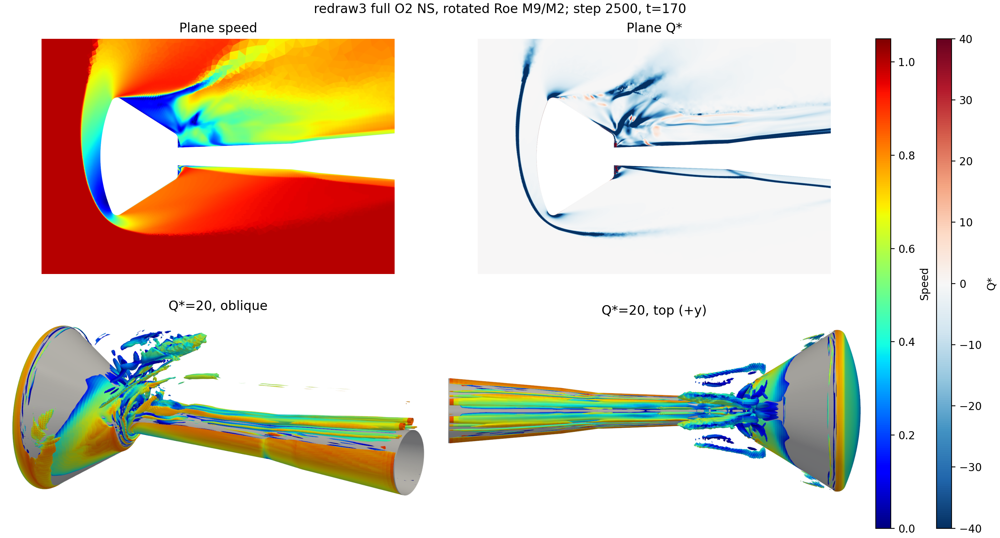

The change from IDDES to NS removes the modeled turbulence terms as well as their implicit coupling. This is therefore not a clean reconstruction-order comparison with the IDDES case.

### 4. Redraw3 full domain: O2 NS with AUSMPW+

The AUSMPW+ no-model continuation completed 10,000 new steps and reached cumulative time **245**. It is the longer O2 AUSMPW+ baseline on the full sting geometry.

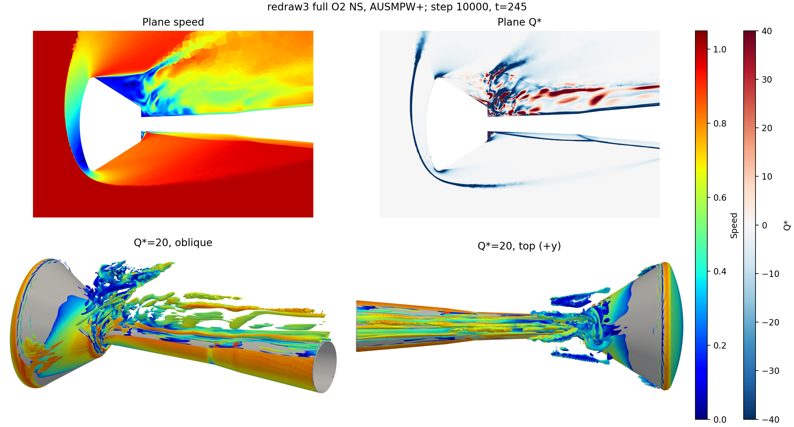

The saved state supplies a useful comparison for the O4 branch below, but the panels have different elapsed times. Differences in wake appearance cannot be attributed solely to reconstruction order.

### 5. Redraw3 full domain: O4 LVR NS with AUSMPW+

The high-order sting case produced thousands of meaningful transient steps. It was deliberately stopped after completing **3843** new steps because progress had become too slow; its latest preserved field is step **3500**, cumulative time **180.1**. Cancellation for cost is distinct from the O4 IDDES numerical failures discussed later.

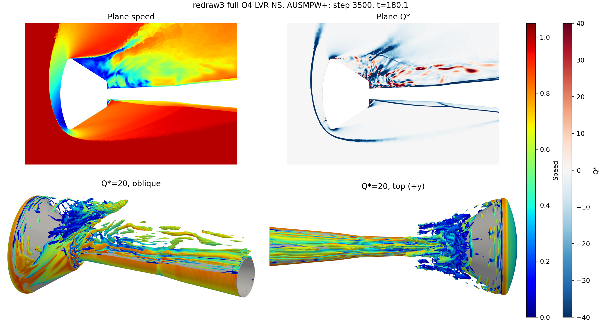

Near the stop, the last 100 updates averaged about 5.15 steps per hour. That throughput made the remaining horizon impractical in the allocation. The flow images remain useful evidence of the evolved high-order no-model trajectory; they are not a completed 10,000-step result.

### 6. Redraw4-F half domain: O2 NS with AUSMPW+

This rod-free mesh changes the physical geometry as well as the wall-layer discretization. The O2 no-model run completed 10,000 steps, reaching cumulative time **100**.

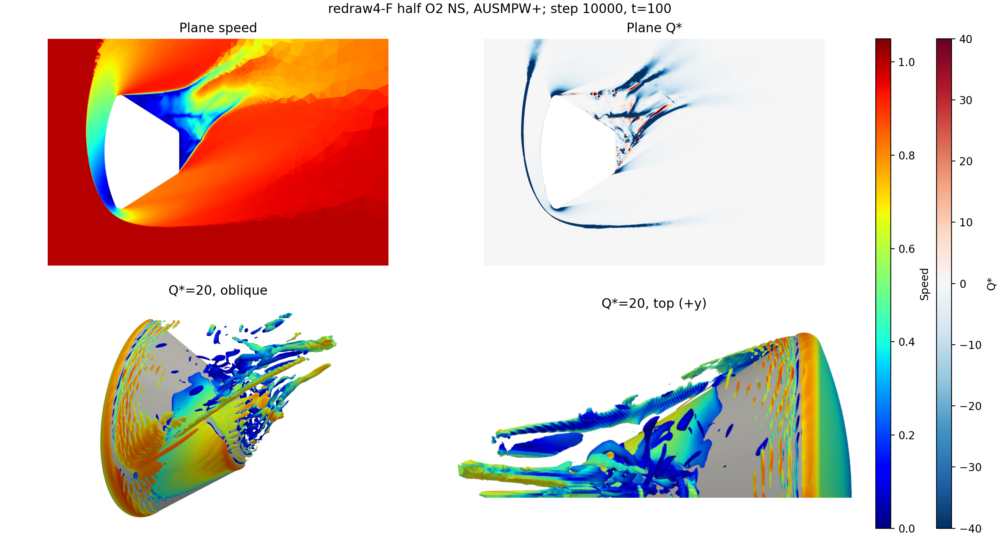

The support wake is absent by design. Comparing this picture with redraw3 is valuable for recognizing how strongly the support changes the flow environment, but it is not a pure grid-refinement test.

### 7. Redraw4-F-add half domain: O2 IDDES with AUSMPW+

The added downstream resolution is first exercised with the O2 IDDES model. This run completed 10,000 steps at cumulative time **100** and supplies the common checkpoint for the recent O4 IDDES diagnostics.

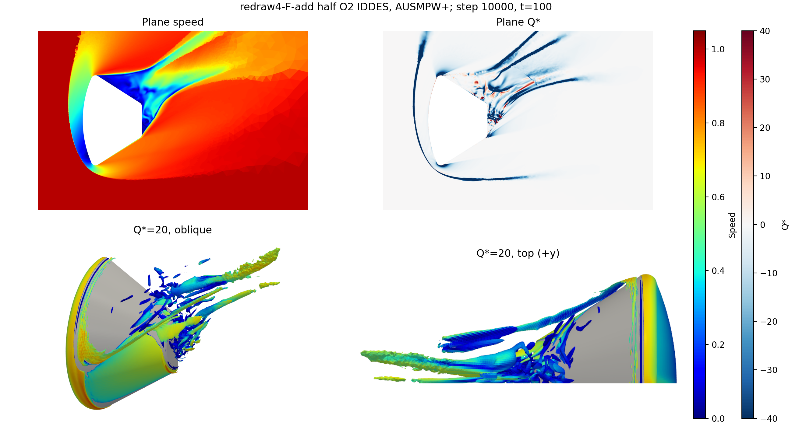

This is the field against which the high-order restart anomalies must be judged. Its global pressure, density and energy maxima are bounded and provide much more informative references than positivity alone.

### 8. Redraw4-F-add half domain: O2 NS with AUSMPW+

The no-model continuation starts from the IDDES branch's step-3500 state, so its 100 units of new solver time end at cumulative time **135**. The six-state SA checkpoint was converted to the five-state NS representation with the mesh's cell indexing preserved.

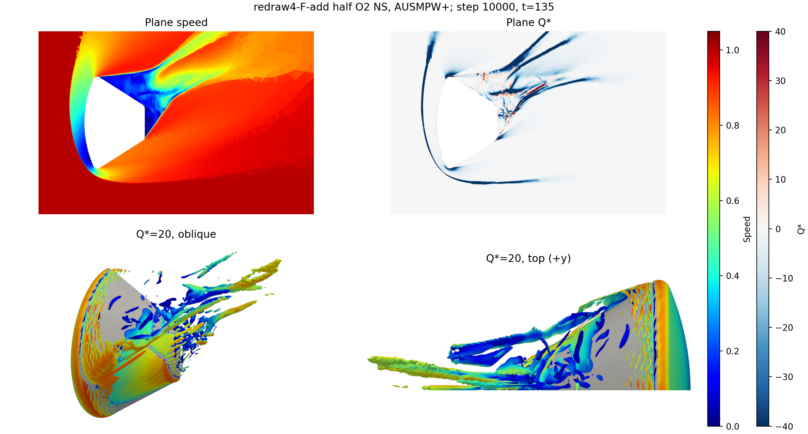

The changed model and restart history matter: the starting wake was produced by IDDES before it evolved under no-model NS. This branch is also the starting state for the selected O4 NS calculation.

### 9. Redraw4-F-add half domain: the latest O4 LVR NS result

The selected long O4 LVR run continues from the completed O2 NS checkpoint. Its latest checked saved snapshot is **step 5000**, cumulative time **185**. At the November 13 check it had completed step **5106** and was still advancing. The latest complete logged density range was 0.02779–13.4946 and total-energy-density range 0.007848–2.57675; the figure represents the earlier, completed saved state.

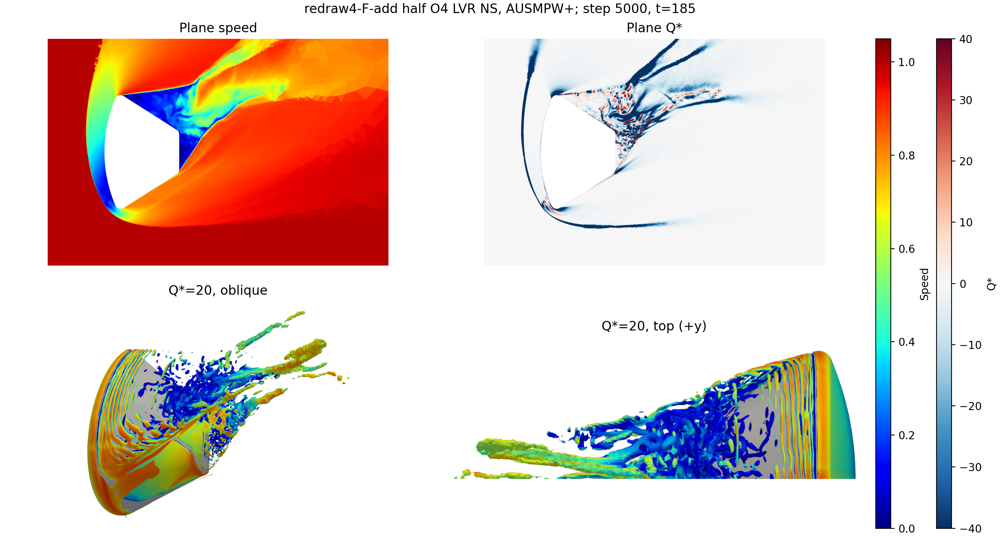

This is the strongest sustained high-order result in the present rod-free sequence. It shows that the method can advance a developed no-model transient for thousands of steps. It does not resolve the SA-IDDES stability problem: those runs solve a different coupled system, even when they share reconstruction and flux controls.

## What failed in high-order SA-IDDES?

### Earlier controls: outlet flags did not identify every failure

The redraw3 investigations already separated several failure patterns. An unmasked full-3WBAP replay had normal pressure maxima in its first two steps, then reached pressure 304.9 beside the downstream support wall at $x/D\simeq2.543$ in step 3. Its final assertion occurred later at a different location. A changed `BCFar` outlet initially improved the density behavior but did not yield a satisfactory O4 trajectory.

Later LVR trials masked either the broad downstream region $x/D>2$ or only cells incident to the outlet. Those masks imposed zero reconstruction there while allowing cell means to evolve. The masked WBAP- and Barth-target trials nevertheless developed their first saved pressure spikes in the forebody wall layer. Their first-step maxima were 23.3, 683.8 and 83.9 for the WBAP/outlet-adjacent, Barth/outlet-adjacent and WBAP/broad-mask variants, respectively. The pressure-peak wall cells had positive volumes and tested scaled Jacobians near 0.99; inversion was not the observed explanation.

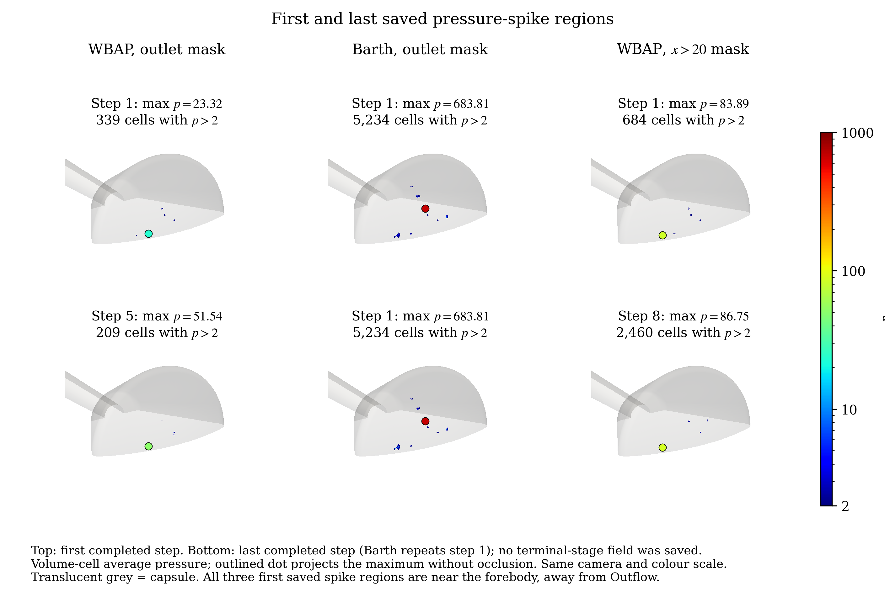

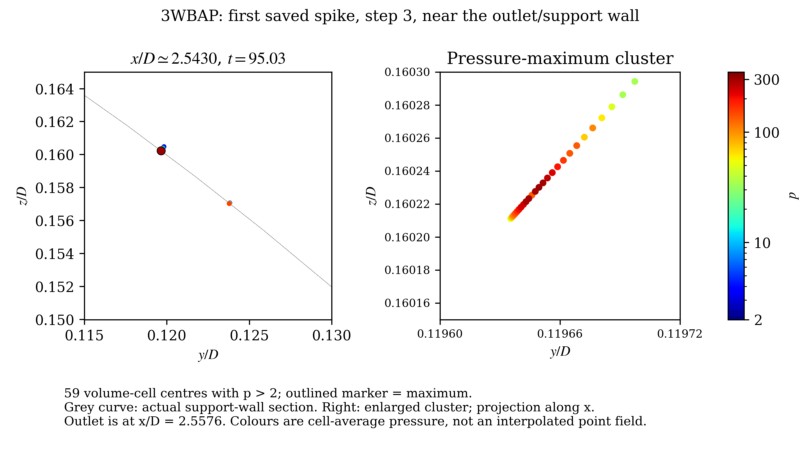

A smaller-step LVR trial with $\Delta t=0.0025$, more SGS work, geometric power 0.5 and extra gate layers still became unstable. A mixed Huang/factorial derivative-weight trial also failed. Those combinations changed several controls, so they do not isolate the effect of a single parameter. A broad-mask 3WBAP control initially completed ten steps with all stages meeting density tolerance, but its longer run progressively lost internal convergence and failed during step 127. It is a useful reminder that ten successful steps can be insufficient.

The earlier diagnostics and their detailed chronology remain in the October report. They motivate the newer controlled tests below without being merged into one common-start experiment.

### Recent common-start diagnostics

The recent diagnostics use the same O2 IDDES checkpoint on redraw4-F-add, then change selected numerical controls. They run ten steps at $\Delta t=0.01$, write every step and use the same executable for the matched new-revision variants. They are short diagnostics, not developed turbulent trajectories.

### A positive state can still be unusable

At the O2 starting checkpoint, the global maximum pressure is approximately 0.947 and maximum total energy density is 2.624 in solver units. The original O4 diagnostic developed catastrophic values by step 10. Rebuilding with the revised positivity procedure reduced those extremes by many orders, but did not remove the instability. Raising both reconstruction/residual compression powers to 4 delayed the severe growth: at step 10 its pressure maximum was 3.652 and energy-density maximum 12.78. These are already elevated relative to the common start.

The longer powers-4 trial made the remaining problem clear. At step 20, pressure reached 45.4 and the energy-density maximum reached 135.0. The run was later canceled during step 31. This is a failed continuation even though density and energy remained positive in many recorded states.

### The forebody spike is spatially separate from the outlet flags

The step-20 maximum is at $(x/D,y/D,z/D)=(0.00583,0.04998,0.10711)$, immediately beside the forebody wall. Its recorded wall distance is $7.66\times10^{-5}$ solver length units. The peak lies off the symmetry plane, which explains why a symmetry-plane image can understate the anomaly. The 20 cells with pressure above 20 form a compact cluster. Outlet boundary pressure in the same snapshot is only 0.0171–0.0353.

At the very same cell, the O2 starting state and powers-4 step 10 are nearly identical: pressure about 0.687, temperature about 319 K and Mach about 0.075. At step 20 pressure is 45.4, temperature about 24,200 K and the specific SA variable has collapsed from 0.105 to $1.26\times10^{-7}$. The neighborhood medians remain close to the starting values. This is a sharp, localized pressure/thermal event with a coincident SA pocket, rather than a broad uniform change in the boundary layer.

The earlier diagnostic peaks are also near the forebody, but their positions differ. The original old-revision step-10 pressure peak is about $0.15D$ from the later powers-4 peak; the powers-4 step-10 global pressure peak is about $0.45D$ away. The evidence points to a vulnerable region and coupled numerical behavior, not one permanently bad cell.

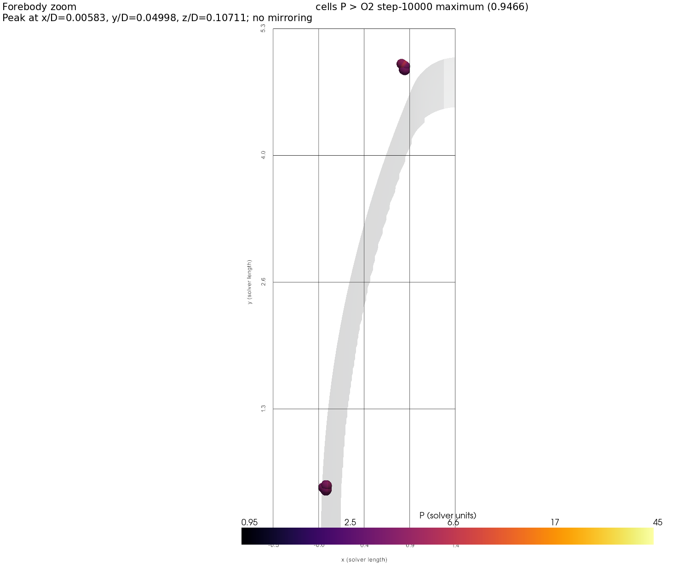

The 3D view enlarges the high-pressure-cell markers for visibility; the gray surface supplies geometric context. It is a localization plot, not a volume rendering of the whole flow.

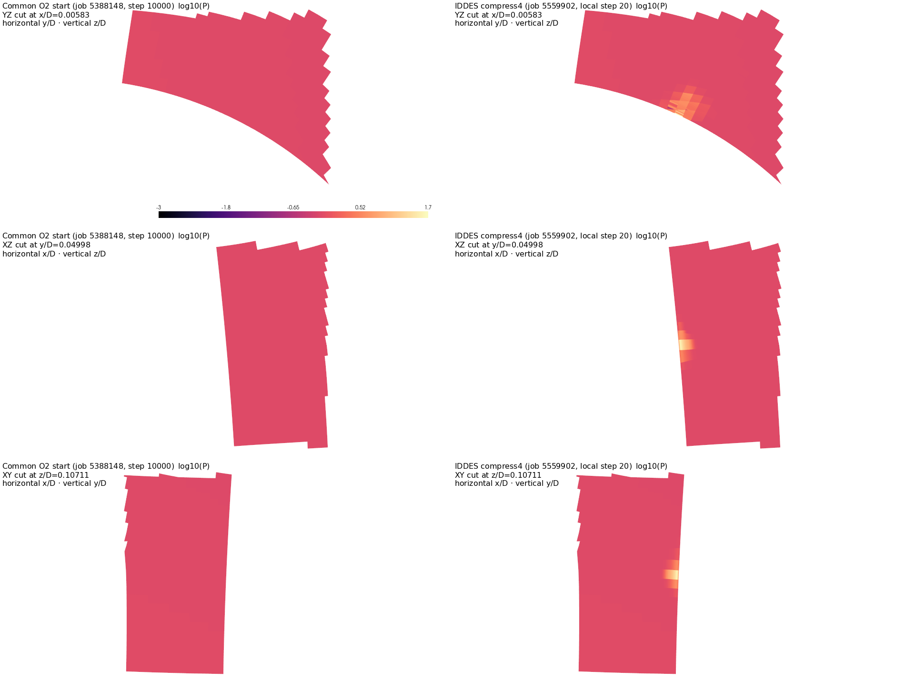

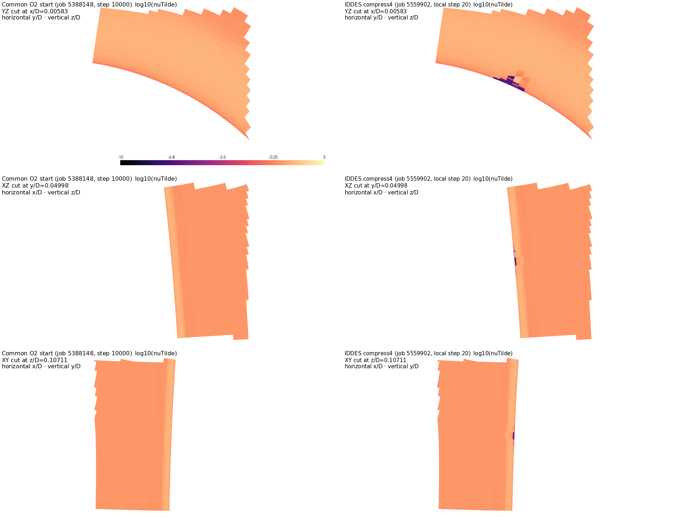

At the saved step-20 pressure-peak cell, both `betaPP` and `lvrO2Beta` equal one. Nearby O2-target positivity compression can be strong, but the largest pressure cell is not necessarily the one with the smallest beta. This is why a plot of positivity flags alone did not locate the emerging pressure problem.

The saved fields do not include the exact IDDES shielding and length-scale fields. A low $\widetilde\nu$ pocket cannot by itself prove a local RANS-to-LES switch, and the snapshots do not establish whether the SA collapse preceded or followed the thermal spike. That distinction needs temporal source/model diagnostics, not a visual inference from one frame.

### Two controlled changes give very different outcomes

| Ten-step setup | Final maximum pressure | Final maximum density | Final maximum $\rho E$ | Interpretation |
|---|---:|---:|---:|---|
| Common O2 starting field | 0.947 | 13.12 | 2.624 | Starting reference |
| AUSMPW+, compression powers 4, $f_{t2}$ off | 3.652 | 13.10 | 12.78 | Early anomaly remains |
| AUSMPW+, compression powers 4, $f_{t2}$ on | 387,646 | 15,831 | $7.47\times10^6$ | Severe numerical blowup |
| Roe_M2, compression powers 4, $f_{t2}$ off | 0.931 | 12.43 | 2.367 | Bounded thermodynamics over ten steps |

Roe_M2 is the nonrotated Rusanov flux here. Its result is encouraging: the ten-step thermodynamic ranges remain close to the common O2 start. Its final printed stage-relative flow residuals are approximately $(9.84\times10^{-4},6.22\times10^{-4},1.02\times10^{-3},1.57\times10^{-3},8.17\times10^{-4})$. The corresponding SA value is about 0.10. The density stopping criterion can pass even when the SA residual is not reduced to the same level; the practical convention in these experiments is to require bounded SA behavior rather than equal SA convergence.

The solver CSV residuals are absolute and must not be mistaken for those stage-relative values. In particular, absolute values around 0.1–0.5 do not by themselves establish failed internal convergence. The ten-step Roe_M2 result remains a short-window robustness observation; a longer trajectory and its stage histories are needed to establish sustained time-marching behavior. Increasing dissipation can suppress the symptom without explaining the coupled instability.

Enabling $f_{t2}$ makes this particular startup markedly worse. That observation belongs to this high-order restart experiment; it is not a general statement that $f_{t2}$ is unsuitable for every SA calculation.

The additional AUSMPW+ trial changes geometric weight power from 0 to 0.5, retaining powers 4 and $f_{t2}$ off. At the checked cutoff it is queued and has produced no numerical output; it therefore supplies no result to rank against the completed cases.

## Wall heating compared with the archived experiment

The flow pictures are only part of the comparison. The available wall-output series also let us compare time-averaged heat transfer with the archived wind-tunnel measurements: six forebody records and 33 afterbody records distributed over nine azimuths. The local archive supplies the values but no measurement-uncertainty estimates, so the plots do not invent experimental error bars.

The saved energy flux `F4` is a flux density. For this normalization, positive heat transfer into the wall is $q_w=-F4\rho_\infty U_\infty^3$, where $\rho_\infty U_\infty^3=2.58014\times10^8$ W/m². Both calculations and experiments are plotted in kW/m². The comparison also maps experimental upward coordinates to numerical $y$ and azimuth to $\operatorname{atan2}(y,z)$; numerical lengths are multiplied by 0.0254 to recover metres. Boundary-zone identifiers are checked separately for each mesh family.

Each case uses its own retained, evolved boundary snapshots and a trapezoidal time average. The initial step-0 boundary flux is excluded because output can precede flux evaluation: initial O4 files contained enormous spurious fluxes, and an O2 file contained all zeros. This exclusion concerns the boundary flux, not the validity of the starting volume state. We first match wall faces by position and zone, then area-average within narrow physical-coordinate bins and interpolate to supported sensor positions. The shaded temporal standard deviation describes how the saved values varied across that window; it is neither a standard error nor experimental uncertainty. These means include the evolved startup interval beginning at the first valid boundary output and should not be read as statistically converged turbulent averages.

The nine cases use 5–20 valid evolved boundary snapshots each, at 500-step spacing (5 solver time units). Initial step-0 boundary flux is excluded consistently because it can precede RHS evaluation: an initial cached flux is not a physical heating measurement. The mean is a trapezoidal integral divided by the recorded window duration. Windows and physical models differ, so the table is not a matched-time method ranking.

Heat flux into the wall is positive, in kW/m². The summary columns are **arithmetic averages over supported experimental sensor locations**, after temporal averaging; they are not whole-surface area means. MAE is the mean absolute discrepancy at those sensor locations. The four supported forebody experimental values average 279.66 kW/m²; the 31 supported aftbody values average 14.07 kW/m². All 39 measurements remain in the tables and figures, but only 35 per case have numerical support with the documented interpolation rule. No extrapolation is used.

| Case | Valid snapshots | Cumulative time window | Forebody mean / MAE | Aftbody mean / MAE |
|---|---:|---|---:|---:|
| redraw3 half O2 IDDES, Roe M9/M2 | 14 | 70–135 | 240.30 / 48.91 | 16.67 / 4.12 |
| redraw3 full O2 IDDES, Roe M9/M2 | 20 | 140–235 | 241.53 / 48.32 | 16.64 / 3.97 |
| redraw3 full O2 NS, Roe M9/M2 | 5 | 150–170 | 98.83 / 180.83 | 6.47 / 8.49 |
| redraw3 full O2 NS, AUSMPW+ | 20 | 150–245 | 96.68 / 182.98 | 5.44 / 8.73 |
| redraw3 full O4 LVR NS, AUSMPW+ | 7 | 150.1–180.1 | 107.60 / 172.06 | 6.25 / 9.05 |
| redraw4-F half O2 NS, AUSMPW+ | 20 | 5–100 | 112.95 / 166.71 | 7.44 / 9.16 |
| redraw4-F-add half O2 IDDES, AUSMPW+ | 20 | 5–100 | 265.18 / 74.58 | 17.50 / 5.59 |
| redraw4-F-add half O2 NS, AUSMPW+ | 20 | 40–135 | 117.64 / 162.02 | 6.51 / 9.17 |
| redraw4-F-add half O4 LVR NS, AUSMPW+ | 10 | 140–185 | 140.83 / 138.83 | 7.33 / 8.06 |

All numerical entries in the last two columns are kW/m². The 351-row [sensor table](heat-all_sensors.csv) retains every case/sensor pair, including unsupported entries. [Summary CSV](heat-summary.csv), [time-series manifest](heat-series_manifest.json), [area validation](heat-norm_area_validation.json) and [initial-cache audit](heat-initial_cache_audit.json) record the calculation.

### What the heating differences show

The no-model NS cases underpredict the forebody sensor heating substantially. Adding O4 LVR increases the forebody sensor mean in each mesh family in these windows (redraw3 approximately 97 to 108 kW/m²; redraw4-F-add approximately 118 to 141 kW/m²), but all remain well below the supported experimental mean. Because windows and initial histories differ, that difference is not an isolated reconstruction-order error estimate.

The IDDES results are closer on average: forebody sensor means are approximately 240–265 kW/m² and aftbody means 16.6–17.5 kW/m². Agreement is not uniform: the rod-free IDDES forebody mean is nearer the experimental mean while its sensor-wise MAE is larger than the redraw3 IDDES cases. Thus agreement of a single aggregate mean can conceal a misplaced heating distribution. The full angle plots and sensor table expose those differences.

The shaded bands below show time-weighted temporal standard deviation of the saved samples. They are not experimental uncertainty, confidence intervals, or standard errors. Sparse 5-unit sampling, unequal averaging windows, startup evolution, spatial binning, unresolved turbulent scales in no-model NS, changed support geometry and absent experimental uncertainty metadata all limit validation claims. Two extreme forebody records lie beyond populated line support, and two aftbody records also lack supported interpolation under the stated spatial-gap rule. They remain shown as measurements rather than being silently clamped.

### Individual heating comparisons

#### redraw3 half O2 IDDES, Roe M9/M2

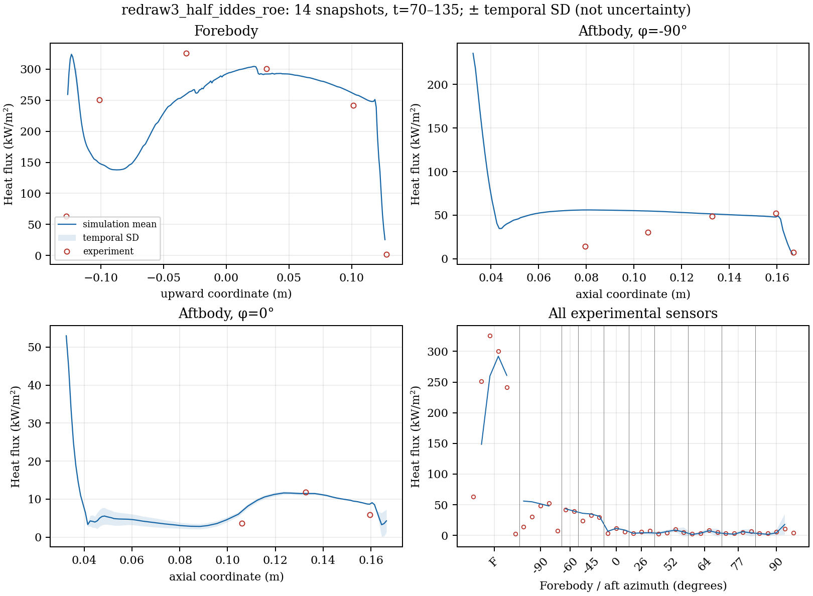

[All nine aftbody azimuths](heat-redraw3_half_iddes_roe-aft_all.png) · [Sensor values](heat-redraw3_half_iddes_roe-sensors.csv)

#### redraw3 full O2 IDDES, Roe M9/M2

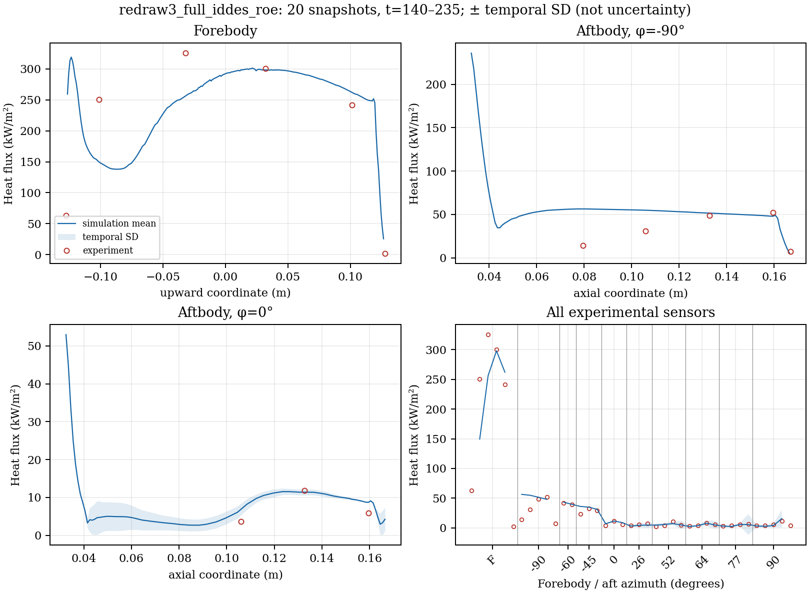

[All nine aftbody azimuths](heat-redraw3_full_iddes_roe-aft_all.png) · [Sensor values](heat-redraw3_full_iddes_roe-sensors.csv)

#### redraw3 full O2 NS, Roe M9/M2

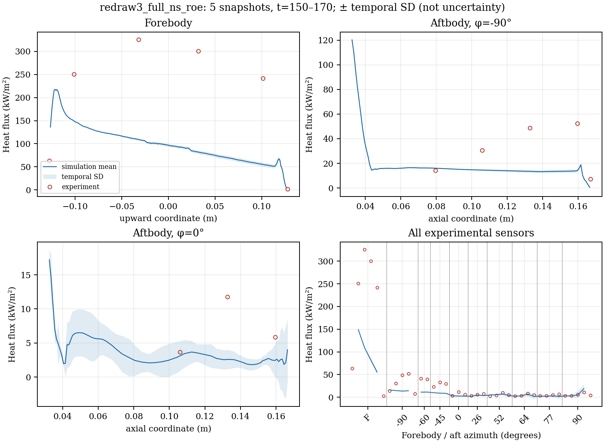

[All nine aftbody azimuths](heat-redraw3_full_ns_roe-aft_all.png) · [Sensor values](heat-redraw3_full_ns_roe-sensors.csv)

#### redraw3 full O2 NS, AUSMPW+

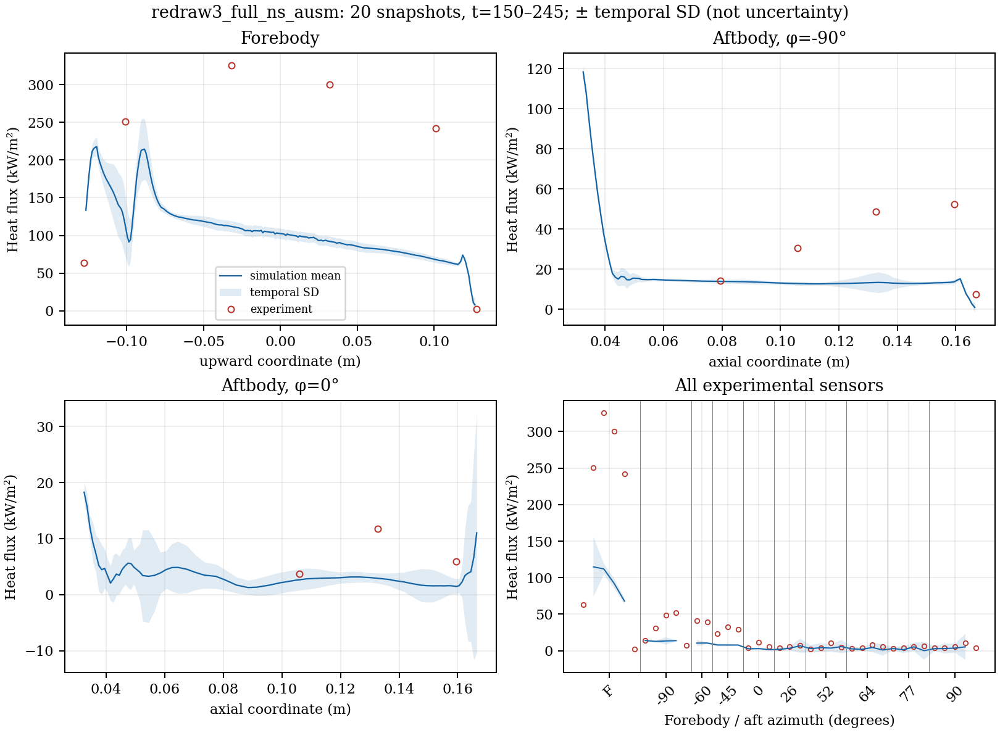

[All nine aftbody azimuths](heat-redraw3_full_ns_ausm-aft_all.png) · [Sensor values](heat-redraw3_full_ns_ausm-sensors.csv)

#### redraw3 full O4 LVR NS, AUSMPW+

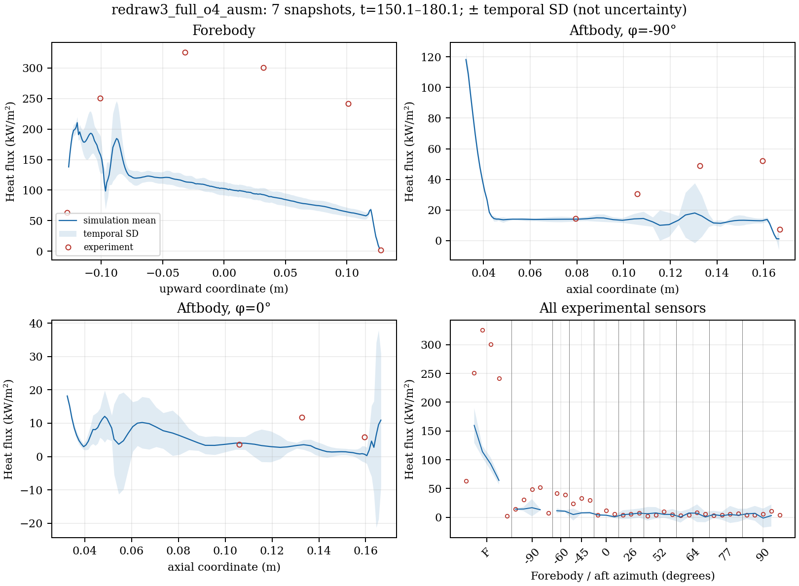

[All nine aftbody azimuths](heat-redraw3_full_o4_ausm-aft_all.png) · [Sensor values](heat-redraw3_full_o4_ausm-sensors.csv)

#### redraw4-F half O2 NS, AUSMPW+

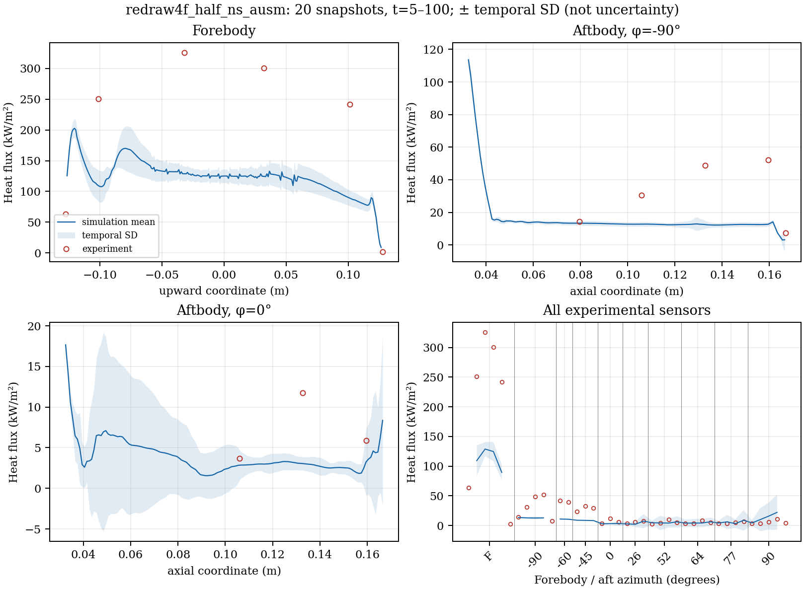

[All nine aftbody azimuths](heat-redraw4f_half_ns_ausm-aft_all.png) · [Sensor values](heat-redraw4f_half_ns_ausm-sensors.csv)

#### redraw4-F-add half O2 IDDES, AUSMPW+

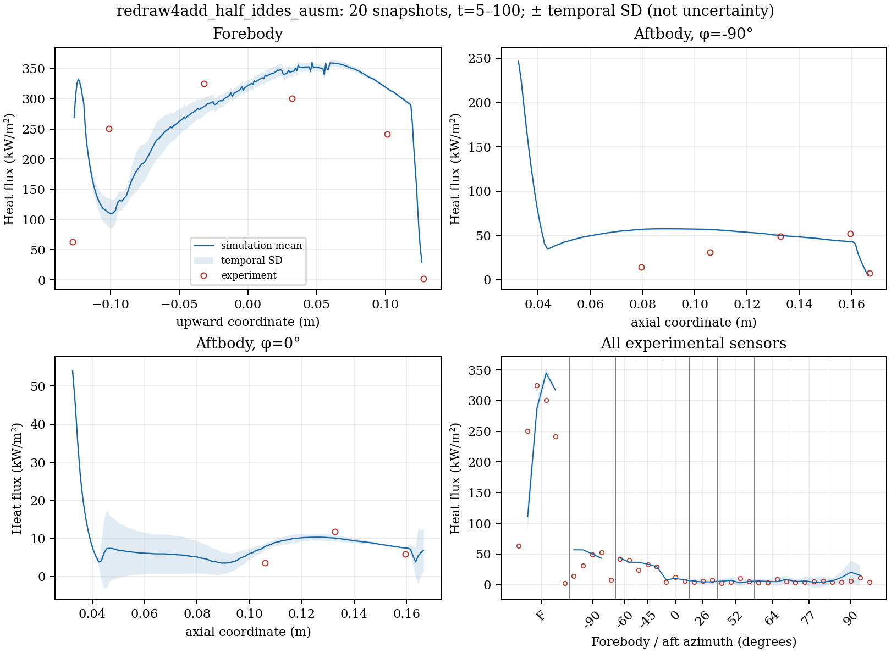

[All nine aftbody azimuths](heat-redraw4add_half_iddes_ausm-aft_all.png) · [Sensor values](heat-redraw4add_half_iddes_ausm-sensors.csv)

#### redraw4-F-add half O2 NS, AUSMPW+

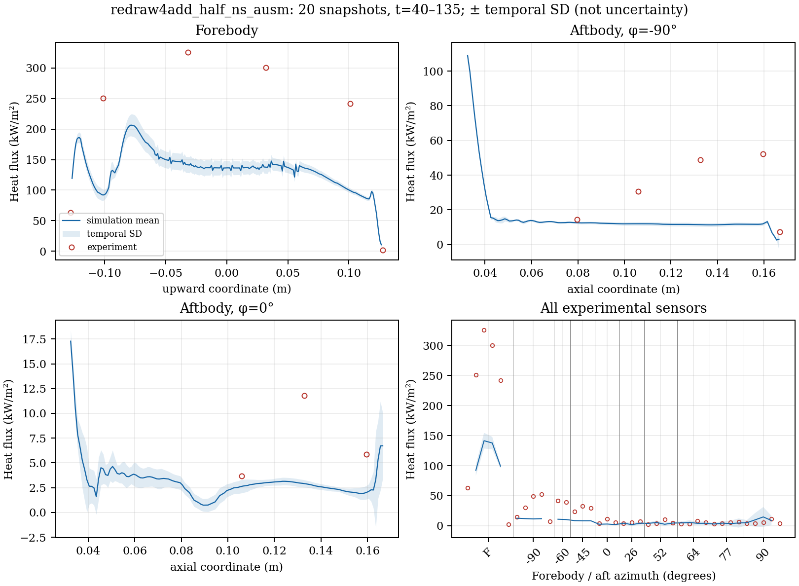

[All nine aftbody azimuths](heat-redraw4add_half_ns_ausm-aft_all.png) · [Sensor values](heat-redraw4add_half_ns_ausm-sensors.csv)

#### redraw4-F-add half O4 LVR NS, AUSMPW+

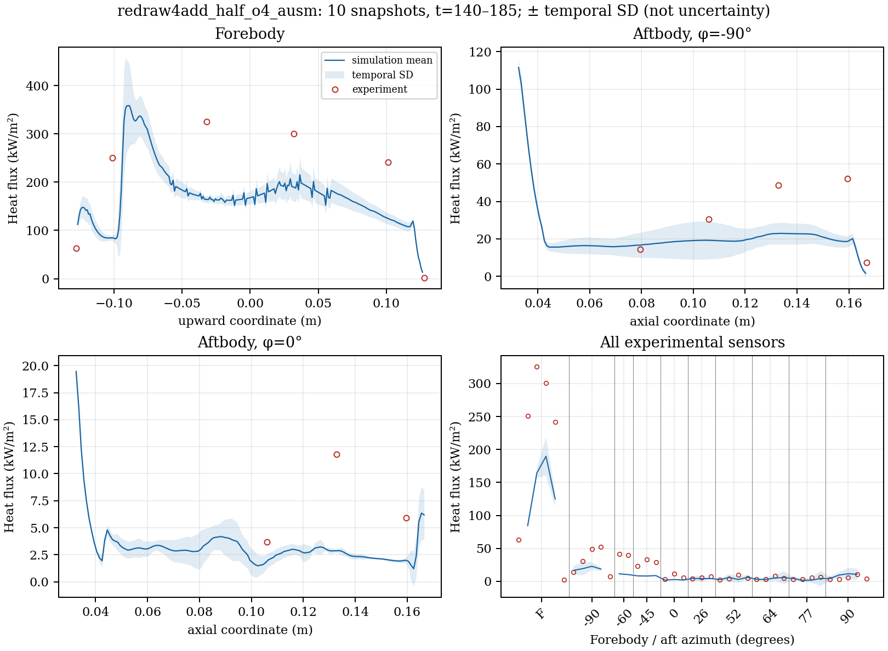

[All nine aftbody azimuths](heat-redraw4add_half_o4_ausm-aft_all.png) · [Sensor values](heat-redraw4add_half_o4_ausm-sensors.csv)

## What these results support

The established O2 IDDES and no-model NS runs provide useful baselines across the mesh family. Sustained O4 LVR NS trajectories show that high-order reconstruction can evolve this geometry and produce developed wake structure. The slowly advancing redraw3 O4 run retained meaningful fields when it was stopped for cost; that is different from the clearly unstable O4 IDDES diagnostics.

The mesh changes should not be judged only by how many small vortices appear. Removing the support sting alters a physical source of disturbance; refining the wake changes what scales can be represented. Half-domain symmetry suppresses antisymmetric modes, whereas the full-domain runs permit them. Different starting times and evolved intervals add another reason not to rank the panels as if they were simultaneous solutions of one discrete problem.

The most useful next numerical question is now local: why does the O4 SA-IDDES update generate a concentrated thermal/pressure spike in a thin forebody layer while the surrounding field remains comparatively unchanged? The available evidence favors inspecting the coupling between reconstruction, wall-layer fluxes, SA updates and internal convergence. The bounded Roe_M2 diagnostic is a useful control for that investigation. It does not yet establish an accurate long-time O4 IDDES method.

The underlying LVR study retains run configurations, checkpoint lineage, transfer hashes, per-step logs, rendering scripts and the distinction between raw absolute CSV residuals and normalized internal stopping measures. None of the images here should be read as a claim of mesh convergence, a statistically converged DES solution or validated DNS.
