The [first RRI progress post](https://harryzhou2000.github.io/hugo-harry/p/reaction-region-indicator-progress/) introduced the selector, and the [September comparison](https://harryzhou2000.github.io/hugo-harry/p/reactive-region-selection-broada-bace6-balance/) set out broadA, BA-CE6, and Balance. This installment follows the research through 19 October 2026: a consolidated flame matrix, the local-rate-ratio candidates, a refined two-scale comparison, and a completed Kinetic-response campaign. It draws on existing runs; preparing the synthesis did not launch new CFD.

The result is a useful mixed-method demonstration, **not a universal new default**. localR10 gives the clearest interface/ignition compromise at coarse steps, but loses broadA's H2/O2 flame robustness. Kinetic response largely recovers flame behavior, yet does not reproduce the desired two-scale compromise.

## What is being selected?

The cellwise switch \(\chi\) partitions chemistry between an implicit flow step and two local-chemistry half-steps. \(\chi=0\) is fully coupled; \(\chi=1\) is full Strang splitting. Intermediate values split only part of the chemical source. The selector is evaluated at the start of each physical step and held through that step, then recomputed on the evolved state. A selector image beside a terminal profile usually shows the *last held* field, not a new evaluation at the endpoint.

The comparisons below use **a-posteriori trajectories** when discussing speed or temperature error. A-priori maps on saved states show what a recipe would select, not what its evolved solution would do. Actual physical steps, inner-iteration caps, and the chosen numerical reference remain separate qualifications.

## The expanded flame matrix

The corrected, nitrogen-diluted H2/O2 flame has a Cantera burning-speed reference of 2.2539659772 m/s. The new curation puts eight available treatments on a common three-ODE, three-step view: 72 comparison cells, **57 completed and 15 failed**. Every completed recent-campaign trajectory reached its 100-iteration inner cap at every physical step. These are fixed-work fitted front speeds, not fully converged flame solutions; a dagger below marks \(R^2\lt0.9\).

| ODE / code step | Coupled | Strang | broadA | BA-CE6 | localR10 | Kinetic |
|---|---:|---:|---:|---:|---:|---:|
| ESDIRK2 / 0.002 | −1.001% | +13.931% | −1.112%† | −1.112%† | +4.808% | −1.014% |
| ESDIRK2 / 0.004 | −1.235% | failed | −1.119% | −1.119% | failed | +0.262% |
| U2R1 / 0.004 | +38.652%† | failed | +16.707%† | +7.681%† | failed | failed |
| U2R2 / 0.004 | −1.911% | failed | −1.831%† | −1.885%† | failed | −1.190% |

These selected rows explain the cross-case tension. broadA and BA-CE6 retain the roughly −1% ESDIRK2 flame-speed behavior when Strang's fitted error grows or its run fails. localR10 cannot keep that protection. Kinetic is promising on ESDIRK2 at the largest step and completes U2R2, but its largest-step U2R1 run fails. The coarse U2R1 fitted values in the table all have poor linearity; a smaller percentage there does not establish a steady accurate flame. Balance without spatial expansion has no flame posterior matrix and should not be inferred from B-E2.

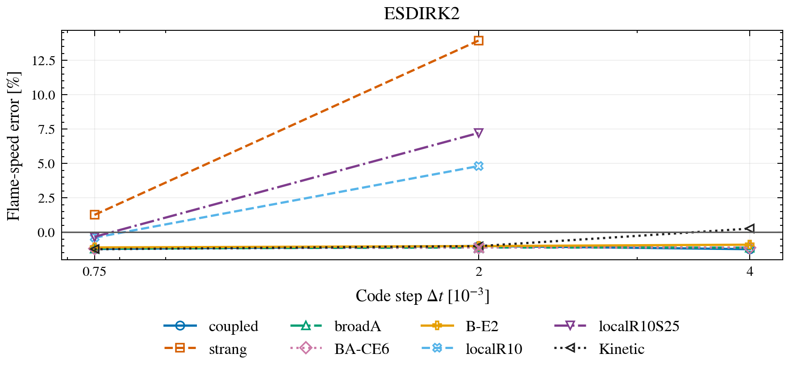

**ESDIRK2 flame comparison.** Each point is a signed fitted-speed error against the Cantera reference at one code step. The broadA and BA-CE6 curves overlap. Crossed markers identify reported poor fits; missing Strang and localR points at the largest step are failed runs, not zero errors. Lines join measured points, not a convergence law.

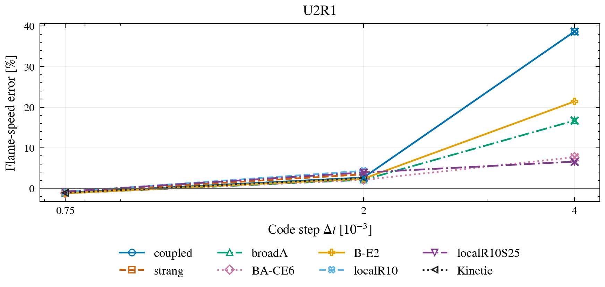

**U2R1 flame comparison.** The plot retains the large coarse-step errors and failures on its full vertical scale. Several fitted front speeds are nonstationary, so the apparent ordering of their percentages is weaker evidence than completion and fit quality. Kinetic has no largest-step point because that run failed.

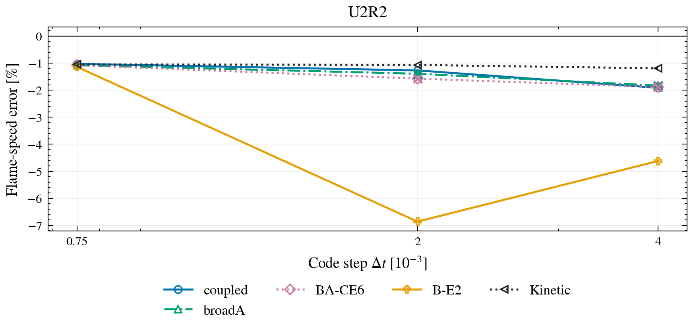

**U2R2 flame comparison.** Strang and the localR variants fail across the tested steps; Kinetic returns coupled-like fitted errors. broadA and BA-CE6 complete, but their medium- and large-step fits have low linearity. B-E2's completion does not imply improved speed error.

Detonation gives a complementary check rather than a single winner. Against the **same-grid time-extrapolated** speed of 2798.225 m/s, the corrected fine-grid matrix at code step \(8\times10^{-7}\) gives:

| ODE | Coupled | Strang | broadA | localR10 |
|---|---:|---:|---:|---:|
| ESDIRK2 | +1.295% | +0.311% | +0.589% | +0.311% |
| U2R2 | +0.360% | +0.943% | +1.017% | +0.855% |

The preferred endpoint reverses with the ODE method. Spatial convergence of that reference is still deferred. BA-CE6, Balance, B-E2, and Kinetic have **no detonation a-posteriori matrix**; a selector contour cannot supply those missing outcomes.

## The two-scale result: localR10 helps, but at particular steps

The n-heptane case separates a narrow reacting interface near 2 mm from a sensitive ignition region farther downstream. All compared short-window trajectories restart from the same state and end at 32 microseconds. Temperature errors are measured without shifting either front: interface means/maxima use \(1\le x\lt3\) mm, and ignition uses \(x\ge3\) mm.

The refined comparison uses a Strang reference at code step \(2.5\times10^{-5}\). Refining the earlier reference by a factor of two changed interface mean/max errors by 3.40/78.31 K and ignition mean/max errors by 1.34/60.97 K. Those differences qualify small gains; they are not rigorous error bounds or proof that the Strang reference is exact.

| Code step | Treatment | Interface mean / max [K] | Ignition mean / max [K] | Implicit stages converged / capped |
|---|---|---:|---:|---:|
| 0.0004 | Coupled | 21.11 / 370.87 | 44.71 / 686.62 | 16 / 0 |
| 0.0004 | Strang | 22.59 / 651.14 | 12.24 / 361.96 | 16 / 0 |
| 0.0004 | broadA | 21.53 / 443.67 | 14.74 / 317.39 | 14 / 2 |
| 0.0004 | localR10 | 20.81 / 412.76 | 10.56 / 242.77 | 16 / 0 |
| 0.0008 | Coupled | failed | failed | 1 / 3 |
| 0.0008 | Strang | 12.28 / 538.32 | 30.50 / 574.34 | 7 / 1 |
| 0.0008 | broadA | 15.36 / 238.02 | 77.29 / 1049.96 | 7 / 1 |
| 0.0008 | localR10 | 8.75 / 149.31 | 30.39 / 571.17 | 7 / 1 |

At \(4\times10^{-4}\), localR10 has roughly coupled-like interface error and Strang-like ignition error, with all stages converged. Its 0.30 K interface-mean advantage over coupled is smaller than the reference-refinement sensitivity; its ignition-mean improvement over coupled is much larger. At \(8\times10^{-4}\), it substantially reduces Strang's worst interface error while keeping similar ignition error, but all completed methods have a capped stage and coupled has no endpoint. At the smaller \(10^{-4}\) step, Strang has the best interface mean among these recipes. A region does not have one permanent preferred method.

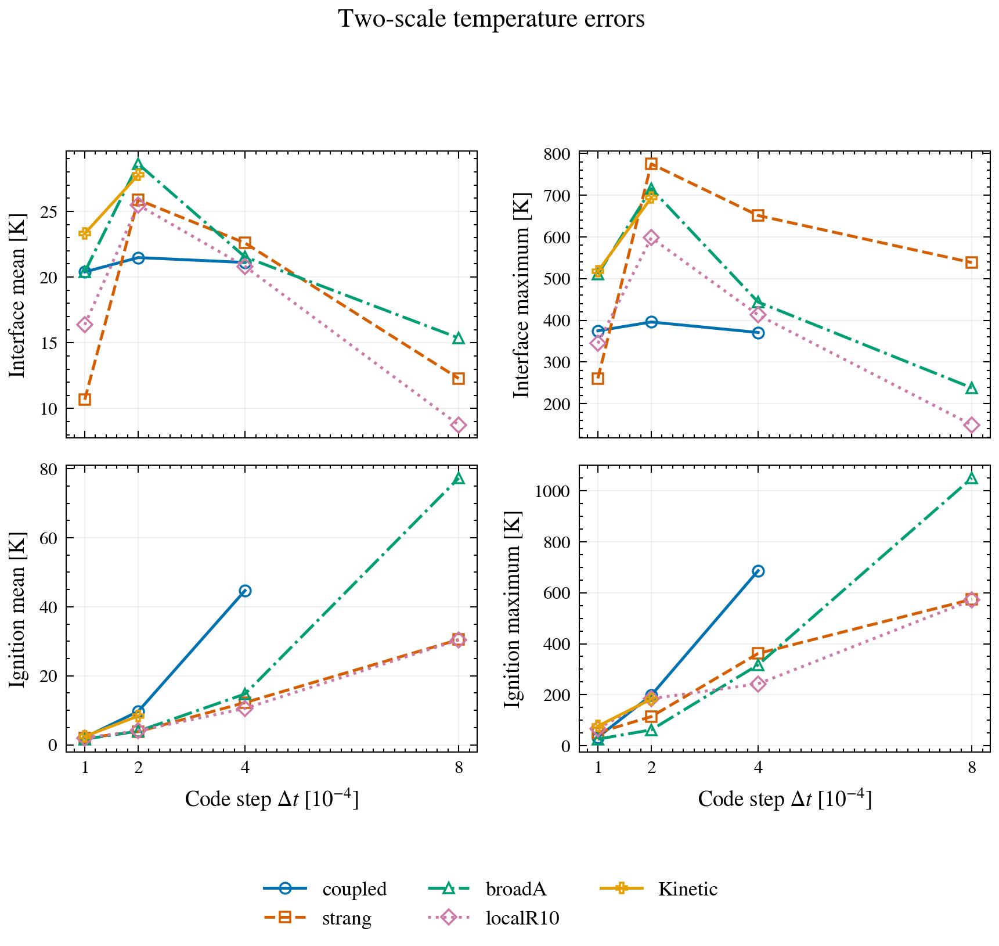

**Two-scale matrix against the refined reference.** The upper panels show interface mean and maximum absolute temperature error; the lower panels show ignition mean and maximum. The horizontal axis is the code step in units of \(10^{-4}\). Kinetic appears only at its two *matched* smaller steps. Missing points, including failed coupled at the largest step, are not zeros; connecting lines do not establish an order of convergence.

The localR10 choice uses chemical and estimated molecular-transport rates in shared coordinates \(q=(Y_1,\ldots,Y_{N_s},\ln(T/T_*))\). Write their rate vectors as \(s\) and \(d\), with \(\mathcal A=\|s\|_2\) and \(\mathcal D=\|d\|_2\). Its coupled share is

$$
f_{R10}=g_h H(\Delta t\mathcal A;0.001,1)
H(\mathcal D/\mathcal A;0.10,4),
\qquad \chi_{R10}=\mathcal P_{0.10,0.05}(1-f_{R10}).
$$

Here \(H(z;z_0,p)=(z/z_0)^p/[1+(z/z_0)^p]\), and \(g_h\) is the existing pressure-jump gate. The endpoint map snaps \(\chi\le0.10\) to coupled and \(\chi\ge0.95\) to Strang. Zero chemical or diffusive rate selects Strang. Unlike broadA's gradient-timescale proxy, this ratio compares estimated rates; it still omits parts of the flow residual and is **not an error estimator**.

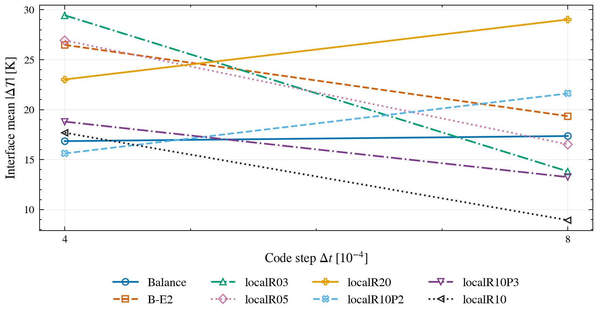

**Tuning is not transferable by inspection.** These interface-mean errors use the *earlier* Strang reference at \(5\times10^{-5}\), not the refined reference used in the main table. localR10P2 is attractive at code step 0.0004 but loses that advantage at 0.0008; B-E2's wider selected interface does not improve both interface metrics. The two plotted step sizes do not define a convergence slope.

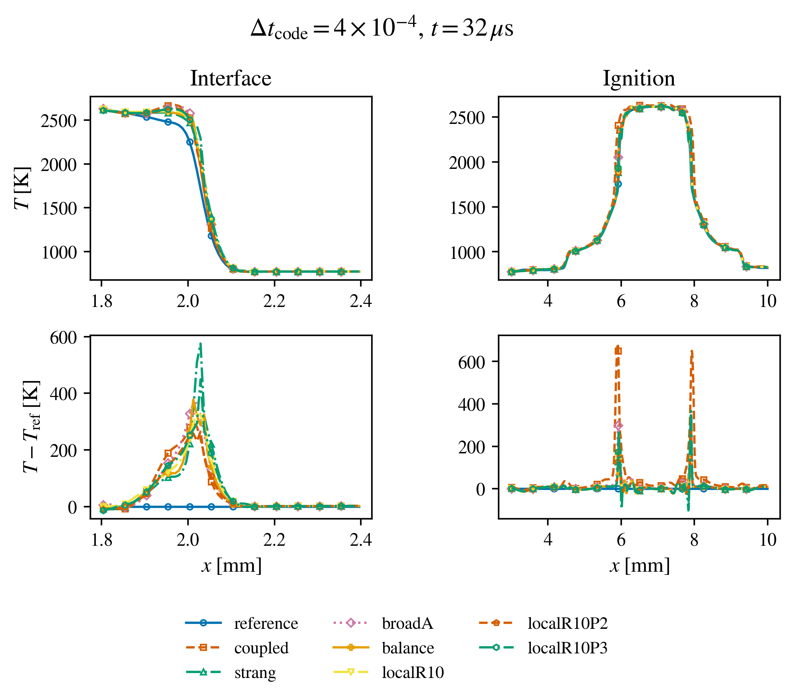

**Same-start trajectories at code step 0.0004.** The top panels enlarge interface and ignition temperatures at the common endpoint; the lower panels show signed differences from the *earlier* \(5\times10^{-5}\) Strang reference. This is where localR10P2 looks especially favorable. The reference's zero-error trace is self-comparison, not exact physical truth, and these plotted errors must not be subtracted from the refined-reference table.

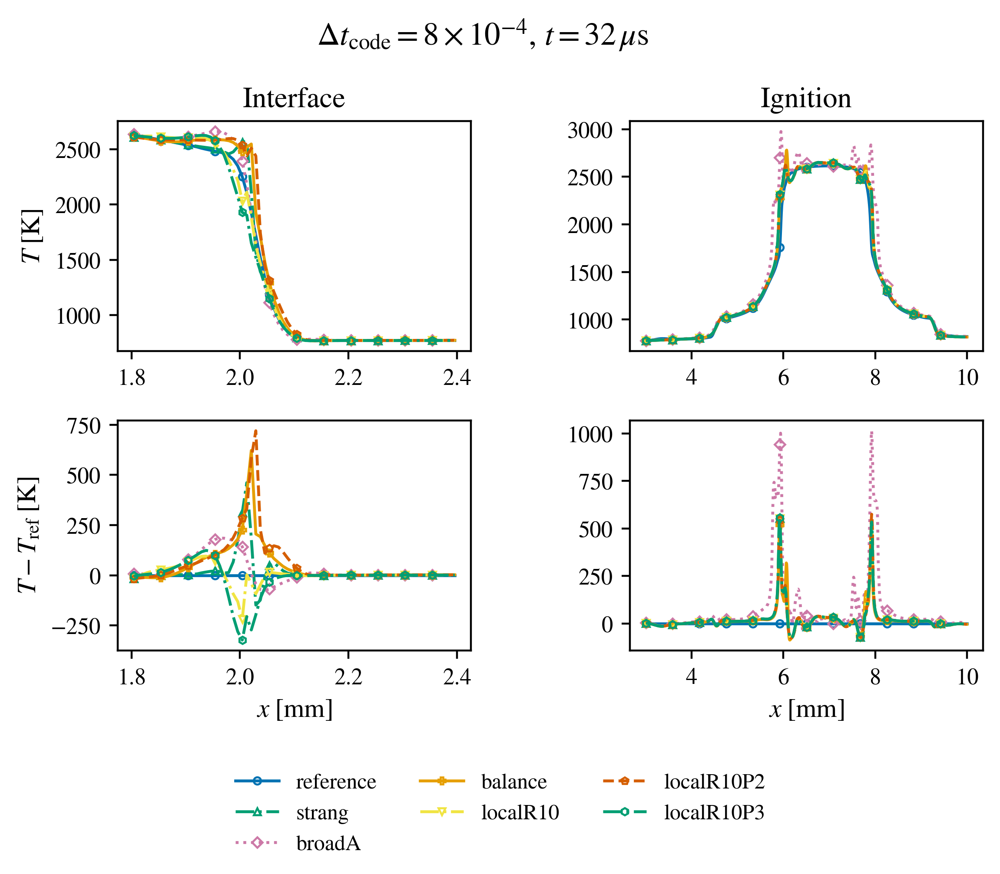

**Same-start trajectories at code step 0.0008.** broadA limits one interface peak but permits larger ignition excursions. localR10 preserves Strang-like ignition behavior while improving the interface; the P2 variant loses its smaller-step advantage. Coupled failed and therefore has no endpoint curve. Several completed rows have a capped stage.

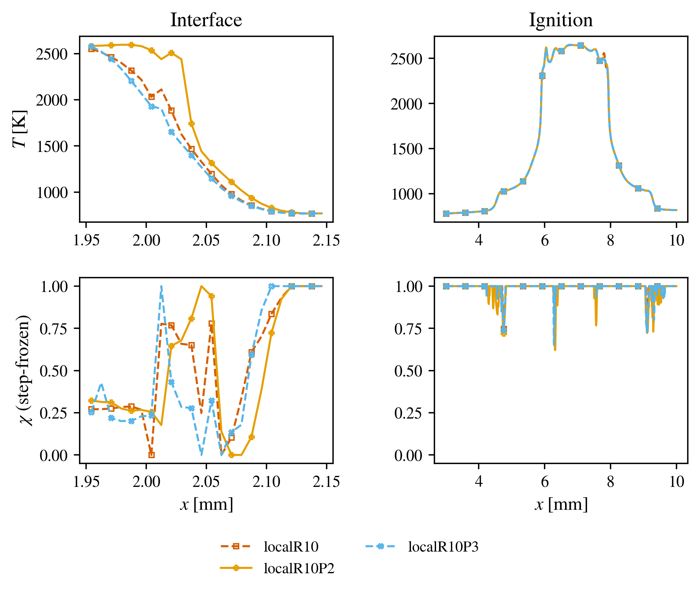

**Selectors on their own evolved states.** The figure pairs final temperature with each recipe's last held selector at code step 0.0008. It shows nontrivial local mixing without spatial expansion, but it is not a same-state causal comparison: each recipe also changed the state from which its next selector was computed.

## Kinetic response: a useful diagnostic, not the missing default

The Kinetic attempt asks how strongly estimated transport changes the chemical rate, relative to chemistry changing its own rate. With the same rate vectors \(s,d\) and a constant-density chemical Jacobian \(J_s\), it uses

$$
R_K=\frac{\|J_s d\|_2}{\|J_s s\|_2},
\qquad \chi_K=1-H(R_K;0.1,2).
$$

This is a local directional-response ratio, **not** the full spatial splitting error. A zero numerator, including the both-zero case, selects Strang; a positive numerator with zero denominator selects coupled. The implemented campaign uses constant-volume chemistry, no activity or shock gate, and no nonzero snapping tolerance. Its ratio has no explicit timestep dependence on a fixed state, although the evolving states still depend on the step. On the corrected flame, Kinetic largely restores coupled-like fitted speeds, including a +0.262% ESDIRK2 error at the largest step. The U2R1 run at that step still fails.

At the *matched* two-scale code step 0.0002, Kinetic's ignition mean/max errors are **8.35/182.83 K**. Strang gives **3.82/114.23 K**, and broadA **3.96/62.29 K**. Kinetic's interface mean is 27.76 K, above coupled's 21.48 K. It does not reproduce localR10's later coarse-step compromise. Its requested 0.0004 and 0.0008 ceilings were both clipped by CFL to the *same 14-step history*, with a median actual step of about 0.0002305. Those results are not equal-large-step comparisons with the eight- and four-step controls.

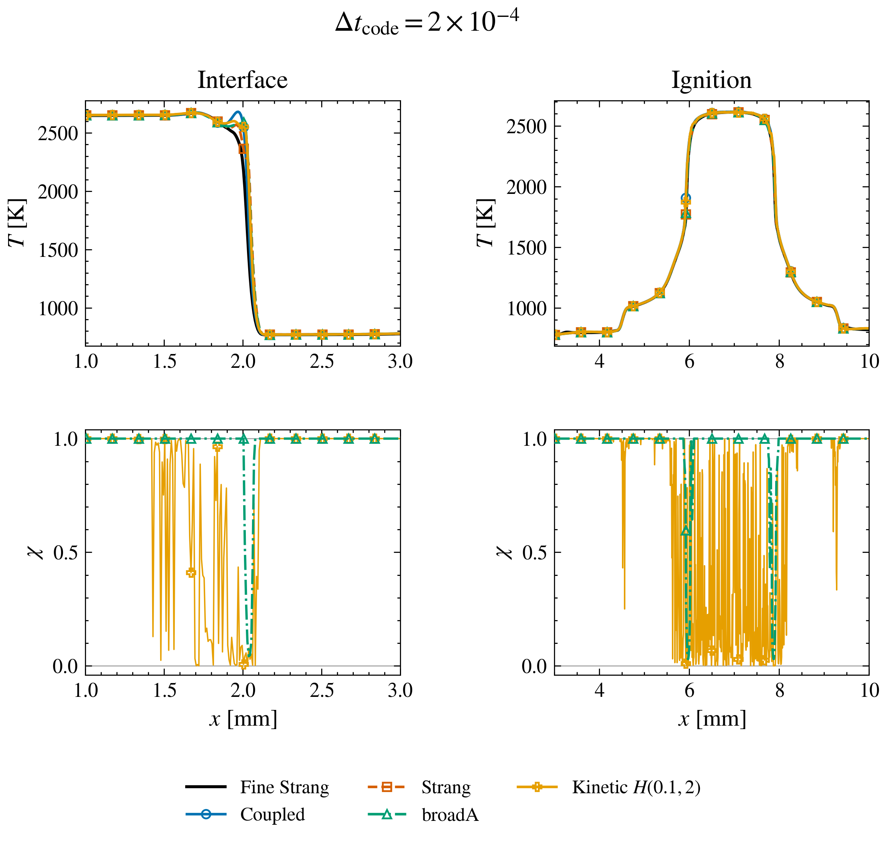

**Matched two-scale selection at code step 0.0002.** Temperature appears above the last held broadA and Kinetic selectors. Zero is coupled and one is Strang. Kinetic retains more coupled chemistry through the ignition region; that accompanies its larger ignition error, but the plot alone cannot establish causality.

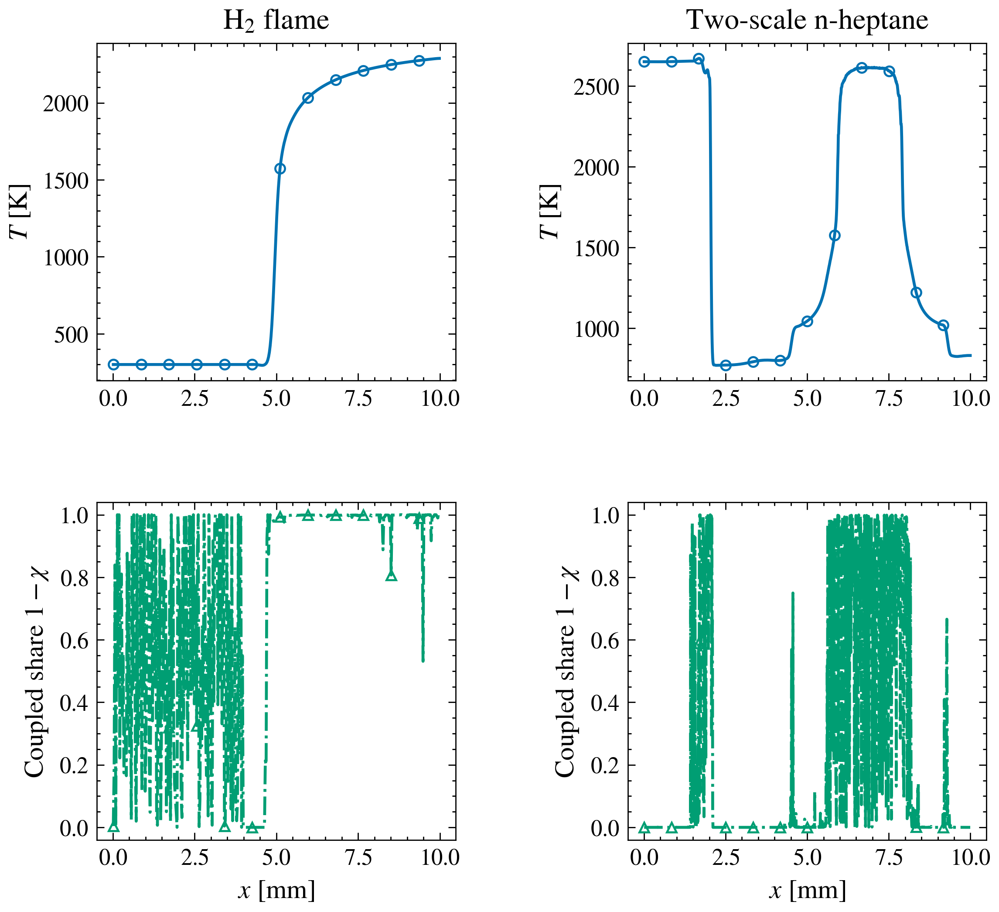

**Native solver fields, not a rounded-state reconstruction.** The H2 flame at code step 0.002 and two-scale n-heptane at 0.0002 pair endpoint temperatures with last-step selectors. Kinetic activates irregularly even in nearly isothermal regions. A satisfactory flame-speed fit does not establish that this cellwise field is smooth or well conditioned.

The fixed-state mapping screen explains part of the difficulty. With \(H(R_K;0.1,2)\), the worst reference-interface coupled coverage is 0.674 while worst reference-ignition coupling is 0.421. Moving the midpoint to 0.03 raises interface coverage to 0.865, but also raises ignition coupling to 0.601. For the report's illustrative 0.8-interface/0.1-ignition targets, even an optimized monotone remapping cannot satisfy every reference state. Those targets diagnose the design tradeoff; they are not physical truth labels.

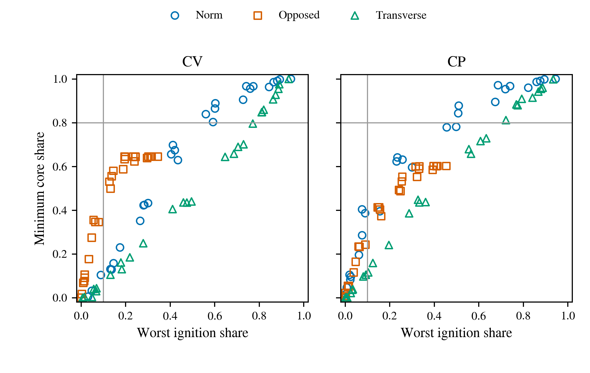

**The remapping limit is visible before a posterior run.** This fixed-state screen compares interface preservation with ignition release as the Kinetic ratio is remapped. Overlap between states forces a tradeoff for the stated diagnostic targets. The plot is not a graph of CFD temperature error and cannot replace the matched posterior result.

## What remains open

broadA remains the strongest practical cross-case mixed baseline in these tests; localR10 is the strongest demonstration of selective interface/ignition behavior at the coarse two-scale steps. Neither combines both advantages across cases. BA-CE6 preserves the tested flame but selects Strang throughout the sampled two-scale states, with no separate two-scale posterior row. B-E2, stronger snapping, and the Kinetic response each improve some measurements while losing others. No new 2-D propagation or GRI30 mixed-method validation resolves the transfer question.

The next proposed diagnostic is a **finite-time, transport-forced local reactor probe**: compare a splitting-defect proxy with the coarse coupled-chemistry integration error over the *actual* proposed step. This is a research proposal, not an implemented or validated selector. A decisive later test would still need matched actual steps, separate accounting of capped nonlinear stages, and reference checks across flame, detonation, interface, and ignition. The goal is not a prettier coupling contour; it is one interpretable rule that retains broadA's flame protection and localR10's two-scale compromise.
